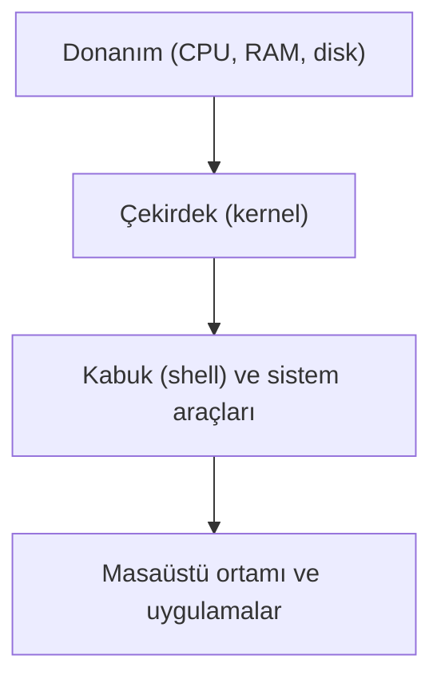
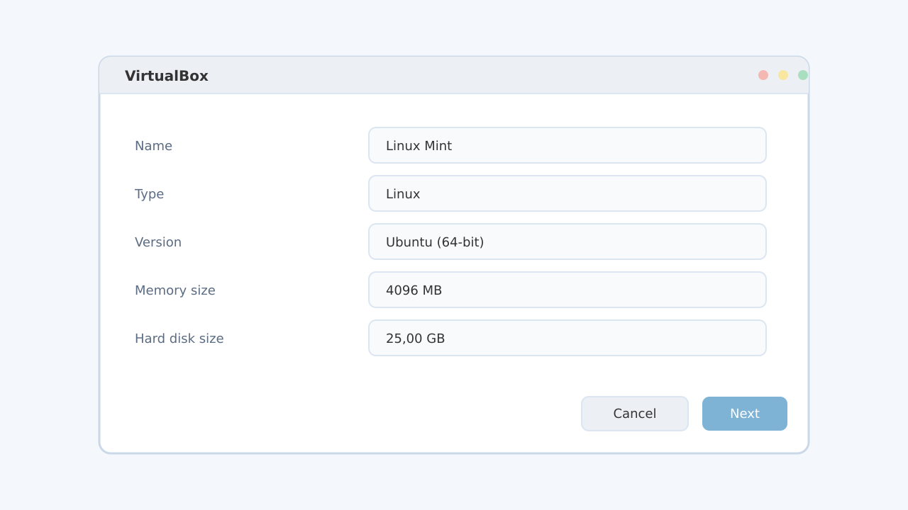

# Linux'a Giriş ve Sanal Makine Kurulumu

## 🎯 Bu Bölümde Ne Öğreneceğiz?

Bu bölümü bitirdiğinde şunları yapabileceksin:

- İşletim sistemi, çekirdek (kernel), dağıtım (distribution) ve açık kaynak
  (open source) kavramlarını kendi cümlelerinle açıklayabileceksin.
- Linux'un günlük hayatta nerelerde karşına çıktığını fark edeceksin.
- Sanal makine (virtual machine) kavramını ve neden güvenli bir öğrenme ortamı
  olduğunu anlayacaksın.
- VirtualBox kurup yeni bir sanal makine oluşturacaksın.
- Linux Mint'i sanal makineye kurup ilk kez çalıştıracaksın.
- Sanal makine, çift önyükleme (dual boot) ve WSL seçeneklerini
  karşılaştırabileceksin.

## 💡 Neden Bu Konuyu Öğreniyoruz?

Belki Linux'u ilk kez duyuyorsun ya da "zaten Windows kullanıyorum, bana ne
gerek?" diye düşünüyorsun. Oysa Linux, farkında olmasan da hayatının büyük bir
bölümünde zaten var.

İnternette gezindiğin sitelerin çoğu, yani web sunucularının büyük kısmı Linux
ile çalışır. Cebindeki akıllı telefon Android işletim sistemini kullanıyorsa,
içinde Linux çekirdeği çalışıyor demektir. Wi-Fi dağıtan modem, akıllı
televizyon ve oyun konsolu gibi cihazların pek çoğunda da Linux ya da Linux
tabanlı bir sistem bulunur.

Bu kursun amacı seni bir sonraki bölümden itibaren Linux'u kendi elinle
kullanmaya hazırlamak. Ancak işe başlamadan önce bir engeli aşmamız gerekiyor:
Mevcut bilgisayarına doğrudan Linux kurmak, diskini bölmeyi ve hata yaparsan
veri kaybını göze almayı gerektirir. Bu yüzden önce **sanal makine** denen
güvenli bir yol kullanacağız. Sanal makine, bilgisayarının içinde çalışan
adeta "bilgisayar içinde bilgisayar" gibidir; Linux'u oraya kurarız, bir şeyi
bozarsak siler yeniden başlarız, ana bilgisayarına hiçbir şey olmaz.

## 📌 Ön Bilgi

Bu kursun ilk bölümü olduğu için önceki bir bölüme ihtiyaç duymuyorsun. Yalnızca
şu temel beceriler yeterlidir:

- Dosya indirme, kurulum sihirbazı (installer) adımlarını takip etme gibi
  günlük bilgisayar kullanımı.
- Kurulum ekranlarında geçen basit İngilizce ifadeleri izleyebilmek için temel
  düzeyde İngilizce. Bazı kurulum araçları İngilizcedir; geçen terimlerin Türkçe
  karşılıklarını birlikte göreceğiz.

> [!NOTE]
> Bu bölümde henüz komut satırını kullanmıyoruz. Terminali bir sonraki bölümde
> öğreneceğiz. Şimdilik kurulumu tıklama ve yazı ile yapacağız.

## 📖 Kavramlar

Yeni bir alana girerken kelimeleri doğru anlamak, sonraki her konuyu
kolaylaştırır. Bu yüzden şu kavramları hızlıca netleştirelim.

**İşletim sistemi (operating system),** bilgisayarın donanımını yöneten ve diğer
programların çalışmasını sağlayan temel yazılımdır. Windows, macOS ve Linux birer
işletim sistemidir. Klavyeden bir tuşa bastığında bu tuşun işleme, fareyi
hareket ettirdiğinde imlecin oynamasına, bir dosyayı kaydettiğinde diske
yazılmasına işletim sistemi aracılık eder.

**Çekirdek (kernel),** işletim sisteminin en alt ve en kritik parçasıdır.
Donanımı doğrudan yöneten, bellek ayıran, işlemciyi süreçler (process) arasında
paylaştıran katmandır. Linux dediğimizde aslında teknik olarak kastedilen şey
çoğu zaman bu çekirdektir.

**Dağıtım (distribution, kısaca distro),** Linux çekirdeğini, onu kullanışlı
hâle getiren araçlarla, bir masaüstü ortamıyla ve genellikle bir paket yöneticisiyle
(package manager) bir araya getiren hazır pakettir. Ubuntu, Fedora, Arch Linux ve
bu kursta kullanacağımız **Linux Mint** birer dağıtımdır. Aynı çekirdeğin üstüne
farklı tercihlerle kurulmuş farklı "lezzetler" gibi düşünebilirsin.

**Açık kaynak (open source),** yazılımın kaynak kodunun herkese açık olduğu ve
istenen amaçla incelenip değiştirilebildiği bir yaklaşımdır. Linux bu yaklaşımın
en bilinen örneklerindendir; bu yüzden dünyanın dört bir yanından insanlar onu
geliştirir, denetler ve iyileştirir.

**Masaüstü ortamı (desktop environment),** pencerelerin, simgelerin, görev
çubuğunun ve menülerin görünümünü sağlayan katmandır. Bunun ne demek olduğunu
ilerleyen bölümlerde (özellikle 6. bölümde) ayrıntılı göreceğiz; şimdilik
"ekranda gördüğün masaüstünün tasarımı" diye düşünebilirsin.

**Sanal makine (virtual machine),** gerçek bilgisayarının içinde, yazılımla
oluşturulmuş yapay bir bilgisayardır. Sanal makineyi çalıştıran asıl bilgisayara
**ana makine (host)** denir. Sanal makinenin içine kurduğun işletim sistemine ise
**konuk işletim sistemi (guest operating system)** denir. Bu kursta ana makinen
ne olursa olsun (Windows, macOS ya da Linux), konuk sistemimiz Linux Mint olacak.

**ISO imajı (ISO image),** bir işletim sisteminin kurulum dosyalarının tek bir
dosya hâlinde paketlenmiş hâlidir. İçinde işletim sistemi vardır ama doğrudan
açılmaz; bir sanal makineye ya da bir USB belleğe bağlanarak kullanılır. Linux
Mint'i indirirken `.iso` uzantılı böyle bir dosya elde edeceksin.

Bu katmanları bir arada görmek faydalı olur:

Diyagramı yukarıdan aşağıya oku: En altta donanım vardır. Çekirdek bu donanımı
yönetir. Onun üstünde kabuk (shell) ve sistem araçları yer alır; kabuğu 2.
bölümde ayrıntılı öğreneceğiz, şimdilik "komutları çalıştıran ara katman" diye
düşün. En üstte ise tıklayıp kullandığın masaüstü ortamı ve uygulamalar bulunur.
Linux, bu katmanların bir bütünüdür.

## 🔍 Birlikte Keşfedelim

Şimdi bir tahmin oyunu oynayalım.

Evinde ya da çevrende, "Linux" adını hiç duymadan kullandığın cihazları düşün.
Sence bu cihazların yüzde kaçı Linux ya da Linux tabanlı bir sistem çalıştırıyor
olabilir?

1. Önce sayısını kendine söyle: yüzde 10 mu, yüzde 50 mi, yoksa daha fazla mı?
2. Şu cihazları tek tek gözden geçir: internet modem, akıllı televizyon, akıllı
   telefon, oyun konsolu, akıllı saat, araç göstergesi, yazıcı, güvenlik kamerası.
3. Her biri için "bunun içinde hangi işletim sistemi vardır?" diye sor.

Tahminini kilitledikten sonra şunu düşün: Bu cihazların çoğunun ekranında
Windows logosu yok, ama yine de çalışıyorlar. Çoğu, Linux çekirdeği üzerine
kurulmuş hafif sistemler kullanır. Yani Linux, masaüstü bilgisayarlarda
Windows kadar yaygın olmasa da, cihazların çoğunluğunda sessizce çalışır.

Bu keşfin önemi şu: Linux "yeni ve garip" bir sistem değildir. Zaten her yerde
olan, olgun ve güvenilir bir sistemdir. Biz yalnızca onu bu kez kendi
bilgisayarımızda, bilinçli olarak kullanmayı öğreniyoruz.

## 🛠️ Uygulama

Şimdi kuruluma geçiyoruz. Her adımda ne yaptığımızı ve neden yaptığımızı
açıklayacağım; amaç sadece tıklamak değil, olan biteni anlamak.

### 1. Adım: Bilgisayarının yeterli olup olmadığını kontrol et

Sanal bir makine, ana makinenin kaynaklarından pay alır. Rahat bir deneyim için
bilgisayarında şu kadarı bulunsun:

| Kaynak | Önerilen miktar | Neden |
|---|---|---|
| RAM (bellek) | En az 8 GB (ideal 16 GB) | Hem ana sisteme hem sanal makineye yer kalması için |
| Boş disk alanı | En az 25-30 GB | Sanal makinenin sanal diski için |
| İşlemci | Sanallaştırma destekli, çift çekirdek ve üzeri | Sanal makinenin akıcı çalışması için |
| İşletim sistemi | Windows, macOS ya da Linux | Sanal makine yazılımı üçünde de çalışır |

İşlemcinin sanallaştırma desteğini kontrol etmek önemlidir. Modern işlemcilerin
neredeyse tamamı bu desteği sunar, ama bazen ayarlardan açılması gerekir (bunu
"Bir Şeyler Ters Giderse" bölümünde ele alacağız).

### 2. Adım: Sanal makine yazılımını kur

Sanal makine oluşturmak için bir sanal makine yazılımı gerekir. Bu kursta
ücretsiz ve yaygın olan **VirtualBox**'u kullanacağız.

1. VirtualBox'un resmî sitesinden işletim sistemine uygun kurulum dosyasını
   indir.
2. Kurulum sihirbazını çalıştır ve varsayılan seçeneklerle ilerle.
3. Kurulum bitince VirtualBox'u aç. Boş bir pencere göreceksin; henüz hiçbir
   sanal makine yok.

### 3. Adım: Linux Mint kurulum imajını indir

1. Linux Mint'in resmî sitesine git ve "Download" bölümünden güncel sürümü bul.
2. Masaüstü olarak **Cinnamon** sürümünü seç (bu kurs boyunca Cinnamon'u
   kullanacağız).
3. `.iso` uzantılı dosyayı indir. Dosya boyutu birkaç gigabayt olabilir; bu
   yüzden biraz sabırlı ol.

> [!TIP]
> İndirdiğin ISO dosyasını, indirme tamamlanmadan sanal makineye bağlamaya
> çalışma. Yarım inen bir ISO, kurulum ortasında hata verir. İndirmenin
> bittiğinden emin olduktan sonra devam et.

### 4. Adım: Yeni bir sanal makine oluştur

VirtualBox penceresinde "New" (Yeni) düğmesine bas. Sihirbaz senden birkaç
bilgi isteyecek:

- **Ad (Name):** Örneğin `Linux Mint`.
- **ISO imajı:** Az önce indirdiğin `.iso` dosyasını seç.
- **Tür (Type) ve Sürüm (Version):** Linux ve Ubuntu (Linux Mint, Ubuntu
  tabanlıdır) seçeneklerini seç.
- **Bellek (RAM):** En az 4096 MB (4 GB) ayır. Ana makinen zayıfsa 2048 MB ile
  de idare edebilir, ama 4 GB daha rahat olur.
- **Sanal disk:** Yeni bir disk oluştur. Boyut için en az 25 GB, dinamik olarak
  büyüyen (dynamically allocated) seçeneği seç. Dinamik seçenek, diski baştan
  tamamen doldurmaz; yalnızca kullandıkça büyür.

Bu adımlarda seçtiğin her değerin bir karşılığı olduğunu gör: Bellek değeri,
sanal makinenin "beyninin" ne kadar büyük olacağını; disk boyutu ise içine ne
kadar dosya sığacağını belirler.

### 5. Adım: Sanal makineyi başlat ve canlı ortamı dene

Sanal makineyi seçip "Start" (Başlat) düğmesine bas. Makine, bağlı ISO
dosyasından açılacak. Karşına Linux Mint'in **canlı ortam (live session)**
denen masaüstü çıkacak. Bu, kurulum yapılmadan bellekte çalışan geçici bir
sistemdir: bir şeyi bozman endişesi taşımayacağın, güvenli bir deneme alanıdır.

Burada birkaç dakika oyalan: menüyü aç, dosya yöneticisine bak, ayarları kurcala.
Fare, klavye ve internet çalışıyorsa her şey yolunda demektir.

### 6. Adım: Kurulumu gerçekleştir

Masaüstündeki "Install Linux Mint" (Linux Mint'i Kur) simgesine çift tıkla.
Sihirbaz sırasıyla dil, klavye düzeni, güncellemeler ve disk seçimi soracak.
Sanal makinede çalıştığımız için disk seçiminde rahatça **"Diskinizi temizleyin
ve Linux Mint'i kur" / "Erase disk and install Linux Mint"** seçeneğini
kullanabilirsin. Bu seçenek yalnızca sanal makinenin sanal diskini etkiler,
gerçek diskin zarar görmez.

> [!IMPORTANT]
> "Tüm diski sil" gibi ifadeler gerçek bilgisayarda çalıştırıldığında tüm
> verini yok eder. Burada güvende olmamızın tek nedeni, bunu bir sanal makinenin
> içinde yapıyor olmamız. Gerçek bir bilgisayara kurulum yapmadan önce mutlaka
> verini yedekle ve kurulum yöntemini iyice öğren.

Sihirbazı sonuna kadar takip et. İşlem birkaç dakika sürebilir.

### 7. Adım: Kurulumu tamamla ve yeniden başlat

Kurulum bitince sistem yeniden başlatılmanı isteyecek. Yeniden başlatıldığında
senden kullanıcı adı ve parola belirlemen istenebilir. Belirlediğin parolayı
not al; Linux sistemlerinde parola, hem oturum açmak hem de yönetici işlemlerini
onaylamak için sık kullanılır (bunu 5. bölümde `sudo` ile birlikte ayrıntılı
göreceğiz).

Tebrikler: Artık çalışan bir Linux sistemin var. Bir sonraki bölümden itibaren
bu sistemi kullanmaya başlayacağız.

## 🧪 Deneyelim ve Gözlemleyelim

Kurulumdan sonra güvenle oynayabileceğimiz bir özellik var: **anlık görüntü
(snapshot)**. Anlık görüntü, sanal makinenin belirli bir andaki durumunun fotoğrafı
gibidir. Bir şeyi bozarsan bu fotoğrafa geri dönebilirsin.

Şunu dene:

1. VirtualBox penceresinde sanal makineni seç.
2. Üst menüden `Machine > Take Snapshot` (Makine > Anlık Görüntü Al) yolunu izle.
3. Görüntüye bir ad ver: örneğin `Temiz kurulum`.
4. Şimdi masaüstünde bir dosya oluştur ya da masaüstü duvar kâğıdını değiştir.
5. Ardından `Machine > Snapshots` bölümünden az önce aldığın görüntüye geri
   dönmeyi dene.

Ne olduğunu gözlemle: Değişikliklerin geri alındı mı? Sanal makinenin gücünün
bir kısmı burada yatıyor. Gerçek bir bilgisayarda "geri al" düğmesi yoktur;
sanal makinede vardır. Bu yüzden öğrenirken rahatça deney yapabilirsin.

## ⚠️ Bir Şeyler Ters Giderse

Kurulum sırasında en sık karşılaşılan iki sorunu ve nasıl yaklaşacağını görelim.
Unutma: Sorun gidermenin yolu paniklemek değil, belirtiyi gözlemlemek, bir
tahmin kurmak ve onu test etmektir.

**Belirti:** Sanal makine başlamıyor ya da "VT-x / AMD-V is not enabled" gibi bir
hata veriyor.

**Olası neden:** İşlemcin sanallaştırmayı destekliyor ama anakart ayarlarında
(BIOS/UEFI) kapalı.

**Ne yapmalısın:** Bilgisayarı yeniden başlatıp BIOS/UEFI ekranına gir ve
"Virtualization Technology" ya da "SVM" adındaki ayarı bulup aç. Bu ayarın adı
üreticiye göre değişir; anakartının kılavuzu sana yol gösterir.

**Belirti:** Kurulum ortasında dosya okunamadı ya da "corrupt" benzeri bir hata
geliyor.

**Olası neden:** ISO dosyası eksik veya bozuk inmiş olabilir.

**Ne yapmalısın:** ISO dosyasını yeniden indir, indirmenin tamamlandığından emin
ol ve sanal makineye sağlam dosyayı yeniden bağla.

> [!NOTE]
> Hata mesajları seni korkutmasın. Çoğu zaman sorunun ne olduğunu ilk satırda
> söylerler. Bir hata mesajı gördüğünde önce onu baştan sona oku; tahminini bu
> metne dayandır.

## ✍️ Kendin Dene

**Görev:** Kurulumu tamamladıktan sonra, sanal makineni düzenli yedeklemek için
kendi anlık görüntü alışkanlığını kur. İki anlık görüntü oluştur: biri temiz
kurulum sonrası, diğeri küçük bir değişiklikten sonra. Ardından ikinci
görüntünün açıklamasına, hangi değişikliği yaptığını yaz.

İpucu göster

Anlık görüntü alırken verdiğin ad ve açıklama, ileride hangi görüntüye
döneceğine karar vermeni kolaylaştırır. "Ne zaman aldım" değil, "ne durumda
aldım" bilgisini yaz.

Örnek çözüm göster

1. `Temiz kurulum` adıyla ilk anlık görüntüyü al; açıklamasına "Linux Mint
   güncellemeler yüklenmeden önce" yaz.
2. Sistem güncellemelerini kur.
3. `Güncelleme sonrası` adıyla ikinci anlık görüntüyü al; açıklamasına "sistem
   güncellemeleri yüklendikten sonra" yaz.

Bu iki görüntü, bir sorun çıktığında güncellemelerin neden olduğu bir problem
mi yoksa başka bir sorun mu olduğunu ayırt etmeni sağlar.

## 🧠 Öğrendiklerini Kontrol Et

1. İşletim sistemi ile çekirdek arasındaki farkı kendi cümlelerinle açıkla.
2. "Dağıtım" kavramını bir benzetme kullanarak anlat.
3. Sanal makinede çalışmanın, Linux'u öğrenirken sağladığı en büyük avantaj
   nedir?
4. Çift önyükleme (dual boot) ile sanal makine arasındaki temel fark nedir?
5. Bir ISO imajı nedir ve neden doğrudan çift tıklayıp açamayız?

Cevapları göster

1. İşletim sistemi, donanımı yöneten ve programların çalışmasını sağlayan geniş
   yazılım bütünüdür. Çekirdek ise bu bütünün içindeki, donanımı doğrudan
   yöneten en alt katmandır. Yani çekirdek, işletim sisteminin bir parçasıdır.
2. Dağıtım, aynı çekirdeğin üzerine farklı araçların, masaüstü ortamlarının ve
   paket yöneticilerinin eklenmesiyle oluşan hazır pakettir. Aynı hamurdan
   yapılmış, farklı malzemelerle hazırlanmış farklı pideler gibi düşünülebilir.
3. En büyük avantaj, ana bilgisayara zarar vermeden deney yapabilmektir. Bir
   şeyi bozarsan sanal makineyi silip yeniden kurabilir ya da bir anlık
   görüntüye dönebilirsin.
4. Çift önyükleme, Linux'u gerçek diske kalıcı olarak kurar ve bilgisayar her
   açılışta hangi işletim sisteminin başlayacağını seçmeni ister. Sanal makine
   ise ana işletim sistemi çalışırken onun içinde, yazılımla oluşturulmuş ayrı
   bir bilgisayar olarak çalışır ve ana sisteme dokunmaz.
5. ISO imajı, bir işletim sisteminin kurulum dosyalarının tek bir dosyada
   paketlenmiş hâlidir. İçindeki sistem doğrudan açılmaz; bir sanal makineye ya
   da USB belleğe bağlanarak kullanılır.

## 🚀 Bağımsız Çalışma

Şimdi öğrendiklerini kendi başına genişletme zamanı. Aşağıdaki iki görevden en az
birini yap; ikisini de yaparsan daha da iyi olur.

1. **Karşılaştırma görevi:** Sanal makine, çift önyükleme ve WSL yöntemlerini
   üç ölçüt açısından karşılaştır: güvenlik (ana sisteme risk), performans ve
   günlük kullanıma uygunluk. Küçük bir tablo hazırla. Bilgi toplarken Linux
   Mint ve WSL'nin resmî sayfalarından yararlan.
2. **Araştırma görevi:** Evinde ya da çevrende Linux tabanlı olduğunu
   düşündüğün üç cihaz seç. Her biri için "bunu neden Linux tabanlı olabilir?"
   sorusuna birer cümlelik gerekçe yaz.

Bu görevlerde tek bir "doğru cevap" peşinde koşma; amaç, düşünceni yazılı hâle
getirmek ve kaynaklardan bilgi toplama alışkanlığı kazanmaktır.

## 📚 Daha Fazlasını Öğrenmek

Aşağıdaki kaynaklar kurs boyunca sık işine yarayacak resmî ve güvenilir
kaynaklardır:

- Linux Mint resmî sitesi: <https://linuxmint.com>
- VirtualBox resmî kullanım kılavuzu: <https://www.virtualbox.org/manual/>
- Linux çekirdeği resmî sitesi: <https://www.kernel.org>
- Open Source Initiative (açık kaynak tanımı ve lisansları): <https://opensource.org>
- Linux Foundation (Linux ekosistemi hakkında genel bilgi): <https://www.linuxfoundation.org>

## 📝 Kısa Özet

- Linux, açık kaynak bir işletim sistemi çekirdeğidir; günlük hayatta
  telefonlardan sunuculara kadar çok geniş bir alanda çalışır.
- Çekirdek, dağıtım ve masaüstü ortamı farklı katmanlardır; dağıtım, bu
  katmanları bir araya getiren hazır pakettir.
- Bilgisayarına risk almadan Linux öğrenmenin en rahat yolu sanal makinedir.
- Sanal makine, çift önyükleme ve WSL farklı ihtiyaçlara hitap eden üç ayrı
  yöntemdir.
- Bu bölümde VirtualBox kurup Linux Mint'i başarıyla çalıştırdın; artık
  kullanmaya hazırsın.

[İçindekiler](../README.md) | [Sonraki bölüm: Masaüstü ile Tanışma ve Terminalin İlk Adımları](02-Desktop-And-Terminal.md)
