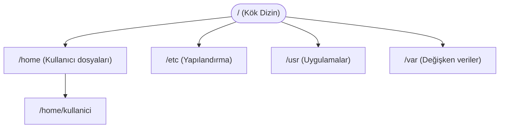
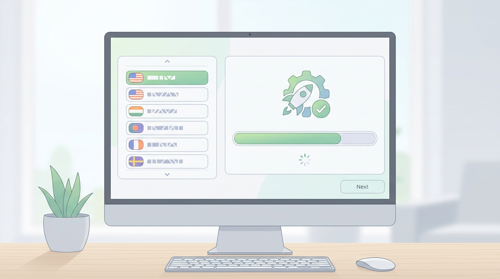
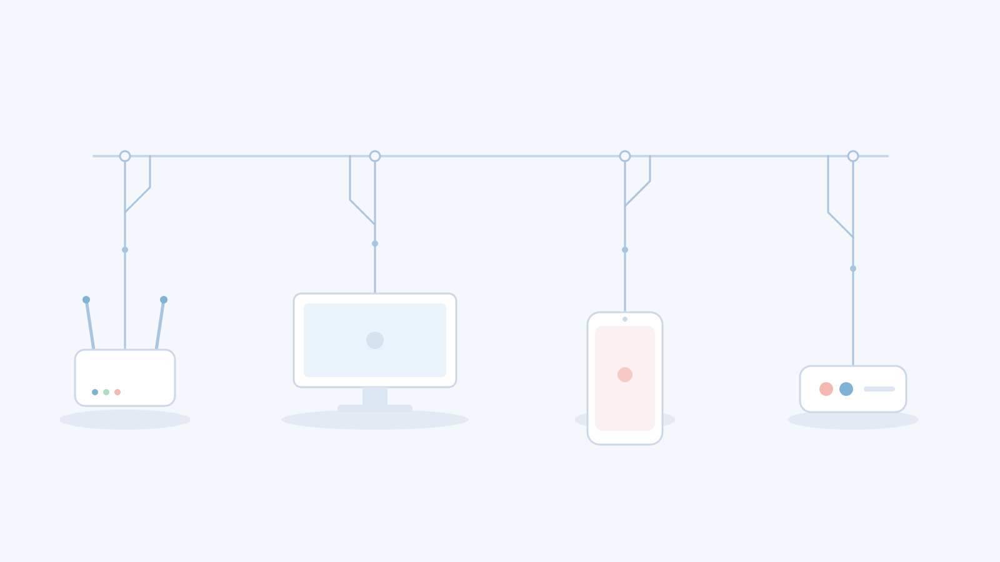

# Linux Kurulumu ve Temel Kavramlar

## 🎯 Bu Derste Ne Öğreneceğiz?

Bu derste, Linux işletim sisteminin temel kavramlarını tanıyacak; çekirdek, kabuk ve dosya sistemi hiyerarşisi gibi kavramların ne anlama geldiğini öğreneceksiniz. Ayrıca basit bir Linux kurulumuna dair ilk adımları atacak, kurulum sırasında karşılaşabileceğiniz temel seçenekleri gözlemleyeceksiniz. Bu dersin sonunda, kendi bilgisayarınızda temel bir Linux ortamı kurabilecek düzeyde olacaksınız.

## 💡 Neden Bu Konuyu Öğreniyoruz?

Veri bilimi ve analitiği alanında çalışırken, çoğu sunucu ortamı ve açık kaynak araç Linux tabanlıdır. Python kütüphanelerinin kurulumu, Jupyter Notebook sunucularının yönetimi, veri işleme boru hatlarının çalıştırılması gibi günlük görevler, temel Linux bilgisi gerektirir. Bu ders, ilerleyen haftalarda kullanacağımız tüm komutları, ortamları ve sistem yapılarını anlamanız için sağlam bir zemin oluşturur.

> [!NOTE]
> Linux, açık kaynak bir çekirdek (kernel) üzerine kurulu birçok farklı dağıtımdan (distribution) oluşan bir ekosistemdir. Bu derste kuracağımız basit Linux sistemi, ilerleyen haftalarda farklı dağıtımları karşılaştırmanız için bir referans noktası olacaktır.

## Ön Bilgi

Bu dersi takip etmek için özel bir teknik ön bilgiye ihtiyaç yoktur. Daha önce hiç Linux kurmadıysanız endişelenmeyin; bu ders tam da bu durumu göz önünde bulundurarak hazırlanmıştır. Sadece temel bilgisayar kullanımı (klavye, fare, internet bağlantısı) yeterlidir.

## Kavramlar

### Çekirdek (Kernel)

Çekirdek, işletim sisteminin kalbidir. Donanım ile yazılım arasında bir köprü görevi görür; işlemciyi, belleği, diskleri ve diğer cihazları yönetir. Linux çekirdeği açık kaynak kodludur ve sürekli geliştirilmektedir.

### Kabuk (Shell)

Kabuk, kullanıcı ile çekirdek arasında bir arayüz sağlar. Komut satırına yazdığınız komutlar kabuk tarafından yorumlanır ve çekirdeğe iletilir. Bu derste `bash` (Bourne Again Shell) kabuğunu kullanacağız.

### Dosya Sistemi Hiyerarşisi

Linux'ta her şey bir dosya olarak temsil edilir. Dizin (klasör) yapısı bir ağaç gibi düzenlenmiştir. Kök dizin (`/`) en üst noktadır ve altındakiler (`/home`, `/etc`, `/usr`, `/var`) belirli amaçlar için ayrılmıştır.

> [!TIP]
> Kök dizin (`/`) ile kullanıcı dizini (`/home/kullanici`) arasındaki farkı iyi anlamak, dosya yollarını doğru yazmanız için çok önemlidir.

## 🔍 Birlikte Keşfedelim

Bir Linux kurulum ortamı başlatın (örneğin bir sanal makine veya canlı USB). Kurulum ekranında aşağıdaki seçenekleri gözlemleyin:

1. Dil seçimi: Hangi diller sunuluyor?
2. Klavye düzeni: Varsayılan olarak hangi düzen seçili?
3. Disk yapılandırması: Otomatik mi, elle mi bölümleme yapmak istiyorsunuz?
4. Ağ bağlantısı: Kurulum sırasında internet bağlantısı gerekli mi?

Tahmin edin: Kurulum bittikten sonra sistem nasıl başlatılacak? Çekirdek yüklenirken hangi mesajlar görünecek?

Şimdi kurulum sihirbazını başlatın, seçenekleri gözlemleyin ve kurulum tamamlanana kadar bekleyin. Kurulum sırasında çıkan mesajları not edin.

### VirtualBox Üzerine Linux Mint Kurulumu (Adım Adım)

Aşağıdaki adımları kendi bilgisayarınızda sanal makine ile uygulayın:

1. **VirtualBox'ı açın.** Menüde "Yeni" (New) seçeneğine tıklayın. Sanal makinenin adına (örneğin `Linux-Mint`) ve türüne (Linux, 64-bit) karar verin.
2. **Bellek ayırın.** En az 2048 MB RAM ayırın; 4096 MB daha sağlıklıdır.
3. **Sanal disk oluşturun.** "Şimdi yeni sanal sabit disk oluştur" seçeneğini işaretleyin; VDI formatını seçin. En az 25 GB dinamik tahsis edin.
4. **ISO dosyasını bağlayın.** Sanal makine ayarlarına gidin; "Depolama" bölümünden boş CD simgesine tıklayıp Linux Mint ISO dosyasını seçin.
5. **Başlatın.** Sanal makineyi başlatın. Live USB / Live DVD seçeneği görünecektir; "Linux Mint'i başlat" seçeneğini seçin.

6. **Deneme veya kurulum.** Masaüstünde "Install Linux Mint" simgesine tıklayın. Dil seçimi, klavye düzeni ve disk yapılandırması ekranlarını takip edin. Disk yapılandırmasında "Diski silip Linux Mint'i yükle" seçeneğini seçebilirsiniz (bu sadece sanal makine içindir; gerçek diskiniz silinmez).
7. **Kullanıcı bilgilerini girin.** Adınızı, bilgisayar adınızı, kullanıcı adınızı ve parolanızı belirleyin.
8. **Kurulum tamamlanana kadar bekleyin.** Kurulum bittiğinde sistem yeniden başlatılacaktır; sabit diski çıkarıp (VirtualBox ayarlarından ISO bağlantısını kaldırıp) yeniden başlatın.
9. **İlk giriş.** Linux Mint masaüstüne giriş yaptıktan sonra terminali açın (`Ctrl + Alt + T`) ve önceki adımları çalıştırın.

> [!TIP]
> VirtualBox kurulumunda en yaygın hata, ISO dosyasının düzgün bağlanmamasıdır. Eğer kurulum ekranı gelmezse, sanal makine ayarlarında "Depolama" bölümünü yeniden kontrol edin.

## 🛠️ Uygulama

Kurulum tamamlandıktan sonra, yeni Linux sisteminizde aşağıdaki basit keşifleri yapın:

1. Terminali açın (genellikle menüde "Terminal" veya "Uçbirim" olarak bulunur).
2. `pwd` komutunu çalıştırın. Çıktıyı not edin.
3. `ls` komutunu çalıştırın. Hangi dosya ve dizinleri görüyorsunuz?
4. `whoami` komutunu çalıştırın. Hangi kullanıcı adı görünüyor?

## 🧪 Deneyelim ve Gözlemleyelim

Kurduğunuz Linux sisteminde şu küçük deneyleri yapın:

- `uname -a` komutunu çalıştırarak çekirdek bilgilerini gözlemleyin.
- `/etc/os-release` dosyasının içeriğini `cat /etc/os-release` ile görüntüleyin. Hangi dağıtım kurulduğunu görün.
- `/` dizinine gidin (`cd /`) ve `ls` ile kök dizindeki ana dizinleri listeleyin.

> [!WARNING]
> Kök dizinde (`/`) bulunan sistem dosyalarını (`/etc`, `/usr`, `/bin`) değiştirmeye veya silmeye çalışmayın. Bu, sistemin çalışmasını bozabilir.

## Bir Şeyler Ters Giderse

Kurulum tamamlanmadıysa veya sistem başlatılmadıysa:

1. Sanal makinenin veya bilgisayarın yeniden başlatıldığından emin olun.
2. Kurulum ortamının (USB veya ISO) doğru şekilde bağlandığını kontrol edin.
3. Hata mesajını dikkatlice okuyun; genellikle eksik bir disk yapılandırması veya bellek yetersizliği gibi bir neden belirtir.

> [!TIP]
> Hata mesajlarını kopyalayıp bir arama motorunda aramak, çoğu zaman hızlı bir çözüm sağlar.

## Kendin Dene

Aşağıdaki görevleri kendi Linux sisteminizde deneyin:

1. `pwd` ve `ls` komutlarının çıktısını karşılaştırın. Neden farklı sonuçlar veriyorlar?
2. `cat /etc/hostname` komutuyla sisteminizin adını öğrenin.
3. `ls /home` komutuyla kullanıcı dizinlerini listeleyin.

Cevapları göster

1. `pwd` mevcut çalışma dizinini gösterir; `ls` o dizindeki içeriği listeler. Farklı amaçlar için farklı sonuçlar verirler.
2. `cat /etc/hostname` sisteminizin ağda tanınan adını gösterir.
3. `/home` altında her kullanıcı için bir dizin bulunur; kendi kullanıcı adınızı orada görebilirsiniz.

## 🧠 Öğrendiklerini Kontrol Et

1. Çekirdek (kernel) ile kabuk (shell) arasındaki fark nedir?
2. `/etc` dizini ne amaçla kullanılır?
3. Kök dizin (`/`) ile `/home` dizini arasındaki temel fark nedir?

Cevapları göster

1. Çekirdek donanımı yönetir; kabuk kullanıcı komutlarını yorumlar ve çekirdeğe iletir.
2. `/etc` sistem yapılandırma dosyalarını içerir.
3. `/` tüm sistemin köküdür; `/home` kullanıcıların kişisel dosyalarını sakladığı dizindir.

## Bağımsız Çalışma

Kendi Linux sisteminizde şu bağımsız çalışmayı yapın:

- `/usr/bin` dizinine gidin (`cd /usr/bin`) ve `ls | head -n 10` ile ilk 10 komutu listeleyin. Bu komutlardan birini seçip (`ls`, `cat`, `pwd` gibi) `man <komut>` ile yardım sayfasını okuyun. En az iki yeni bilgi edinin.

## Daha Fazlasını Öğrenmek

- Linux Dosya Sistemi Hiyerarşisi Standardı (FHS): [https://refspecs.linuxfoundation.org/fhs.shtml](https://refspecs.linuxfoundation.org/fhs.shtml)
- Bash kabuğu hakkında temel bilgiler: [https://www.gnu.org/software/bash/](https://www.gnu.org/software/bash/)

## Kısa Özet

Bu derste Linux işletim sisteminin temel kavramlarını — çekirdek, kabuk ve dosya sistemi hiyerarşisi — öğrendiniz. Basit bir kurulum gerçekleştirdiniz ve sisteminizde ilk keşifleri yaptınız. Bir sonraki derste, bu temel bilgileri kullanarak daha fazla komut öğreneceğiz.

---

← [Ana Sayfa](../README.md) | [Temel Komutlar ve Dosya Sistemi →](02-File-Operations.md)