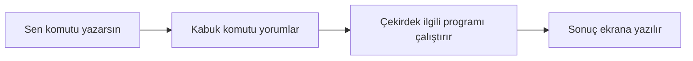
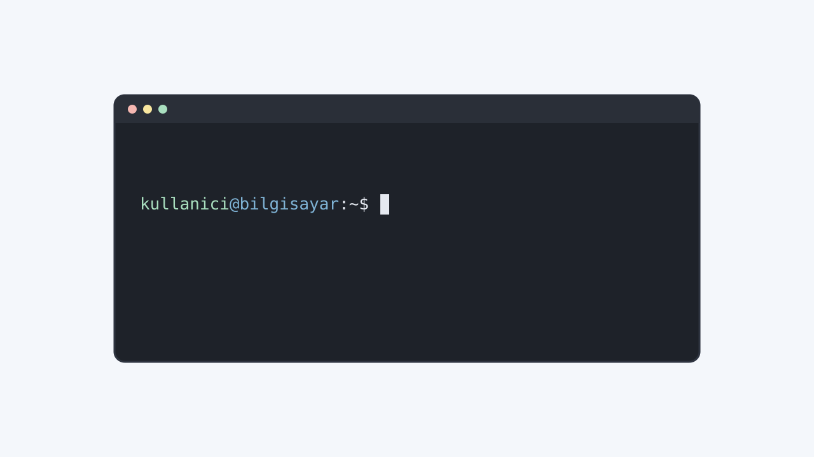

# Masaüstü ile Tanışma ve Terminalin İlk Adımları

## 🎯 Bu Bölümde Ne Öğreneceğiz?

Bu bölümü bitirdiğinde şunları yapabileceksin:

- Linux Mint'in masaüstü ortamını (Cinnamon) tanıyıp temel ögelerini
  kullanabileceksin.
- Terminalin ne olduğunu ve neden bu kadar güçlü bir araç olduğunu
  açıklayabileceksin.
- Bir komutun bölümlerini (komut, seçenek, argüman) ayırt edebileceksin.
- İlk komutlarını çalıştırıp çıktılarını yorumlayabileceksin: `pwd`, `whoami`,
  `date`, `echo`, `clear`.
- Sekmeyle tamamlamayı kullanarak daha hızlı ve hatasız komut yazabileceksin.
- Kabuk (shell) kavramını kendi cümlelerinle açıklayabileceksin.

## 💡 Neden Bu Konuyu Öğreniyoruz?

Masaüstünü fareyle kullanmak sezgiseldir; bir dosyayı açmak için tıklarsın,
programı başlatmak için simgeye basarsın. Peki neden ayrıca terminal
öğreniyoruz?

Çünkü terminal, aynı işi çok daha hızlı ve çok daha esnek biçimde yapmanı
sağlar. Üstelik sunucuların büyük çoğunluğunda masaüstü ortamı hiç yoktur;
orada yalnızca terminal bulunur. Bir gün bir web sunucusunu yönetmen, bir
sorunu çözmen ya da tekrarlayan bir işi otomatikleştirmen gerektiğinde terminal
kaçınılmaz hâle gelir. Bu kursun geri kalanı büyük ölçüde terminal üzerinden
ilerleyecek; bu yüzden ona bu bölümde alışmaya başlıyoruz.

## 📌 Ön Bilgi

Bu bölüm, 1. bölümde kurduğun çalışan Linux sistemine dayanır. Sanal makineni
başlatıp Linux Mint'e giriş yaptıysan hazırsın. Ek bilgi gerekmez.

## 📖 Kavramlar

### Masaüstü ortamı

Ekranda gördüğün masaüstü, görev çubuğu, panel, menüler ve pencerelerin tümü bir
**masaüstü ortamı (desktop environment)** tarafından çizilir. Linux Mint'in
varsayılan masaüstü ortamı **Cinnamon**'dur. Masaüstü ortamları görünüm ve
davranış bakımından farklılık gösterir; bunları 6. bölümde ayrıntılı
karşılaştıracağız. Şimdilik "ekranda gördüğün her şeyin arkasındaki tasarım"
diye düşünebilirsin.

### Terminal, kabuk ve komut

**Terminal (terminal emulator),** içinde komut yazabildiğin pencereye denir.
Ama yazdığın komutları asıl yorumlayan ve çalıştıran şey terminalin kendisi
değildir. Komutları alıp anlamlandıran, ilgili programa yönlendiren ara katmana
**kabuk (shell)** denir. Linux'ta en yaygın kabuk **bash**'tir.

Kabuğa bir komut yazıp Enter'a bastığında şu akış gerçekleşir:



Yani seninle donanım arasında sırasıyla terminal, kabuk ve çekirdek vardır.
Kabuğu 1. bölümdeki katman diyagramından hatırlarsın; şimdi onu doğrudan
kullanmaya başlıyoruz.

### Komutun bölümleri

Yazdığın her komut genellikle üç parçadan oluşur:

- **Komut (command):** Yapılacak işin adı. Örneğin `date`.
- **Seçenek (option):** Komutun davranışını değiştiren, genellikle `-` ya da
  `--` ile başlayan ek. Örneğin `date -u`.
- **Argüman (argument):** Komutun üzerinde çalışacağı hedef. Örneğin bir dosya
  adı.

Bir cümlede fiil, zarf ve nesne gibi düşünebilirsin: `date` fiil, `-u` zarf,
dosya adı ise nesnedir. Bütün komutlar bu üç parçayı kullanmaz; kimisi seçeneksiz
ya da argümansız da çalışır.

## 🔍 Birlikte Keşfedelim

Terminali açmadan önce bir tahmin yürütelim.

Şu komutu çalıştırmak üzere olduğunu varsay:

```bash
whoami
```

Sence bu komut ekrana ne yazar? Kullanıcının gerçek adını mı, kullanıcı adını
mı, yoksa bilgisayarın adını mı?

Tahminini netleştirdikten sonra terminali aç ve komutu çalıştır. Çıktıyı
tahmininle karşılaştır.

Gördüğün şey, sisteme giriş yaptığın **kullanıcı adıdır**; senin adın ve
soyadın değil. Bu ayrım önemlidir: Linux, kişileri isimleriyle değil, kullanıcı
adlarıyla tanır. Bu kullanıcı kavramını 5. bölümde ayrıntılı işleyeceğiz.

## 🛠️ Uygulama

### 1. Adım: Terminali aç

Linux Mint'te terminali açmanın birkaç yolu vardır. En yaygını şudur:

1. Sol alttaki menü düğmesine bas.
2. Arama kutusuna `terminal` yaz.
3. Çıkan "Terminal" uygulamasına tıkla.

Karşına içi boş, siyah ya da koyu renkli bir pencere çıkacak. İşte bu terminal.

### 2. Adım: Kabuk istemini (prompt) oku

Terminal açıldığında seni bir satır bekliyor olacak. Bu satıra **kabuk istemi
(prompt)** denir. Genellikle şuna benzer:

```text
kullanici@bilgisayar:~$
```

Bu satırı parça parça okuyalım:

- `kullanici` -> oturum açtığın kullanıcı adı.
- `@` -> "şu makinede" anlamında bir ayraç.
- `bilgisayar` -> makinenin (sanal makinene verdiğin) adı.
- `:` -> ayraç.
- `~` -> şu an bulunduğun dizin. `~` işareti "ev dizini" anlamına gelir; bunu
  3. bölümde ayrıntılı göreceğiz.
- `$` -> komut beklediğini gösteren işaret. (Yönetici yetkisiyle çalışırken bu
  işaret `#` olur; bunu 5. bölümde göreceğiz.)

Yani istem satırı sana "kim olarak, hangi makinede, hangi dizinde
çalışıyorsun?" bilgisini tek bakışta verir.



### 3. Adım: İlk komutlarını çalıştır

Aşağıdaki komutları sırayla yazıp her birinden sonra Enter'a bas. Her komutun
önce ne yapacağını tahmin etmeyi alışkanlık hâline getir.

```bash
pwd
```

`pwd`, "print working directory" ifadesinin kısaltmasıdır ve **şu an hangi
dizinde olduğunu** söyler. Çıktıda muhtemelen ev dizinini göreceksin.

```bash
whoami
```

Hangi kullanıcı olarak oturum açtığını gösterir.

```bash
date
```

Sistemin tarih ve saatini gösterir.

```bash
echo "Merhaba, Linux!"
```

`echo`, kendisine verilen metni olduğu gibi ekrana yazar. Bu komut ileride çok
işine yarayacak; çünkü çıktı üretmenin en basit yoludur.

```bash
clear
```

Ekranı temizler ve istemi en üste taşır. Yazdıkların silinmez; yalnızca görüntü
temizlenir.

Bu beş komut, terminal dünyasının ilk tuğlalarıdır. Hepsi küçük, öngörülebilir ve
güvenlidir: yazdıkları bilgiyi bozmaz, dosyalarına dokunmaz.

## 🧪 Deneyelim ve Gözlemleyelim

Şimdi terminali hızlandıran iki küçük hile deneyelim.

**Sekmeyle tamamlama.** Komutun veya dosya adının tamamını yazmak zorunda
değilsin. Terminale şunu yaz ama Enter'a basma:

```text
dat
```

Şimdi `Tab` tuşuna bas. Ne oldu? Sekme, yazdığın harflere uyan komutu otomatik
tamamladı. Bu özellik, uzun komutları yazarken hem zaman kazandırır hem de yazım
hatalarını azaltır.

**Geçmişten çağırma.** Yukarı ok (`↑`) tuşuna bas. Az önce çalıştırdığın
komutların geri geldiğini göreceksin. Aşağı ok (`↓`) ile ileri doğru
dönebilirsin. Kabuk, çalıştırdığın komutları bir yere kaydeder; bu kaydı
`history` komutuyla 11. bölümde ayrıntılı inceleyeceğiz, şimdilik yalnızca
yukarı okla komut çağırabildiğini bil.

Gözlemle: Sekmeyle tamamlama, birden fazla seçenek olduğunda ne yapıyor?
`dat` yazıp `Tab` tuşuna iki kez basarak dene.

## ⚠️ Bir Şeyler Ters Giderse

**Belirti:** `command not found` ya da "komut bulunamadı" benzeri bir mesaj.

**Olası neden:** Komutu yanlış yazmışsın ya da o komut bu sistemde kurulu değil.

**Ne yapmalısın:** Önce yazımı kontrol et. Linux büyük-küçük harfe duyarlıdır;
`Date` ile `date` aynı komut değildir. Yazım doğruysa ve komut gerçekten
kurulu değilse, biraz sabret: paket kurmayı 7. bölümde öğreneceğiz.

**Belirti:** Komutu yazdın ama hiçbir şey olmuyor, imleç görünmüyor.

**Olası neden:** Belki uzun süren bir işlem başlattın ya da yanlışlıkla bir
program açık kaldı.

**Ne yapmalısın:** `Ctrl` + `C` tuşlarına birlikte bas. Bu, çalışan işlemi
durdurur ve istemi geri getirir. Unutma: `Ctrl` + `C` komutu iptal eder, veriyi
silmez.

> [!TIP]
> Terminale yazdığın komut kendiliğinden çalışmaz; Enter'a basman gerekir.
> Yazarken bir hata yaptığını fark edersen `Ctrl` + `C` ile satırı temizleyip
> baştan yazabilirsin.

## ✍️ Kendin Dene

**Görev:** Aşağıdaki üç komutun çıktısını, çalıştırmadan önce tahmin et. Sonra
çalıştırıp tahmininle karşılaştır.

```bash
echo "Bugün harika bir gün"
echo Bugün harika bir gün
date -u
```

Özellikle ikinci komutta tırnak kullanmadığına dikkat et: `echo` birden fazla
kelimeyi tırnaksız gördüğünde ne yapıyor?

<details>
<summary>İpucu göster</summary>

`echo`, tırnak içinde verilen metni tek bir bütün olarak yazar. Tırnak yoksa
boşluklarla ayrılmış her parçayı ayrı bir argüman olarak alır, ama ekrana
yazarken aralarına yine boşluk koyar. Bu yüzden iki komut da benzer görünebilir;
farkı daha karmaşık örneklerde 4. bölümde göreceğiz.

</details>

<details>
<summary>Örnek çözüm göster</summary>

- `echo "Bugün harika bir gün"` -> `Bugün harika bir gün`
- `echo Bugün harika bir gün` -> `Bugün harika bir gün` (sonuç aynı görünür,
  çünkü `echo` argümanları boşlukla birleştirir)
- `date -u` -> tarih ve saati, evrensel zaman (UTC) olarak gösterir; `-u`
  seçeneği yerel saati değil UTC'yi yazdırır.

Buradaki asıl ders şu: aynı komut, seçeneklerle farklı davranış
sergileyebilir. `-u` seçeneği tam da bunu yapıyor.

</details>

## 🧠 Öğrendiklerini Kontrol Et

1. Terminal ile kabuk arasındaki fark nedir?
2. Bir komutun üç temel bölümünü say ve her birine birer örnek ver.
3. Kabuk istemindeki `~` işareti neyi ifade eder?
4. Sekmeyle tamamlama ne işe yarar ve nasıl bir kolaylık sağlar?
5. Bir komut takılıp kalırsa hangi tuş kombinasyonuyla durdurabilirsin?

<details>
<summary>Cevapları göster</summary>

1. Terminal, komut yazdığın penceredir; kabuk ise yazdığın komutları yorumlayıp
   çalıştıran ara katmandır. Terminal bir arayüz, kabuk bir yorumlayıcıdır.
2. Komut (örneğin `date`), seçenek (örneğin `-u`) ve argüman (örneğin bir dosya
   adı). Her komut bu üçünü birden kullanmak zorunda değildir.
3. `~` işareti kullanıcının ev dizinini ifade eder; yani kişisel dosyalarının
   varsayılan olarak bulunduğu klasörü.
4. Sekmeyle tamamlama, yazmaya başladığın komutu veya dosya adını tek tuşla
   tamamlar. Böylece hem zaman kazanırsın hem de yazım hatası yapma olasılığın
   azalır.
5. `Ctrl` + `C`. Bu kombinasyon çalışan işlemi durdurur ve istemi geri getirir.

</details>

## 🚀 Bağımsız Çalışma

1. **Keşif görevi:** Linux Mint'te terminali açmanın en az üç farklı yolunu
   bul. (İpucu: menü, klavye kısayolu, dosya yöneticisi.) Her yolu bir cümleyle
   not et.
2. **İnceleme görevi:** Terminalde kasıtlı olarak yanlış bir komut yaz, örneğin
   `tarih`. Hata mesajını oku ve sana ne anlatmaya çalıştığını kendi
   cümlelerinle açıkla. Bu alıştırma, ileride hata mesajlarını okuma becerinin
   temelini atar.

Amaç doğru cevabı ezberlemek değil; sistemi kurcalayarak öğrenmeye başlamaktır.

## 📚 Daha Fazlasını Öğrenmek

- GNU Bash kullanım kılavuzu: <https://www.gnu.org/software/bash/manual/>
- Linux Mint kullanıcı belgeleri: <https://linuxmint.com/documentation.php>
- Ubuntu man sayfaları (komut kılavuzları): <https://manpages.ubuntu.com>

## 📝 Kısa Özet

- Masaüstü ortamı, ekrandaki görsel katmandır; Linux Mint'te varsayılan olarak
  Cinnamon gelir.
- Terminal, komut yazdığın penceredir; komutları yorumlayan kabuktur ve yaygın
  kabuk bash'tir.
- Her komut komut, seçenek ve argüman bölümlerinden oluşabilir.
- `pwd`, `whoami`, `date`, `echo` ve `clear` gibi basit komutlarla terminalle
  tanıştın.
- Sekmeyle tamamlama ve yukarı ok, terminalde işini hızlandıran temel
  kolaylıklardır.

[Önceki bölüm: Linux'a Giriş ve Sanal Makine Kurulumu](01-Getting-Started.md) | [İçindekiler](../README.md) | [Sonraki bölüm: Dosya Sistemi, Dizin Yapısı ve Dosya İşlemleri](03-File-System-Basics.md)
