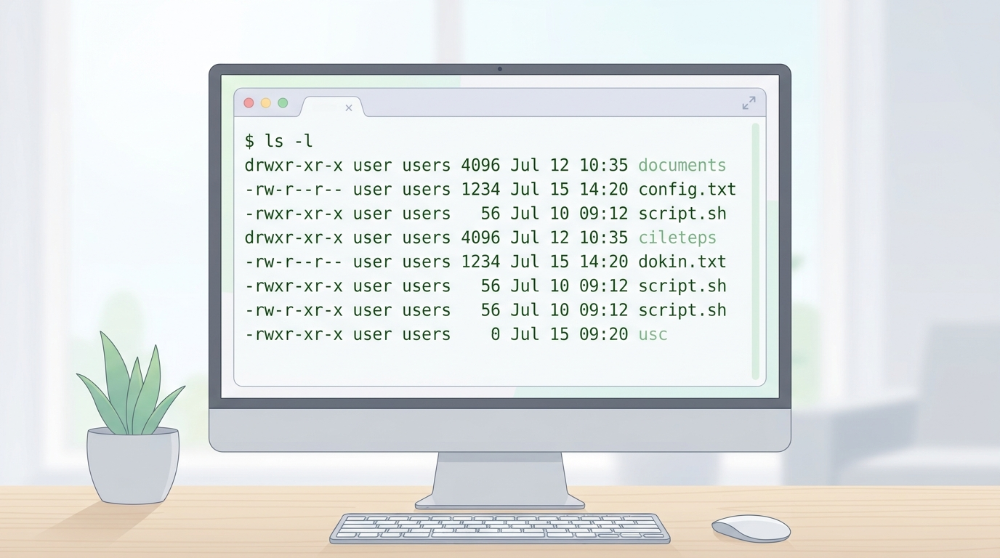

# Temel Komutlar ve Dosya Sistemi

## 🎯 Bu Derste Ne Öğreneceğiz?

Bu derste, Linux'ta dosya ve dizinlerle çalışmanın temel komutlarını öğreneceksiniz: `ls`, `pwd`, `cd`, `cp`, `mv`, `rm`, `mkdir`, `rmdir`, `cat`, `head`, `tail`, `touch`. Ayrıca dosya yollarının mutlak (absolute) ve göreli (relative) formlarını ayırt edecek, dizin hiyerarşisinde gezinmeyi pratiğe dökeceksiniz. Bu derste, önceki haftada kurduğunuz sistem üzerinde gerçek komutlar çalıştırarak davranışları gözlemleyeceksiniz.

## 💡 Neden Bu Konuyu Öğreniyoruz?

Veri biliminde, veri dosyalarını taşımak, sonuçları farklı dizinlere kopyalamak, log dosyalarını incelemek ve betikleri düzenli olarak çalıştırmak için sürekli dosya işlemi yapmanız gerekir. Bu komutlar, ilerleyen haftalarda paket kurulumu, sistem izleme ve veri araçlarının kurulumu gibi görevlerin temelini oluşturur. Bu komutları ezberlemeye çalışmak yerine, her birinin ne değiştirdiğini gözlemleyerek öğrenmeniz çok daha kalıcı olacaktır.

> [!IMPORTANT]
> `rm` komutu silinen dosyaları **geri getirmez** (varsayılan olarak çöp kutusu yoktur). Kritik dosyaları silmeden önce her zaman `ls` ile hedefi doğrulayın.

## Ön Bilgi

Bu dersi takip etmek için bir Linux sistemine erişiminiz olmalıdır (önceki haftada kurduğunuz veya mevcut bir sistem). Temel kavramları (çekirdek, kabuk, kök dizin) anlamak yeterlidir. Komut satırını nasıl açacağınızı bilmiyorsanız önceki derse bakabilirsiniz.

## Kavramlar

### Mutlak ve Göreli Yol

- **Mutlak yol:** Kök dizinden (`/`) başlayarak tam konumu belirtir; örneğin `/home/kullanici/Belgeler/dosya.txt`.
- **Göreli yol:** Mevcut çalışma dizinine göre konumu belirtir; örneğin `Belgeler/dosya.txt` (eğer `/home/kullanici` dizinindeyseniz).

> [!TIP]
> `pwd` komutuyla mevcut dizininizi öğrenebilirsiniz. `.` (nokta) mevcut dizini, `..` (iki nokta) üst dizini temsil eder.

### Dizin Yapısının Temel Komutları

| Komut | Amaç | Örnek |
|---|---|---|
| `ls` | Dizin içeriğini listele | `ls -l` (detaylı) |
| `pwd` | Mevcut dizini yazdır | `pwd` |
| `cd` | Dizini değiştir | `cd /etc` |
| `mkdir` | Yeni dizin oluştur | `mkdir projem` |
| `rmdir` | Boş dizin sil | `rmdir eski` |
| `cp` | Dosya kopyala | `cp kaynak.txt hedef.txt` |
| `mv` | Dosya taşı | `mv eski.txt yeni.txt` |
| `rm` | Dosya sil | `rm sil.txt` |
| `cat` | Dosya içeriğini görüntüle | `cat dosya.txt` |
| `head` | Dosyanın ilk satırları | `head -n 5 dosya.txt` |
| `tail` | Dosyanın son satırları | `tail -n 5 dosya.txt` |
| `touch` | Yeni dosya oluştur | `touch yeni_dosya.txt` |

## 🔍 Birlikte Keşfedelim

Terminalinizde şu adımları izleyin:

1. `pwd` komutunu çalıştırın. Çıktıyı not edin.
2. `ls` komutunu çalıştırın. Hangi dosya ve dizinler görünüyor?
3. `ls -l` komutunu çalıştırın. İlk sütundaki harfler (örneğin `d`, `-`, `l`) ne anlama geliyor?
4. `cd ..` komutunu çalıştırın. `pwd` ile yeni konumu kontrol edin.

Tahmin edin: `cd /` komutuyla kök dizine gidince `ls` çıktısı nasıl değişecek?

Şimdi `cd /` komutunu çalıştırın ve `ls` ile kök dizini gözlemleyin. Notlarınızı karşılaştırın.

## 🛠️ Uygulama

Aşağıdaki küçük görevleri sırayla tamamlayın:

1. `mkdir calisma` ile yeni bir dizin oluşturun.
2. `cd calisma` ile içine girin.
3. `touch veri.txt` ile boş bir dosya oluşturun.
4. `echo "Merhaba Linux" > veri.txt` ile dosyaya yazın.
5. `cat veri.txt` ile içeriği görüntüleyin.
6. `cp veri.txt yedek.txt` ile kopyalayın.
7. `mv yedek.txt ../` ile üst dizine taşıyın.
8. `ls -l` ile sonuçları doğrulayın.

## 🧪 Deneyelim ve Gözlemleyelim

Aşağıdaki deneyleri yapın ve sonuçları not edin:

1. `echo "satır1" >> veri.txt` komutuyla dosyaya yeni bir satır ekleyin; `cat veri.txt` ile sonucu görün.
2. `head -n 2 veri.txt` ve `tail -n 1 veri.txt` komutlarını karşılaştırın. Hangisi ilk iki satırı, hangisi son satırı gösteriyor?
3. `rm veri.txt` komutuyla dosyayı silin. `ls` ile kontrol edin.

> [!WARNING]
> `rm` komutunu dikkatli kullanın. Yanlış dizinde çalıştırırsanız önemli dosyaları silebilirsiniz. Önce `ls` ile içeriği doğrulayın.

## Bir Şeyler Ters Giderse

Komut çalışmazsa veya beklenmedik bir sonuç alırsanız:

1. `pwd` ile doğru dizinde olduğunuzu kontrol edin.
2. `ls` ile dosyanın var olduğunu doğrulayın.
3. Komut yazımında büyük/küçük harf farkı olabilir; Linux komutları küçük harfe duyarlıdır.
4. `man <komut>` ile komutun yardım sayfasını okuyun; genellikle hatanın nedeni burada açıklanır.

> [!TIP]
> Hata mesajlarını kopyalayıp bir arama motorunda aramak, hızlı çözümler sunar; ancak önce `man` komutuyla kendi yardım kaynaklarınızı kontrol etmek daha kalıcı öğrenme sağlar.

## Kendin Dene

Aşağıdaki görevleri kendi Linux sisteminizde deneyin:

1. `mkdir test` ile bir dizin oluşturun; içine `touch a b c` ile üç boş dosya oluşturun.
2. `cp a b` komutuyla `a` dosyasının bir kopyasını `b` olarak oluşturun. `ls -l` ile boyutları karşılaştırın.
3. `mv c ../test2/` komutuyla `c` dosyasını yeni bir dizine taşımaya çalışın. Eğer `test2` yoksa hata alacaksınız; bu durumu gözlemleyin.

Cevapları göster

1. `mkdir test` çalışır; `touch a b c` üç boş dosya oluşturur (boyut 0).
2. `cp a b` ile `b` dosyası oluşur; `ls -l` ile her ikisinin de boyutu 0 görünür (içerik aynı çünkü boş).
3. Eğer `test2` dizini yoksa `mv` hatası verir: `No such file or directory`. Bu, göreli yolun doğru olmasını gerektirdiğini gösterir.

## 🧠 Öğrendiklerini Kontrol Et

1. `pwd` komutu ne işe yarar?
2. `ls -l` çıktısındaki ilk sütun (örneğin `-rw-r--r--`) neyi temsil eder?
3. `cp` ile `mv` arasındaki temel fark nedir?

Cevapları göster

1. `pwd` mevcut çalışma dizinini yazdırır.
2. İlk sütun dosya türünü (`-` = dosya, `d` = dizin) ve izinleri (`rw-` = okuma/yazma, `r--` = sadece okuma) temsil eder.
3. `cp` kaynağı kopyalar (kaynak kalır); `mv` kaynağı taşır (kaynak silinir).

## Bağımsız Çalışma

Kendi Linux sisteminizde bu bağımsız çalışmayı tamamlayın:

- `/tmp` dizinine gidin (`cd /tmp`). `ls` ile içeriği listeleyin. 10 dosyayı geçmeyen bir dizin oluşturun (`mkdir benim_dizinim`). İçine `echo "test" > dosya1.txt` ile bir dosya yazın. Ardından `ls -la benim_dizinim/` ile içeriği detaylı olarak listelerken `.` ve `..` girişlerinin ne olduğunu açıklayın.

## Daha Fazlasını Öğrenmek

- GNU Coreutils (temel komutlar): [https://www.gnu.org/software/coreutils/](https://www.gnu.org/software/coreutils/)
- Linux Dosya Sistemi Hiyerarşisi Standardı (FHS): [https://refspecs.linuxfoundation.org/fhs.shtml](https://refspecs.linuxfoundation.org/fhs.shtml)

## Kısa Özet

Bu derste dosya ve dizinlerle çalışmanın temel komutlarını (`ls`, `pwd`, `cd`, `cp`, `mv`, `rm`, `mkdir`, `touch`, `cat`, `head`, `tail`) öğrendiniz. Mutlak ve göreli yolları ayırt edebiliyorsunuz; dosya işlemlerini güvenli bir şekilde yapabiliyorsunuz. Bir sonraki derste kullanıcı yönetimi ve izinlerle bu bilgiye ek olarak sistem güvenliğini öğreneceğiz.

---

← [Linux Kurulumu ve Temel Kavramlar](01-Linux-Basics.md) | [Kullanıcı Yönetimi ve İzinler →](03-User-Management.md)
