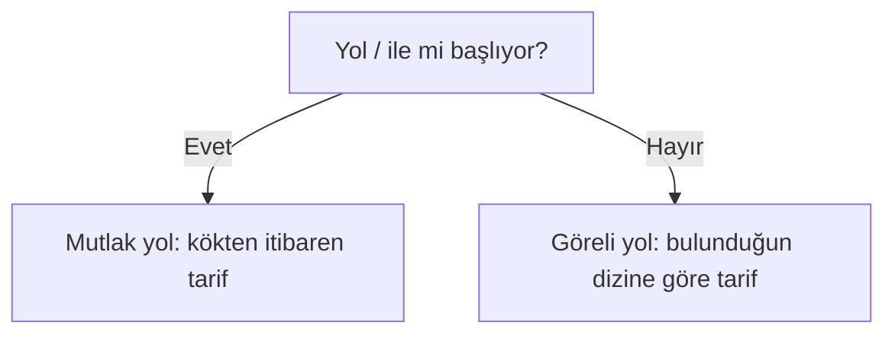

# Dosya Sistemi, Dizin Yapısı ve Dosya İşlemleri

## 🎯 Bu Bölümde Ne Öğreneceğiz?

Bu bölümü bitirdiğinde şunları yapabileceksin:

- Dosya, dizin ve dosya sistemi kavramlarını açıklayabileceksin.
- Linux'un standart dizin yapısını (FHS) tanıyıp önemli dizinlerin işlevini
  söyleyebileceksin.
- Mutlak ve göreli yolları ayırt edip kullanabileceksin.
- `ls`, `cd`, `mkdir`, `touch`, `cp`, `mv` ve `rm` komutlarıyla dosya ve dizin
  işlemlerini gerçekleştirebileceksin.
- Joker karakterlerle birden çok dosyayı aynı anda ele alabileceksin.
- `find` ile dosya ve dizin arayabileceksin.
- Sembolik bağ (link) oluşturup ne işe yaradığını açıklayabileceksin.

## 💡 Neden Bu Konuyu Öğreniyoruz?

Linux'ta neredeyse her şey bir dosyadır; hatta cihazlar bile birer dosya gibi
temsil edilir. Dolayısıyla dosya ve dizin yapısını anlamak, sistemi anlamanın
temelidir. Yeni bir sistemde kaybolmamak için "bu klasör ne işe yarar, dosyalarım
nerede durur, izin verirsen şuraya yazabilirsin" sorularının cevabını bilmen
gerekir.

Bu bölüm, bundan sonraki her bölümün üzerine oturacağı zemini kurar: dosya
dizinin yapısını, yolları ve dosya işlemlerini. İlerleyen bölümlerde metin
işleme, izinler, paket kurulumu ve yedekleme gibi konular hep bu temel üzerine
kurulur.

## 📌 Ön Bilgi

Bu bölüm, 2. bölümde öğrendiğin terminal kullanımına dayanır. Kabuk istemini
okuyabilmen, komut yazıp Enter'a basabilmen ve `pwd` ile bulunduğun dizini
görebilmen yeterlidir. Yeni bir komut öğrenirken önce ne yapacağını tahmin
etmeye çalışmayı sürdür.

## 📖 Kavramlar

### Dosya, dizin ve dosya sistemi

**Dosya (file),** verinin adlandırılmış hâlidir: bir metin, bir resim, bir
program. **Dizin (directory, klasör),** başka dosya ve dizinleri bir arada
tutan kapsayıcıdır. **Dosya sistemi (file system),** bu dosya ve dizinlerin disk
üzerinde nasıl saklandığını ve düzenlendiğini tanımlayan yapıdır.

Bazı dizinlerin adı seni yanıltmasın: Windows'taki "klasör" ile Linux'taki
"dizin" aynı şeydir; Linux kültüründe genellikle "dizin" denir.

### Ağaç yapısı ve kök dizin

Linux'ta her şey tek bir ağacın altında toplanır. Bu ağacın en tepesindeki
noktaya **kök dizin (root directory)** denir ve tek bir eğik çizgiyle gösterilir:
`/`. Dikkat: `/` hem kök dizini hem de yolları ayıran işareti ifade eder; hangisi
olduğu kullanıldığı yere göre anlaşılır.

Ağacın kabaca görünümü şöyledir:

```text
/
├── bin     -> temel çalıştırılabilir programlar
├── boot    -> sistemin açılış dosyaları
├── dev     -> cihazların dosya olarak temsili
├── etc     -> sistem yapılandırma dosyaları
├── home    -> kullanıcıların kişisel dizinleri
│   └── kullanici_adin
├── opt     -> ek kurulan yazılımlar
├── tmp     -> geçici dosyalar (açılışta temizlenir)
├── usr     -> kullanıcı programları ve verileri
└── var     -> değişken veriler (günlükler, kuyruklar)
```

Bu düzenin adı **FHS (Filesystem Hierarchy Standard)**, yani Dosya Sistemi
Hiyerarşisi Standardı'dır. Amaç, farklı Linux dağıtımlarında aynı dizinin aynı
işi görmesini sağlamaktır. Bu sayede Ubuntu'dan Fedora'ya geçtiğinde nereye
bakacağını bilirsin.

Günlük işlerinde en sık karşılaşacağın dizinler şunlardır:

| Dizin | Ne bulunur? |
|---|---|
| `/` | Her şeyin başladığı kök dizin |
| `/home` | Kullanıcıların kişisel dosyaları |
| `/etc` | Sistem ayar dosyaları |
| `/var/log` | Sistem günlükleri (kayıtları) |
| `/tmp` | Geçici dosyalar |
| `/bin` ve `/usr/bin` | Çalıştırılabilir programlar |

> [!NOTE]
> Belirli bir dizinin gerçekten ne işe yaradığını şimdilik ezberlemek zorunda
> değilsin. Önemli olan mantığı kavramak: yapılandırma dosyaları `/etc`'de,
> kişisel dosyalar `/home`'da, günlükler `/var/log`'ta toplanır.

### Mutlak ve göreli yol

Bir dosyanın yerini tarif etmenin iki yolu vardır.

**Mutlak yol (absolute path)** her zaman `/` ile başlar ve dosyanın konumunu
kökten itibaren eksiksiz tarif eder. Örneğin `/home/kullanici_adin/notlar.txt`.

**Göreli yol (relative path)** ise bulunduğun dizine göre verilir ve `/` ile
başlamaz. Örneğin ev dizinindeysen `belgeler/mektup.txt` göreli bir yoldur.

İki özel işaret işini kolaylaştırır:

- `.` -> bulunduğun dizin.
- `..` -> bir üst dizin.

Ayrıca `~` işareti ev dizinini ifade eder; `~/belgeler` gibi kullanılır.



### Gizli dosyalar

Adı nokta ile başlayan dosya ve dizinler **gizli** sayılır. Örneğin ev
dizinindeki `.bashrc` gizli bir dosyadır. Gizli olmak "güvenli" demek değildir;
yalnızca günlük listelemede gösterilmemesi anlamına gelir.

## 🔍 Birlikte Keşfedelim

Aşağıdaki komutu çalıştırmadan önce dur ve düşün:

```bash
cd /etc
```

Sence bu komuttan sonra `pwd` sana ne söyler? Ve `/etc` içinde ne tür dosyalar
beklersin: resimler mi, ayar dosyaları mı, müzikler mi?

Haydi deneyelim. Ev dizininden başlayarak şu komutları sırayla çalıştır:

```bash
cd /etc
pwd
ls
```

Şimdi de şunu:

```bash
cd /home
pwd
ls
```

İki dizinin içeriği arasındaki farkı gözlemle. `/etc` ağırlıklı olarak `.conf`,
`.cfg`, `.d` gibi yapılandırma dosyaları içerir; `/home` ise kullanıcı
dizinlerini barındırır. Aynı sistem, iki farklı amaca hizmet eden iki ayrı
dünya gibidir. Bu düzeni bilmek, "aradığım dosya nerede olabilir?" sorusuna hızlı
cevap vermeni sağlar.

> [!TIP]
> `cd` ile yanlışlıkla başka bir dizine geçtiysen, tek başına `cd` yazıp
> Enter'a basman seni her zaman ev dizinine geri getirir.

## 🛠️ Uygulama

Şimdi ev dizininde kendi çalışma alanını kuracaksın. Tüm işlemleri ev dizininde
yapacağız; böylece sistem dosyalarına dokunmadan rahatça deneyebilirsin.

### 1. Adım: Çalışma dizini oluştur

```bash
cd ~
mkdir linux_deneme
cd linux_deneme
pwd
```

Önce ev dizinine gittik, `linux_deneme` adlı bir dizin oluşturduk ve içine
girdik. `pwd` çıktısında `.../linux_deneme` gibi bir yol görmelisin.

### 2. Adım: Dosya oluştur

```bash
touch notlar.txt
ls
```

`touch`, adı geçen dosya yoksa boş bir dosya oluşturur, varsa zaman damgasını
günceller. `ls` çıktısında `notlar.txt` dosyasını görmelisin.

### 3. Adım: Kopyala ve taşı

```bash
cp notlar.txt kopya.txt
ls
mv kopya.txt yedek.txt
ls
```

`cp` bir kopya oluşturur; `mv` ise taşır ya da adını değiştirir. Burada
`kopya.txt` dosyasının adını `yedek.txt` olarak değiştirdik. `ls` çıktısını her
adımdan sonra inceleyerek dosyaların nasıl değiştiğini takip et.

### 4. Adım: Dizin oluştur ve içine dosya koy

```bash
mkdir belgeler
mv yedek.txt belgeler/
ls
ls belgeler
```

`mv yedek.txt belgeler/` komutu, `yedek.txt` dosyasını `belgeler` dizininin
içine taşır. Sondaki `/` işareti, hedefin bir dizin olduğunu açıkça belirtir.

### 5. Adım: Sil

```bash
rm notlar.txt
ls
```

`rm`, dosyayı siler.

> [!CAUTION]
> Linux'ta komut satırından silinen dosya, çöp kutusuna gitmez; doğrudan
> silinir. Bu yüzden `rm` komutunu kullanırken hedefi iki kez kontrol et.
> Özellikle joker karakterlerle (`rm *.txt` gibi) çalışırken çok dikkatli ol.

## 🧪 Deneyelim ve Gözlemleyelim

Joker karakterler (wildcard), birden çok dosyaya aynı anda hitap etmeni sağlar.
En yaygını yıldız işaretidir: `*`, "herhangi bir sayıda herhangi bir karakter"
anlamına gelir.

Önce birkaç dosya oluştur:

```bash
cd ~/linux_deneme
touch rapor1.txt rapor2.txt rapor3.txt resim.png
ls
```

Şimdi şu komutu dene ve ne olduğunu gözlemle:

```bash
echo *.txt
```

`echo` aslında yalnızca metin yazdıran bir komuttur; burada ne oldu? Kabuk, sen
komutu çalıştırmadan önce `*.txt` ifadesini eşleşen tüm dosya adlarıyla
değiştirdi. Yani `echo` çalıştığında artık `rapor1.txt rapor2.txt rapor3.txt`
almıştı. Bu sürece **joker karakter genişlemesi** denir ve kabuk tarafından
yapılır.

Diğer jokerleri de dene:

```bash
ls rapor?.txt
ls r*.txt
```

`?` tam olarak bir karakteri, `*` ise sıfır veya daha fazla karakteri temsil
eder.

### Arama: find

Belirli bir dosyayı bulmak için `find` komutunu kullanırsın:

```bash
find ~/linux_deneme -name "*.txt"
```

Bu komut, `linux_deneme` dizini ve alt dizinlerinde `.txt` ile biten tüm
dosyaları bulur. `-name` seçeneği "ada göre ara" demektir.

> [!NOTE]
> `find` komutu Linux'ta her zaman bulunur ve çok güçlüdür. Hızlı arama için
> `locate` komutu da vardır, ancak bazı sistemlerde ek olarak etkinleştirilmesi
> gerekir. Şimdilik `find` ile rahatça çalışabilirsin.

### Bağ: ln

Bazen aynı dosyaya birden çok yerden erişmek isteyebilirsin. **Sembolik bağ
(symbolic link),** bir dosyaya işaret eden kısayol gibidir:

```bash
ln -s rapor1.txt kisa_yol
ls -l
```

`ls -l` çıktısında `kisa_yol` satırının `->` işaretiyle `rapor1.txt` dosyasına
işaret ettiğini görürsün. Bağ, dosyanın kendisi değildir; ona açılan bir
kapıdır.

## ⚠️ Bir Şeyler Ters Giderse

**Belirti:** `No such file or directory` ("Böyle bir dosya ya da dizin yok")
hatası.

**Olası neden:** Yolu yanlış yazmışsın ya da dosya gerçekten yok.

**Ne yapmalısın:** `pwd` ile nerede olduğunu kontrol et, sonra `ls` ile
beklediğin dosya orada mı diye bak. Yolların büyük-küçük harfe duyarlı olduğunu
da unutma: `Belgeler` ile `belgeler` farklı dizinlerdir.

**Belirti:** `Permission denied` ("İzin reddedildi") hatası.

**Olası neden:** Bir dosyayı değiştirmeye ya da silmeye çalışıyorsun ama ona
yazma yetkin yok.

**Ne yapmalısın:** Şimdilik, sistem dizinlerine değil kendi ev dizinine
çalıştığından emin ol. Yetkilerin nasıl çalıştığını ve bu hatayı nasıl
çözeceğini 5. bölümde öğreneceğiz.

**Tehlike uyarısı:** Ev dizininin dışında `rm -r` gibi komutlar çalıştırma.
`-r` seçeneği `rm`'i dizinleri içeriğiyle birlikte silmeye zorlar ve bu işlem
geri alınamaz.

## ✍️ Kendin Dene

**Görev:** Ev dizininde `proje` adında bir dizin oluştur. İçine `kaynaklar` ve
`ciktilar` adlı iki alt dizin aç. `kaynaklar` içine üç tane `.txt` dosyası
koy. Sonra bu üç dosyayı `ciktilar` dizinine taşı ve `proje` dizini altında
`.txt` dosyalarını `find` ile bul.

<details>
<summary>İpucu göster</summary>

Dosyaları toplu oluşturmak için `touch a.txt b.txt c.txt` gibi tek komutta birden
çok ad yazabilirsin. Taşımak için joker karakterden yararlanabilirsin:
`mv kaynaklar/*.txt ciktilar/`.

</details>

<details>
<summary>Örnek çözüm göster</summary>

```bash
cd ~
mkdir -p proje/kaynaklar proje/ciktilar
touch proje/kaynaklar/a.txt proje/kaynaklar/b.txt proje/kaynaklar/c.txt
mv proje/kaynaklar/*.txt proje/ciktilar/
find proje -name "*.txt"
```

`mkdir -p`, gerekli üst dizinleri de otomatik oluşturur. `find` çıktısında üç
dosya da `ciktilar` altında görünmelidir.

</details>

## 🧠 Öğrendiklerini Kontrol Et

1. Mutlak yol ile göreli yol arasındaki farkı bir örnekle açıkla.
2. Linux'ta kişisel dosyaların hangi dizinde tutulur? Sistem yapılandırma
   dosyaları hangi dizinde?
3. `cp` ile `mv` arasındaki fark nedir?
4. `..` işareti ne anlama gelir ve ne zaman işine yarar?
5. `rm` komutunu kullanırken neden özellikle dikkatli olmalısın?

<details>
<summary>Cevapları göster</summary>

1. Mutlak yol `/` ile başlar ve konumu kökten itibaren eksiksiz belirtir
   (`/home/kullanici/belge.txt`). Göreli yol ise bulunduğun dizine göre verilir
   ve `/` ile başlamaz (`belgeler/belge.txt`).
2. Kişisel dosyalar `/home` altındadır. Sistem yapılandırma dosyaları `/etc`
   dizininde bulunur.
3. `cp` kaynağı olduğu gibi bırakıp bir kopya oluşturur; `mv` ise dosyayı
   taşır ya da adını değiştirir, yani kaynak eski yerinde kalmaz.
4. `..` bir üst dizini ifade eder. Örneğin alt dizinlerde çalışırken `cd ..`
   ile bir üst dizine geçmek için kullanılır.
5. Çünkü komut satırından silinen dosya çöp kutusuna gitmez; doğrudan ve kalıcı
   olarak silinir. Yanlış bir hedef geri döndürülemez kayba yol açar.

</details>

## 🚀 Bağımsız Çalışma

1. **Keşif görevi:** `/usr`, `/opt` ve `/var` dizinlerini sırayla gez. Her biri
   için "burada ne tür şeyler var?" sorusuna iki-üç cümlelik bir not yaz.
2. **Uygulama görevi:** Ev dizininde küçük bir klasör yapısı kur: `okul` adlı bir
   dizin, içinde `dersler` ve `notlar`; `notlar` içinde bugünün tarihini adında
   taşıyan bir dosya. Amaç, öğrendiğin komutları bir senaryo içinde birleştirmek.

Cevaplar tek değil; önemli olan yapıyı kendi başına kurabilmen.

## 📚 Daha Fazlasını Öğrenmek

- FHS (Dosya Sistemi Hiyerarşisi Standardı): <https://refspecs.linuxfoundation.org/FHS_3.0/fhs/index.html>
- GNU coreutils kılavuzu (ls, cp, mv, rm gibi komutlar): <https://www.gnu.org/software/coreutils/manual/>
- Ubuntu man sayfaları: <https://manpages.ubuntu.com>

## 📝 Kısa Özet

- Linux'ta her şey tek bir ağaç altında toplanır; en tepede kök dizin `/`
  bulunur.
- FHS standardı sayesinde önemli dizinler farklı dağıtımlarda aynı işi görür:
  `/home`, `/etc`, `/var/log`, `/tmp` gibi.
- Yollar mutlak (`/` ile başlar) ya da göreli olabilir; `.`, `..` ve `~`
  işaretleri yol yazmayı kolaylaştırır.
- `ls`, `cd`, `mkdir`, `touch`, `cp`, `mv`, `rm` temel dosya işlemlerini
  yapar; `find` ile arama yapılır.
- `rm` ile silinen dosya geri gelmez; bu komutu kullanırken çok dikkatli ol.

[Önceki bölüm: Masaüstü ile Tanışma ve Terminalin İlk Adımları](02-Desktop-And-Terminal.md) | [İçindekiler](../README.md) | [Sonraki bölüm: Dosya İçeriği, Metin Düzenleme, Boru ve Kılavuz](04-Text-And-Pipes.md)
