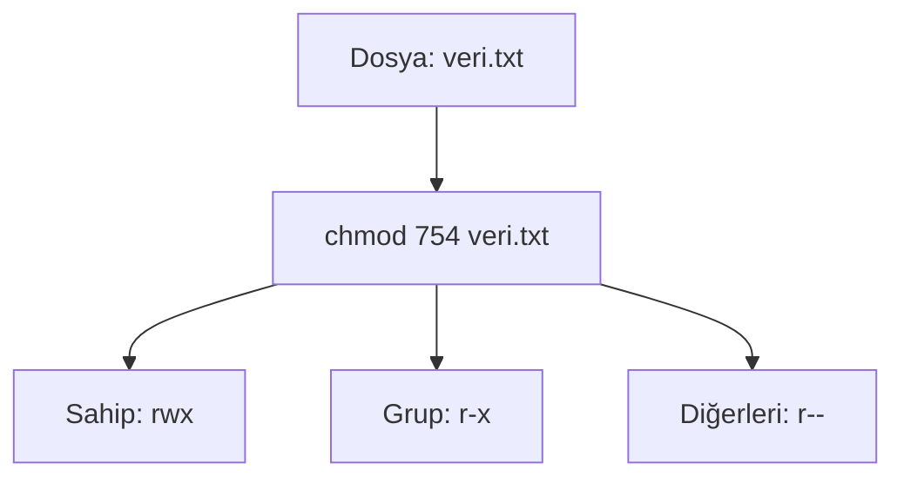

# Kullanıcı Yönetimi ve İzinler

## 🎯 Bu Derste Ne Öğreneceğiz?

Bu derste, Linux sisteminde kullanıcı ve grup kavramlarını tanıyacak; dosya ve dizin izinlerini (okuma, yazma, çalıştırma) `chmod` komutu ile değiştirmeyi öğreneceksiniz. Ayrıca dosya sahibi (`chown`) değişimini deneyimleyecek; sistem güvenliği açısından izinlerin neden kritik olduğunu anlayacaksınız.

## 💡 Neden Bu Konuyu Öğreniyoruz?

Veri biliminde birden fazla kullanıcı veya ekip ile çalışırken, dosyaların doğru kişilere erişilebilir olması gerekir. Bir veri dosyasının yanlışlıkla silinmesini veya değiştirilmesini önlemek için izinleri doğru ayarlamak, sistem güvenliğinin temelidir. Bu ders, ilerleyen haftalarda sistem bakımı ve yedekleme görevlerinde karşılaşacağınız erişim sorunlarını anlamanız için gerekli olur.

> [!IMPORTANT]
> Yanlış izin ayarları sisteminizi güvenliksiz hale getirebilir. Örneğin herkese yazma izni (`777`) vermek, yetkisiz kullanıcıların dosyaları değiştirmesine izin verir. Her zaman en düşük gerekli izni verin.

## Ön Bilgi

Bu dersi takip etmek için önceki haftalarda öğrenilen temel komutları (`ls`, `pwd`, `cd`) ve dosya sistemi kavramlarını bilmeniz yeterlidir. Ayrıca `sudo` komutunun ne işe yaradığını bilmiyorsanız basit bir açıklama yeterlidir: sistem yöneticisi (root) yetkisiyle komut çalıştırmanızı sağlar.

## Kavramlar

### Kullanıcı ve Grup (User and Group)

Her dosya ve dizin bir sahip kullanıcıya (`user`) ve bir sahip gruba (`group`) aittir. Ayrıca her dosya üç izin kümesine sahiptir: sahip (`user`), grup (`group`) ve diğerleri (`others`).

### İzin Türleri

| Harf | Anlamı | Sayısal Değer |
|---|---|---|
| `r` | Okuma (read) | 4 |
| `w` | Yazma (write) | 2 |
| `x` | Çalıştırma (execute) | 1 |

Bir dosyanın izinleri `rw-r--r--` şeklinde gösterilir: sahip (`rw-`), grup (`r--`), diğerleri (`r--`).

### `chmod` Komutu

`chmod` komutu dosya izinlerini değiştirir. Örneğin `chmod 754 dosya.txt` aşağıdaki anlamına gelir:
- Sahip: 7 → `rwx` (okuma, yazma, çalıştırma)
- Grup: 5 → `r-x` (okuma, çalıştırma)
- Diğerleri: 4 → `r--` (sadece okuma)

## 🔍 Birlikte Keşfedelim

Terminalinizi açın ve şu adımları izleyin:

1. `pwd` ile mevcut dizininizi kontrol edin.
2. `ls -l` komutuyla mevcut dizindeki dosyaların izinlerini gözlemleyin. İlk sütundaki harfleri (`-`, `d`, `r`, `w`, `x`) not edin.
3. `touch test.txt` ile yeni bir dosya oluşturun.
4. `chmod 777 test.txt` komutunu çalıştırın. `ls -l test.txt` ile sonucu doğrulayın.
5. `chmod 644 test.txt` ile izinleri daha güvenli bir değere düşürün.

Tahmin edin: `chmod 777` ile `chmod 644` arasındaki fark, sistem güvenliği açısından neden önemlidir?

Şimdi `ls -l test.txt` komutunu çalıştırarak izinlerin değiştiğini gözlemleyin.

## 🛠️ Uygulama

Aşağıdaki görevleri sırayla tamamlayın:

1. `mkdir guvenli_dizin` ile yeni bir dizin oluşturun.
2. `touch guvenli_dizin/ozel.txt` ile içine bir dosya oluşturun.
3. `chmod 700 guvenli_dizin` komutuyla dizin izinlerini sadece sahibine verin.
4. `ls -ld guvenli_dizin` ile sonucu doğrulayın.
5. `chmod 755 guvenli_dizin` ile izinleri yeniden düzenleyin.

> [!NOTE]
> `chmod` komutuyla dizin izinlerini ayarlarken, `x` izni dizine giriş yapmak için gereklidir. `700` izinli bir dizine sahip kullanıcı girebilir; diğerleri giremez.

## 🧪 Deneyelim ve Gözlemleyelim

Şu deneyleri yapın:

1. `chown kullanıcı:test.txt` komutuyla dosya sahibini değiştirin (sadece `sudo` ile yetkiniz varsa). Eğer yetkiniz yoksa `sudo chown ...` kullanın.
2. `ls -l test.txt` ile yeni sahibin göründüğünü doğrulayın.
3. `chmod u+x test.txt` ile sadece sahibi çalıştırma izni verin; `ls -l` ile sonucu gör.

> [!WARNING]
> `chown` komutunu yanlış kullanıcı adıyla çalıştırırsanız dosya sahibi değişebilir ve dosyaya erişiminizi kaybedebilirsiniz. Kararsızsanız önce yedek alın.

## Bir Şeyler Ters Giderse

İzin değişikliği çalışmazsa:

1. `whoami` ile hangi kullanıcı olduğunuzu kontrol edin.
2. `ls -l` ile dosyanın mevcut izinlerini doğrulayın.
3. Eğer `chmod` hatası alıyorsanız (`Operation not permitted`), dosyanın sahibi siz değilsiniz demektir; önce `sudo` kullanın veya sahibin değiştirin.
4. `man chmod` ile komutun yardım sayfasını okuyun.

> [!TIP]
> `ls` çıktısında `.` (nokta) ile başlayan dosyalar gizlidir; izin kontrolü yaparken `ls -la` komutunu kullanmak daha kapsamlı sonuç verir.

## Kendin Dene

Aşağıdaki görevleri kendi Linux sisteminizde deneyin:

1. `mkdir test_izin` dizinini oluşturun; içine `touch gizli.txt` ile dosya oluşturun.
2. `chmod 750 test_izin` ile dizin izinlerini ayarlayın.
3. `ls -ld test_izin` ile sonucu gözlemleyin; `rwx`, `r-x`, `---` anlamlarını açıklayın.

Cevapları göster

1. `chmod 750 test_izin`: sahip (`rwx`), grup (`r-x`), diğerleri (`---`).
2. `ls -ld` çıktısında ilk sütun `drwxr-x---` görünür; `d` dizin, `rwx` sahip, `r-x` grup, `---` diğerleri.

## 🧠 Öğrendiklerini Kontrol Et

1. `chmod 644` ne anlama gelir?
2. `chown` komutu ne işe yarar?
3. Bir dizine giriş yapmak için hangi izin gereklidir?

Cevapları göster

1. `644`: sahip (`rw-`), grup (`r--`), diğerleri (`r--`).
2. `chown` dosya veya dizin sahibini değiştirir.
3. `x` (çalıştırma) izni gereklidir.

## Bağımsız Çalışma

Kendi Linux sisteminizde şu bağımsız çalışmayı tamamlayın:

- `mkdir proje` ile yeni bir dizin oluşturun.
- İçine `touch veri.csv` ile bir dosya oluşturun.
- `chmod 700 proje` ile dizin izinlerini ayarlayın; ardından `ls -ld proje` ile sonucu not edin.
- `mkdir proje/alt` ile alt dizin oluşturun; `ls -l proje` ile içeriği listeleyin. Alt dizin oluşturulabiliyor mu? Cevap: evet, çünkü `x` izni dizine girişe izin verir; `w` izni yeni dizin oluşturmayı sağlar.

## Daha Fazlasını Öğrenmek

- Linux Dosya İzinleri: [Linux Foundation](https://www-linuxfoundation-org.translate.goog/blog/blog/classic-sysadmin-understanding-linux-file-permissions?_x_tr_sl=en&_x_tr_tl=tr&_x_tr_hl=tr&_x_tr_pto=tc)
- `chmod` yardım sayfası: `man chmod` (yerel yardım; terminalde `man chmod` ile erişilir)

## Kısa Özet

Bu derste kullanıcı ve grup kavramlarını öğrendiniz; dosya izinlerini `chmod` ile değiştirebiliyor, `chown` ile sahip değiştirebiliyorsunuz. İzinlerin sistem güvenliği açısından neden kritik olduğunu anladınız. Bir sonraki derste farklı Linux dağıtımlarını karşılaştıracağız.

---

← [Temel Komutlar ve Dosya Sistemi](02-File-Operations.md) | [Farklı Dağıtımlar →](04-Distributions.md)
