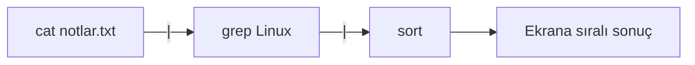

# Dosya İçeriği, Metin Düzenleme, Boru ve Kılavuz

## 🎯 Bu Bölümde Ne Öğreneceğiz?

Bu bölümü bitirdiğinde şunları yapabileceksin:

- Bir dosyanın içeriğini `cat`, `less`, `head` ve `tail` ile
  görüntüleyebileceksin.
- `nano` metin düzenleyicisiyle dosya oluşturup düzenleyebileceksin.
- `grep`, `wc` ve `sort` ile metin içinde arama, sayma ve sıralama yapabileceksin.
- Boru (`|`) kullanarak komutların çıktısını birbirine bağlayabileceksin.
- Yönlendirme (`>`, `>>`, `<`) ile çıktıyı dosyaya yazabileceksin.
- `man`, `--help` ve `apropos` ile bir komutun kullanımını kendi başına
  öğrenebileceksin.

## 💡 Neden Bu Konuyu Öğreniyoruz?

Bir sistemde işinin büyük bir bölümü metinlerle geçer: yapılandırma dosyaları,
günlük kayıtları, listeler, notlar. Bu metinleri okuyabilmek, içinde arama
yapabilmek ve bir komutun çıktısını başka bir komuta besleyebilmek, Linux'un en
güçlü olduğu alandır.

Bu bölümde öğreneceğin boru ve yönlendirme fikri, küçük komutları birleştirip
büyük işler yapmanın yolunu açar. Ayrıca `man` sayfalarını okumayı öğrenmek,
seni bana ya da başkasına bağımlı olmaktan kurtarır: Artık herhangi bir komutun
nasıl çalıştığını kendi başına keşfedebilirsin.

## 📌 Ön Bilgi

Bu bölüm, 3. bölümde öğrendiğin dosya işlemlerine dayanır. Bir dosyayı
oluşturmayı, listelemeyi ve yolunu yazmayı biliyorsan hazırsın. Denemeleri yine
ev dizinindeki kendi klasöründe yapacağız.

## 📖 Kavramlar

### Üç akış: stdin, stdout, stderr

Her komut aslında üç akışla çalışır:

- **Standart giriş (stdin):** Komutun okuduğu veri. Genellikle klavyeden gelir.
- **Standart çıktı (stdout):** Komutun ürettiği normal sonuç. Genellikle ekrana
  gider.
- **Standart hata (stderr):** Komutun ürettiği hata mesajları.

Bu akışları yönlendirebildiğimizde komutlar birbirine bağlanabilir hâle gelir.

### Boru ve yönlendirme

**Boru (pipe),** bir komutun çıktısını doğrudan başka bir komutun girişine
verir. `|` işaretiyle gösterilir. Bir boru hattı, suyun borulardan akması gibi
veriyi komuttan komuta taşır.

**Yönlendirme (redirection),** bir akışı ekran yerine bir dosyaya (ya da
dosyadan komuta) yönlendirir:

- `>` -> çıktıyı dosyaya yazar, **varsa dosyanın içeriğini silip baştan yazar.**
- `>>` -> çıktıyı dosyanın **sonuna ekler.**
- `<` -> komutun girdisini bir dosyadan okur.



Yukarıdaki hatta `cat`, dosyanın içeriğini üretir; `grep` bu içerikte "Linux"
geçen satırları süzer; `sort` kalan satırları sıralar. Üç küçük komut, tek bir
anlamlı işe dönüşür.

> [!IMPORTANT]
> `>` ile `>>` arasındaki fark hayati olabilir. `>` hedef dosyanın mevcut
> içeriğini **siler**; `>>` yalnızca sonuna ekler. Dosyaya bir şey eklemek
> istiyorsan `>>` kullan.

## 🔍 Birlikte Keşfedelim

Önce bir deneme dosyası oluşturup içini dolduralım. Aşağıdaki komutlardan sonra
ne olacağını tahmin etmeyi sürdür.

```bash
cd ~/linux_deneme
echo "elma" > meyveler.txt
echo "armut" >> meyveler.txt
echo "muz" >> meyveler.txt
```

Sence `meyveler.txt` dosyasının son hâli nasıl görünür: tek satır mı, üç satır mı?
Peki ikinci komutta `>` yerine `>>` kullanmasaydık ne olurdu?

Tahminini netleştirdikten sonra dosyayı oku:

```bash
cat meyveler.txt
```

Üç satır gördüysen boru ve yönlendirmenin temel fikrini yakaladın demektir.
Birinci komut dosyayı oluşturdu, sonraki ikisi sonuna ekledi.

## 🛠️ Uygulama

### 1. Adım: İçeriği görüntüle

Bir dosyanın tüm içeriğini görüntülemek için `cat` kullanılır:

```bash
cat meyveler.txt
```

Uzun dosyalarda `cat` ekranı doldurur. Bu durumda sayfa sayfa gezinmek için
`less` kullanılır:

```bash
less /etc/services
```

`less` içinde gezinmek için boşluk tuşuyla ilerler, `b` ile geri gider, `q` ile
çıkarsın.

Bir dosyanın yalnızca başını ya da sonunu görmek için:

```bash
head /etc/services
tail /etc/services
```

`head` ilk satırları, `tail` son satırları gösterir. Varsayılan olarak onar
satır yazdırırlar; `head -n 3 /etc/services` gibi seçenekle sayıyı
değiştirebilirsin.

### 2. Adım: Metni düzenle

`nano`, terminalde çalışan basit bir metin düzenleyicisidir. Yeni bir dosya
açalım:

```bash
nano plan.txt
```

Ekranda bir düzenleme alanı açılır. Şu satırları yaz:

```text
Linux ogreniyorum
Terminal benim icin yeni
Ama her gun ilerliyorum
```

Kaydetmek için `Ctrl` + `O`, ardından Enter'a bas. Çıkmak için `Ctrl` + `X`.
Ekranın altındaki kısa kılavuz, hangi tuşun ne yaptığını sürekli hatırlatır;
`^` işareti `Ctrl` anlamına gelir.

### 3. Adım: Ara, say, sırala

Metin araçları, dosya üzerinde hızlı işlem yapmanı sağlar:

```bash
grep "Linux" plan.txt
wc plan.txt
sort meyveler.txt
```

- `grep`, verilen kelimeyi içeren satırları bulur.
- `wc` (word count), satır, kelime ve karakter sayısını verir.
- `sort`, satırları alfabetik sıralar.

### 4. Adım: Komutları boruyla birleştir

Şimdi tek tek çalışan bu komutları bir hatta bağlayalım:

```bash
cat meyveler.txt | sort | head -n 2
```

Bu komut, dosyayı okur, alfabetik sıralar ve ilk iki satırını gösterir. Tek
satırda üç iş yaptık. İstediğin sonuca göre boruyu uzatıp kısaltabilirsin.

### 5. Adım: Çıktıyı dosyaya yönlendir

```bash
ls /etc > etc_listesi.txt
cat etc_listesi.txt
```

`ls` çıktısı artık ekranda değil, dosyada. Aynı çıktıyı başka bir komuta da
besleyebilirsin:

```bash
ls /etc | grep "conf"
```

Bu satır, `/etc` içindeki adında "conf" geçen dosyaları listeler. Yönlendirme
ile boru arasındaki farkı hisset: `>` sonucu bir dosyaya yazar, `|` sonucu başka
bir komuta verir.

### 6. Adım: Kılavuzu oku

Bir komutun ne yaptığını unuttuysan iki temel kaynağın var:

```bash
man grep
date --help
```

- `man`, bir komutun ayrıntılı kılavuz sayfasını açar. İçinde `q` ile
  çıkarsın, `/` ile arama yaparsın.
- `--help` seçeneği, komutun kısa kullanım özetini gösterir.

Ne yapacağını hiç bilmiyorsan, `apropos` sana yol gösterir:

```bash
apropos "list files"
```

`apropos`, kılavuz açıklamalarında arama yapar ve ilgili komutları listeler.

> [!TIP]
> `man` sayfaları başta yoğun ve teknik görünür. Hemen hepsinin "NAME"
> (ad) bölümü bir iki cümleyle komutun ne yaptığını söyler. Zorlandığında
> yalnızca bu bölümü okumak bile işini görür.

## 🧪 Deneyelim ve Gözlemleyelim

Yönlendirme davranışını bizzat gözlemleyelim. Şu komutları sırayla çalıştır:

```bash
echo "satir 1" > deneme.txt
echo "satir 2" >> deneme.txt
cat deneme.txt
echo "yeni icerik" > deneme.txt
cat deneme.txt
```

Son `cat` komutunda ne görüyorsun? Dosya artık yalnızca "yeni icerik" içeriyor.
Çünkü `>` dosyayı baştan yazdı ve önceki iki satırı sildi. Şimdi aynısını `>>`
ile yap ve farkı gör.

Bir de şunu dene: `sort` komutuna dosya vermeden çağırıp boruyla besle. Aynı
sonucu verip vermediğini gözlemle.

## ⚠️ Bir Şeyler Ters Giderse

**Belirti:** Bir dosyaya ekleme yapmak isterken içeriğinin tamamen silindiğini
fark ettin.

**Olası neden:** Ekleme için `>>` yerine yanlışlıkla `>` kullandın.

**Ne yapmalısın:** Ne yazık ki `>` ile silinen içerik geri gelmez. Bu yüzden
yönlendirme yapmadan önce her zaman "ekliyor muyum, baştan mı yazıyorum?"
sorusunu sor. Kritik dosyaların yedeğini tut.

**Belirti:** `less` ya da `man` içinde sıkışıp kaldın, komut satırına dönemiyorsun.

**Olası neden:** Bu programlar tam ekran çalışır ve çıkmak için belirli bir
tuşu bekler.

**Ne yapmalısın:** `q` tuşuna bas. `q`, "quit" yani çık anlamına gelir ve seni
komut satırına döndürür.

## ✍️ Kendin Dene

**Görev:** `notlar` adlı bir dosya oluştur ve içine beş alışveriş maddesi yaz.
Sonra dosyayı sırala ve yalnızca ilk üç maddeyi görüntüle. En son, `sort`
çıktısını `sirali_notlar.txt` adlı yeni bir dosyaya kaydet.

<details>
<summary>İpucu göster</summary>

Dosyayı `nano` ile oluşturabilirsin. Sıralama ve ilk üç satırı gösterme işini
boru ile birleştirebilirsin: `sort dosya | head -n 3`.

</details>

<details>
<summary>Örnek çözüm göster</summary>

```bash
nano notlar
# içine beş madde yaz ve kaydet

sort notlar | head -n 3
sort notlar > sirali_notlar.txt
cat sirali_notlar.txt
```

İlk komut sıralı listenin ilk üç maddesini ekranda gösterir; ikincisi tüm
sıralı listeyi yeni bir dosyaya yazar. Aradaki farkı gözlemle: biri ekrana,
diğeri dosyaya.

</details>

## 🧠 Öğrendiklerini Kontrol Et

1. `>` ile `>>` arasındaki fark nedir? Yanlış olanı kullanırsan ne olur?
2. Boru (`|`) ile yönlendirme (`>`) arasındaki farkı açıkla.
3. Bir dosyanın yalnızca son 5 satırını görmek için hangi komutu kullanırsın?
4. `grep`, `wc` ve `sort` komutları ne işe yarar?
5. Bir komutun tüm ayrıntılarını öğrenmek için hangi aracı kullanırsın?

<details>
<summary>Cevapları göster</summary>

1. `>` hedef dosyanın içeriğini silip baştan yazar; `>>` içeriği koruyup sonuna
   ekler. Yanlışlıkla `>` kullanırsan mevcut içerik geri dönüşsüz silinir.
2. Boru, bir komutun çıktısını başka bir komuta verir. Yönlendirme ise çıktıyı
   bir dosyaya yazar ya da girdiyi bir dosyadan okur.
3. `tail -n 5 dosya_adi`.
4. `grep` metin arar, `wc` satır-kelime-karakter sayar, `sort` satırları
   sıralar.
5. `man komut_adi` komutu ayrıntılı kılavuzu açar; `komut --help` ise kısa
   kullanım özetini gösterir.

</details>

## 🚀 Bağımsız Çalışma

1. **Araştırma görevi:** `man` sayfasını kullanarak `head` komutunun `-n`
   seçeneğinin ne yaptığını öğren ve bir örnekle göster.
2. **Birleştirme görevi:** `/etc` dizinindeki dosyalardan adında "conf" geçenleri
   listeleyip bu listeyi alfabetik sırala ve `conf_listesi.txt` dosyasına kaydet.
   Bunu tek bir boru hattıyla yapmaya çalış.

Bu görevler, komutları birleştirerek tek satırda iş bitirme alışkanlığı
kazandırır.

## 📚 Daha Fazlasını Öğrenmek

- GNU coreutils kılavuzu (cat, head, tail, sort, wc): <https://www.gnu.org/software/coreutils/manual/>
- GNU grep kılavuzu: <https://www.gnu.org/software/grep/manual/>
- GNU nano düzenleyicisi: <https://www.nano-editor.org>
- Ubuntu man sayfaları: <https://manpages.ubuntu.com>

## 📝 Kısa Özet

- `cat`, `less`, `head`, `tail` bir dosyanın içeriğini farklı biçimlerde
  görüntüler.
- `nano`, terminalde çalışan sade bir metin düzenleyicisidir.
- `grep` arar, `wc` sayar, `sort` sıralar.
- Boru (`|`) komutları birbirine bağlar; yönlendirme (`>`, `>>`, `<`) akışı
  dosyaya yönlendirir.
- `man`, `--help` ve `apropos` ile herhangi bir komutu kendi başına
  öğrenebilirsin.

[Önceki bölüm: Dosya Sistemi, Dizin Yapısı ve Dosya İşlemleri](03-File-System-Basics.md) | [İçindekiler](../README.md) | [Sonraki bölüm: Sahiplik, İzinler, Kullanıcı ve Grup Yönetimi](05-Permissions-And-Users.md)
