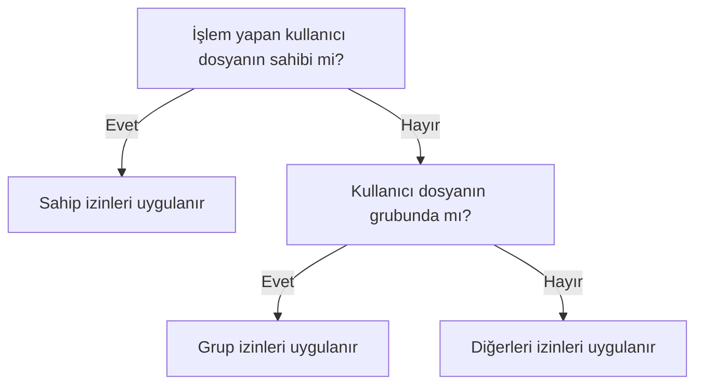

# Sahiplik, İzinler, Kullanıcı ve Grup Yönetimi

## 🎯 Bu Bölümde Ne Öğreneceğiz?

Bu bölümü bitirdiğinde şunları yapabileceksin:

- Kullanıcı, grup ve `root` kavramlarını açıklayabileceksin.
- `ls -l` çıktısındaki izinleri okuyup yorumlayabileceksin.
- `chmod` ile izinleri hem sembolik hem sayısal yöntemle değiştirebileceksin.
- `chown` ve `chgrp` ile sahiplik ve grubu değiştirebileceksin.
- `umask` ile yeni dosyaların varsayılan izinlerini anlayabileceksin.
- `adduser` ve `passwd` ile kullanıcı oluşturup parola belirleyebileceksin.
- `sudo` ile yönetici yetkisi gerektiren işlemleri güvenli biçimde
  yapabileceksin.

## 💡 Neden Bu Konuyu Öğreniyoruz?

Bir bilgisayarı tek kişi kullanıyorsa "kim neyi yapabilir?" sorusu gereksiz
görünebilir. Ama aynı sistemi birden çok kişi kullanabilir; üstelik sistemin
kendi servisleri de farklı kullanıcılar olarak çalışır. Yanlış bir izin
ayarı, ya önemli bir dosyanın silinmesine ya da bir saldırganın sisteme
sızmasına yol açabilir.

İzinleri anlamak, "neden bu dosyayı değiştiremiyorum?" sorusunun cevabıdır.
Ayrıca `sudo` kavramı, sistemde tehlikeli işlemleri bilinçli ve kontrollü
yapmanın anahtarıdır. Bu bölüm, hem günlük kullanım hem de güvenlik açısından
kursun en kritik parçalarından biridir.

## 📌 Ön Bilgi

Bu bölüm, 3. ve 4. bölümlerde öğrendiğin dosya kavramlarına dayanır. Bir dosyayı
listelemeyi, oluşturmayı ve içeriğini görmeyi biliyorsan hazırsın. Ayrıca
2. bölümdeki kabuk isteminde `$` yerine `#` işaretinin görünebileceğini
hatırla; bu bölümde bunun nedenini öğreneceksin.

## 📖 Kavramlar

### Kullanıcı, grup ve root

Linux, çok kullanıcılı bir sistemdir. Her kullanıcının bir **kullanıcı adı
(username)** ve bir kullanıcı numarası (UID) vardır. Kullanıcılar, dosyalara
erişimi kolay yönetmek için **gruplar (groups)** altında toplanır.

Her sistemde bir de **root** kullanıcısı vardır. `root`, sistemdeki en yetkili
kullanıcıdır ve her şeyi yapabilir. Günlük işlerini `root` olarak yapmak
tehlikelidir; küçük bir hata bile sistemi bozabilir. Bunun yerine normal
kullanıcı olarak çalışır, yalnızca gerçekten gerektiğinde `sudo` ile geçici
olarak yönetici yetkisi alırsın.

**sudo (superuser do),** "bu tek komutu yönetici yetkisiyle çalıştır" demektir.
`sudo` kullandığında sistem senden parolanı ister ve komutu root yetkisiyle
çalıştırır. Bu yüzden `sudo` ile yazdığın komutun ne yaptığını mutlaka bilmelisin.

### Sahip, grup ve diğerleri

Linux'ta her dosyanın bir **sahibi (owner)** ve bir **grubu (group)** vardır.
Dosyaya erişim üç kesim için ayrı ayrı tanımlanır:

- **Sahip (user):** Dosyanın sahibi olan kullanıcı.
- **Grup (group):** Dosyanın grubuna dahil olan kullanıcılar.
- **Diğerleri (others):** Geri kalan herkes.

### İzinler: okuma, yazma, çalıştırma

Her kesim için üç izin ayrı ayrı verilebilir:

| Sembol | Anlamı | Sayısal değer |
|---|---|---|
| `r` | read (okuma) | 4 |
| `w` | write (yazma) | 2 |
| `x` | execute (çalıştırma) | 1 |

`ls -l` çıktısının ilk sütunu, bu izinleri on karakterlik bir dizgeyle gösterir.
Örneğin `-rwxr-xr--` şöyle okunur:

```text
-  rwx  r-x  r--
|   |    |    |
|   |    |    └── diğerleri: sadece okuma (4)
|   |    └─────── grup: okuma + çalıştırma (5)
|   └──────────── sahip: okuma + yazma + çalıştırma (7)
└──────────────── dosya türü (- normal dosya, d dizin)
```

Bir izni yorumlamak için şu akışı izleyebilirsin:



Yani sistem, önce "sahip misin?", değilsen "grup'ta mısın?", o da değilse
"diğerlerindensin" diye bakar ve o kesime tanımlı izinleri uygular.

### Kullanıcı bilgilerinin tutulduğu dosyalar

Sistemdeki kullanıcı ve grup bilgileri üç dosyada saklanır:

- `/etc/passwd` -> kullanıcı hesapları hakkında temel bilgiler.
- `/etc/shadow` -> şifrelenmiş parolalar (yalnızca root okuyabilir).
- `/etc/group` -> gruplar ve üyeleri.

Bu dosyaları incelemek öğreticidir, ama doğrudan elle düzenlemek yerine her
zaman komutları kullanmak daha güvenlidir.

## 🔍 Birlikte Keşfedelim

Şu komutu çalıştırmadan önce bir tahmin yürüt:

```bash
ls -l /etc/passwd
```

Sence bu dosyanın sahibi kim olabilir? Normal bir kullanıcı bu dosyayı
değiştirebilir mi?

Şimdi çalıştır ve ilk sütuna bak. Muhtemelen `-rw-r--r--` gibi bir izin
göreceksin: sahibi (root) okuyup yazabilir, diğer herkes yalnızca okuyabilir.
Peki neden yazma izni yalnızca sahipte? Çünkü bu dosya sistemin kullanıcı
veritabanıdır; herkesin değiştirebilmesi, herkesin hesap açıp kapatabilmesi
anlamına gelirdi.

Şimdi bir de kendi oluşturduğun dosyaya bak:

```bash
ls -l ~/linux_deneme/plan.txt
```

Sahibi sensin ve genellikle hem okuma hem yazma iznin vardır. İki çıktıyı
karşılaştır: aynı sistem, aynı izin dili, ama farklı güvenlik kararları.

## 🛠️ Uygulama

### 1. Adım: İzinleri görüntüle

```bash
cd ~/linux_deneme
touch gizli_bilgi.txt
ls -l gizli_bilgi.txt
```

Yeni oluşturulan dosyalar genellikle `-rw-rw-r--` ya da `-rw-r--r--` gibi
gelir. Çıktıyı yukarıdaki şemaya göre oku.

### 2. Adım: İzinleri sembolik yöntemle değiştir

```bash
chmod g-w gizli_bilgi.txt
ls -l gizli_bilgi.txt
```

`g-w`, "grup (g) için yazma (−w) iznini kaldır" demektir. Benzer biçimde:

- `u+x` -> sahibe çalıştırma izni ekle.
- `o-r` -> diğerlerinden okuma iznini kaldır.
- `a+r` -> herkese (all) okuma izni ekle.

### 3. Adım: İzinleri sayısal yöntemle değiştir

Aynı işi üç sayıyla da yapabilirsin. Her basamak bir kesimin izinlerini
toplamıyla ifade eder:

```bash
chmod 640 gizli_bilgi.txt
ls -l gizli_bilgi.txt
```

`640` şu anlama gelir: sahip `6` (4+2, oku+yaz), grup `4` (oku), diğerleri `0`
(hiçbir şey). Sonuç `-rw-r-----` olacaktır.

> [!CAUTION]
> `chmod 777` komutu herkese her izni verir: okuma, yazma ve çalıştırma. Bu,
> hızlı çözüm gibi görünse de ciddi bir güvenlik açığıdır. Gerçek bir sorunu
> çözmek için "herkese açalım" demek yerine, tam olarak hangi iznin gerektiğini
> düşün.

### 4. Adım: Sahiplik ve grubu değiştir

Sahiplik değiştirmek genellikle yönetici yetkisi gerektirir:

```bash
ls -l gizli_bilgi.txt
sudo chown root gizli_bilgi.txt
ls -l gizli_bilgi.txt
```

`chown` sahibi, `chgrp` ise grubu değiştirir. İlk komutta `sudo` kullanmamızın
nedeni, bir dosyayı başka bir kullanıcıya (burada `root`) devretmenin yönetici
yetkisi istemesidir. Sahibi tekrar kendine almak için:

```bash
sudo chown $USER gizli_bilgi.txt
```

> [!NOTE]
> `$USER` ifadesi, o an oturum açmış kullanıcı adını otomatik olarak yazar.
> Ortam değişkenlerini (environment variables) ve `$` ile başlayan bu tür
> ifadeleri 11. bölümde ayrıntılı öğreneceğiz.

### 5. Adım: Varsayılan izinleri anla (umask)

Yeni oluşturulan dosyaların izinleri rastgele değildir; bir **umask** değeriyle
belirlenir. Umask, "hangi izinlerin **verilmeyeceğini**" söyler:

```bash
umask
```

Muhtemelen `0022` ya da `0002` gibi bir değer görürsün. `0022`, grup ve
diğerlerinden yazma iznini kaldırır; bu yüzden yeni dosyalar genellikle `644`
ile başlar.

### 6. Adım: Yeni bir kullanıcı oluştur

Şimdi sisteme yeni bir kullanıcı ekleyelim. Bu işlem yönetici yetkisi ister:

```bash
sudo adduser deneme_kullanici
```

Sihirbaz sana parola ve birkaç bilgi soracak. Ardından bilgilerin tutulduğu
dosyaya bak:

```bash
grep deneme_kullanici /etc/passwd
```

Kullanıcının parolasını sonradan değiştirmek için `sudo passwd deneme_kullanici`
komutunu kullanabilirsin. Kullanıcıyı silmek için `sudo deluser deneme_kullanici`
kullanılır; bu kursun denemelerinde oluşturduğun fazladan kullanıcıları
silmeyi unutma.

> [!IMPORTANT]
> `sudo` ile çalıştırdığın her komut, sistemi bozma gücüne sahiptir. Komutu
> yazmadan önce "gerçekten bunu mu istiyorum?" diye sor. Özellikle `rm`, `chown`
> ve `chmod` komutlarını sistem dizinlerinde `sudo` ile kullanırken çok dikkatli
> ol.

## 🧪 Deneyelim ve Gözlemleyelim

İzinlerin gerçekten erişimi nasıl etkilediğini gözlemleyelim.

```bash
touch deneme_izni.txt
chmod 000 deneme_izni.txt
cat deneme_izni.txt
```

Son komutta ne oldu? `000` izniyle hiç kimse (sahibi bile) dosyayı okuyamaz;
çıktıda "Permission denied" hatası görürsün. Şimdi izni geri ver:

```bash
chmod 600 deneme_izni.txt
cat deneme_izni.txt
```

Bu kez hata yok, çünkü sahibe okuma iznini geri verdik. Bu deney, iznin soyut
bir kavram değil, doğrudan erişimi belirleyen bir kapı olduğunu gösterir.

## ⚠️ Bir Şeyler Ters Giderse

**Belirti:** Yapmak istediğin işlemde `Permission denied` hatası alıyorsun ve
komut yönetici yetkisi istiyor.

**Olası neden:** Sistem dosyalarını değiştirmeye çalışıyorsun ama normal
kullanıcı olarak buna yetkin yok.

**Ne yapmalısın:** Komutun gerçekten yönetici yetkisi gerektirdiğinden emin
olduysan başına `sudo` ekle. Ancak `sudo`'nun bir çözüm değil, bir sorumluluk
olduğunu unutma.

**Belirti:** `sudo` komutu "kullanıcı sudoers dosyasında değil" benzeri bir
hata veriyor.

**Olası neden:** Kullandığın kullanıcıya yönetici yetkisi verilmemiş.

**Ne yapmalısın:** Bu durum genellikle sistem kurulumunda belirlenir. Kurulumda
oluşturduğun ilk kullanıcı genellikle bu yetkiye sahiptir; başka bir kullanıcıda
bu hatayı alıyorsan o kullanıcıyı uygun gruba eklemek gerekir.

**Belirti:** Yanlışlıkla bir dosyanın sahibini değiştirdin ve artık
kullanamıyorsun.

**Ne yapmalısın:** `sudo chown $USER dosya_adi` ile sahipliği kendine geri al.

## ✍️ Kendin Dene

**Görev:** `paylasilan.txt` adlı bir dosya oluştur. İznini öyle ayarla ki sahibi
oku-yaz-çalıştır, grup oku-çalıştır, diğerleri yalnızca okuma yetkisine sahip
olsun. Sonra bu izni hem sembolik hem sayısal yöntemle ifade et.

<details>
<summary>İpucu göster</summary>

Sahip için `7`, grup için `5`, diğerleri için `4` değerini düşün. Sembolik
gösterimde `u=rwx`, `g=rx`, `o=r` kullanabilirsin.

</details>

<details>
<summary>Örnek çözüm göster</summary>

```bash
touch paylasilan.txt

# Sayısal yöntem
chmod 754 paylasilan.txt

# Sembolik yöntem (aynı sonuç)
chmod u=rwx,g=rx,o=r paylasilan.txt

ls -l paylasilan.txt   # -rwxr-xr-- beklenir
```

Sayısal ve sembolik yöntem aynı sonucu verir; hangisini kullanacağın tercih
meselesidir. Sayısal yöntem hızlı, sembolik yöntem ise tek bir izni değiştirmek
istediğinde daha okunaklıdır.

</details>

## 🧠 Öğrendiklerini Kontrol Et

1. `root` kullanıcısı ile normal bir kullanıcı arasındaki fark nedir?
2. `sudo` ne işe yarar ve neden her komutu `sudo` ile çalıştırmamalıyız?
3. `-rw-r-----` iznini sahip, grup ve diğerleri açısından açıkla.
4. `chmod 640` komutu hangi izinleri verir?
5. `umask` kavramı neyi belirler?

<details>
<summary>Cevapları göster</summary>

1. `root`, sistemdeki en yetkili kullanıcıdır ve her şeyi yapabilir. Normal
   kullanıcının yetkileri sınırlıdır; sistemin kritik bölgelerine müdahale
   edemez.
2. `sudo`, tek bir komutu yönetici yetkisiyle çalıştırır. Her komutu `sudo` ile
   çalıştırmak, yanlış bir komutun tüm sisteme zarar verme riskini artırır; bu
   yüzden yalnızca gerçekten gerekli olduğunda kullanılır.
3. Sahip okuyup yazabilir (`rw-`), grup yalnızca okuyabilir (`r--`), diğerleri
   hiçbir şey yapamaz (`---`).
4. `640`: sahip oku+yaz (`6`), grup oku (`4`), diğerleri hiçbir şey (`0`).
5. `umask`, yeni oluşturulan dosya ve dizinlere hangi izinlerin
   **verilmeyeceğini** belirleyen değerdir.

</details>

## 🚀 Bağımsız Çalışma

1. **İnceleme görevi:** `/etc/shadow` dosyasının izinlerine bak (`ls -l`).
   Bu dosyayı neden yalnızca root okuyabilir? Bir cümleyle açıkla.
2. **Görev:** `adduser` ile kendi adına benzer ikinci bir kullanıcı oluştur,
   parolasını belirle ve oluştuğunu `grep` ile doğrula. Ardından aynı kullanıcıyı
   `deluser` ile sil.

Bu görevler, kullanıcı ve izin yönetimini kendi başına uygulama alışkanlığı
kazandırır.

## 📚 Daha Fazlasını Öğrenmek

- GNU coreutils kılavuzu (chmod, chown): <https://www.gnu.org/software/coreutils/manual/>
- Ubuntu man sayfaları (chmod, sudo, adduser): <https://manpages.ubuntu.com>
- The Linux Command Line (William Shotts), dosya izinleri bölümü

## 📝 Kısa Özet

- Linux çok kullanıcılı bir sistemdir; her dosyanın bir sahibi ve bir grubu
  vardır.
- `root` en yetkili kullanıcıdır; günlük işleri `sudo` ile geçici yetki alarak
  yaparsın.
- İzinler okuma (`r`), yazma (`w`) ve çalıştırma (`x`) olarak sahip, grup ve
  diğerlerine ayrı ayrı verilir.
- `chmod` izinleri, `chown` ve `chgrp` sahiplik ile grubu değiştirir.
- `umask`, yeni dosyaların varsayılan izinlerini belirler.
- `adduser`, `passwd` ve `deluser` ile kullanıcı hesaplarını yönetirsin.

[Önceki bölüm: Dosya İçeriği, Metin Düzenleme, Boru ve Kılavuz](04-Text-And-Pipes.md) | [İçindekiler](../README.md) | [Sonraki bölüm: Dağıtım Aileleri ve Masaüstü Ortamları](06-Distributions-And-Desktops.md)
