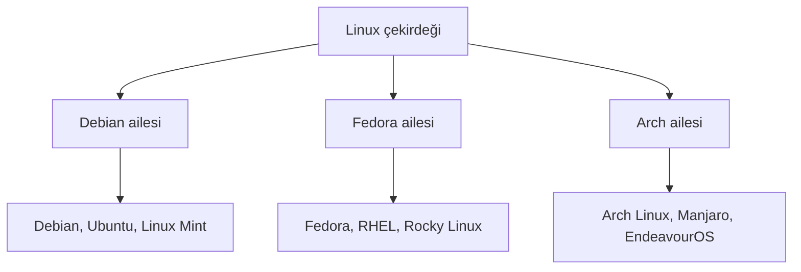

# Dağıtım Aileleri ve Masaüstü Ortamları

## 🎯 Bu Bölümde Ne Öğreneceğiz?

Bu bölümü bitirdiğinde şunları yapabileceksin:

- Dağıtım ve dağıtım ailesi kavramlarını açıklayabileceksin.
- Debian, Arch ve Fedora gibi ana dağıtım ailelerini ayırt edebileceksin.
- Kendi sisteminin hangi aileye ait olduğunu bulabileceksin.
- Cinnamon, GNOME, KDE Plasma ve XFCE masaüstü ortamlarını
  karşılaştırabileceksin.
- Kararlı sürüm ve sürekli güncellenen sürüm arasındaki farkı anlayacaksın.
- Kendi gereksinimlerine uygun bir dağıtım ve masaüstü ortamı seçimi
  yapabileceksin.

## 💡 Neden Bu Konuyu Öğreniyoruz?

İnternette bir Linux sorununa çözüm ararken karşına farklı komutlar çıkar.
Çünkü komutların bir kısmı dağıtımdan dağıtıma değişir: Bir dağıtımda yazılım
kurma komutu `apt` iken başka bir dağıtımda `pacman` ya da `dnf` olabilir. Bu
farkı bilmezsen, bulduğun çözümü yanlış sisteme uygulamaya çalışır ve kafan
karışır.

Bu bölüm, Linux dünyasının haritasını çıkarır. Hangi ailenin hangi araçları
kullandığını ve masaüstü ortamlarının nasıl farklılaştığını öğrenerek, bir
sonraki bölümde paket yönetimini üç aile için karşılaştırmalı görebileceksin.

## 📌 Ön Bilgi

Bu bölüm, 1. bölümde Linux Mint kurarken karşılaştığın seçimlere dayanır.
Sistemin çalışıyor olması ve 4. bölümde öğrendiğin `cat` komutunu
kullanabilmen yeterlidir. Bir paket kurmayacağız; bu bölüm daha çok tanıma ve
karşılaştırma üzerinedir.

## 📖 Kavramlar

### Dağıtım ve dağıtım ailesi

1. bölümden hatırlayacağın gibi **dağıtım (distribution),** Linux çekirdeğini
araçlar, bir masaüstü ortamı ve bir paket yöneticisiyle bir araya getiren hazır
pakettir. Yüzlerce dağıtım vardır, ama çoğu birkaç **aile (family)** etrafında
toplanır. Aynı ailedeki dağıtımlar benzer araçları ve paket biçimini paylaşır.

Başlıca üç aileyi tanıyalım:

- **Debian ailesi:** Debian, Ubuntu, Linux Mint, Pop!_OS gibi dağıtımları
  içerir. Paket biçimi `.deb`, paket yöneticisi `apt`'tir.
- **Fedora ailesi (Red Hat tarafı):** Fedora, RHEL, CentOS, Rocky Linux gibi
  dağıtımları içerir. Paket biçimi `.rpm`, paket yöneticisi `dnf`'tir.
- **Arch ailesi:** Arch Linux, Manjaro, EndeavourOS gibi dağıtımları içerir.
  Paket yöneticisi `pacman`'dir ve paketler kaynak koddan derlenebilir
  (AUR üzerinden).



Bu kursun temel sistemleri Linux Mint olduğu için ana ailemiz Debian'dır. Ama
diğer aileleri tanımak, internette karşılaşacağın komutları doğru bağlama
oturtmanı sağlar.

### Sürüm yaklaşımı: kararlı ve sürekli güncel

Dağıtımlar, güncellemeleri sunma bakımından ikiye ayrılır:

- **Kararlı (stable) sürümler:** Paketler uzun süre test edilir ve nadiren
  değişir. Linux Mint ve Debian bu yaklaşımı benimser. Günlük kullanım için
  idealdir.
- **Sürekli güncellenen (rolling release) sürümler:** Paketler sürekli en son
  sürüme güncellenir. Arch Linux bu yaklaşımı benimser. Güncel olmak isteyene
  hitap eder, ama daha fazla bakım gerektirir.

Mint'te "LTS" ifadesini görebilirsin; bu "Long Term Support", yani **uzun süreli
destek** demektir. Böyle bir sürüm yıllarca güvenlik güncellemesi alır.

### Masaüstü ortamı

**Masaüstü ortamı (desktop environment),** pencerelerin, panelin, menülerin ve
dosya yöneticisinin görünümünü sağlayan pakettir. Aynı Linux, farklı masaüstü
ortamlarıyla tamamen farklı görünebilir. Yaygın dört masaüstü ortamı şöyledir:

| Masaüstü ortamı | Genel izlenim | Kaynak kullanımı |
|---|---|---|
| Cinnamon | Klasik, dengeli, tanıdık | Orta |
| GNOME | Modern, sade, dokunmatik dostu | Orta-yüksek |
| KDE Plasma | Çok ayarlanabilir, zengin | Orta |
| XFCE | Hafif, hızlı, sade | Düşük |

Linux Mint'in varsayılanı Cinnamon'dur; ama Mint'in XFCE ve MATE sürümleri de
vardır. Eski ya da zayıf donanımda XFCE gibi hafif ortamlar daha akıcı çalışır.

> [!NOTE]
> Masaüstü ortamı bir zorunluluk değildir. Sunucularda genellikle hiç masaüstü
> ortamı kurulmaz; orada yalnızca terminal bulunur. Bu yüzden ilerleyen
> bölümlerde terminal becerilerinin önemi daha da artacak.

## 🔍 Birlikte Keşfedelim

Kendi sisteminin hangi aileye ait olduğunu tahmin edelim. Sence Linux Mint,
hangisidir: Debian, Fedora yoksa Arch ailesi?

Tahminini netleştirdikten sonra şu komutu çalıştır:

```bash
cat /etc/os-release
```

Çıktıda `ID`, `ID_LIKE`, `VERSION` gibi satırlar göreceksin. Özellikle
`ID_LIKE=debian` ya da `ID_LIKE=ubuntu` gibi bir satır, sistemin aile bağını
açıkça gösterir. Bu dosya, "ben kimim?" sorusunu sistemin sana cevaplamasıdır;
bir sorunun hangi dağıtıma ait olduğunu anlamak istediğinde ilk bakacağın
yerlerden biridir.

Bir de şu dosyaya bakarak sürüm yaklaşımını fark edebilirsin:

```bash
cat /etc/apt/sources.list
```

Burada sistemin hangi depoları (paket kaynaklarını) kullandığını görürsün.
Depoları ve paket yönetimini bir sonraki bölümde ayrıntılı işleyeceğiz.

## 🛠️ Uygulama

Bu bölümde doğrudan bir şey kurmuyoruz; bunun yerine bir seçim alıştırması
yapıyoruz.

### 1. Adım: Kendi sistemini tanı

Zaten sisteminin Debian ailesinde olduğunu gördün. Şimdi masaüstü ortamını
doğrula. Menüden "Ayarlar" -> "Sistem Bilgisi" ya da "Hakkında" bölümünü aç ve
masaüstü ortamının adını bul. Muhtemelen Cinnamon yazacaktır.

### 2. Adım: Aileleri keşfet

Aşağıdaki tablo, dağıtım seçerken soracağın temel soruları özetler. Kendi
kullanımın için hangi sütunun sana uyduğunu düşün.

| Soru | Debian ailesi | Fedora ailesi | Arch ailesi |
|---|---|---|---|
| Yeni başlayan için uygun mu? | Evet | Evet | Genellikle hayır |
| Paket yöneticisi | `apt` | `dnf` | `pacman` |
| Paket biçimi | `.deb` | `.rpm` | `pkg.tar.zst` |
| Güncellik | Dengeli | Güncel | En güncel |
| Bakım kolaylığı | Yüksek | Yüksek | Düşük |

### 3. Adım: Kime ne uygun?

Kendine şu soruları sor:

1. Bilgisayarım eski mi yeni mi? Eski ise hafif bir masaüstü ortamı (XFCE) daha
   uygun olabilir.
2. Kurulumda rehberliğe mi ihtiyacım var, yoksa her şeyi elimle mi
   ayarlamak istiyorum? Yeni başlıyorsan Mint gibi kararlı dağıtımlar daha
   rahattır.
3. En güncel yazılımlara mı ihtiyacım var, yoksa kararlılık mı önceliğim?
   Günlük kullanımda kararlılık genellikle daha önemlidir.

Bu sorulara verdiğin yanıtlar, aslında bir dağıtım seçme yöntemidir. Doğru
dağıtım diye tek bir şey yoktur; ihtiyaca göre değişir.


## 🧪 Deneyelim ve Gözlemleyelim

Masaüstü ortamının değiştirilebilir bir katman olduğunu düşünmek başta zor
gelebilir. Şunu yaparak bunu dene: aynı "Sistem Bilgisi" ekranında, işletim
sistemi sürümü ile masaüstü ortamı sürümünün **ayrı ayrı** yazıldığını gör.

Bu, iki katmanın birbirinden bağımsız geliştirildiğini gösterir. Yani Linux
Mint, çekirdeği ve araçları sağlar; Cinnamon ise yalnızca görünen yüzü çizer.
Başka bir dağıtım, aynı Cinnamon'u kullanabilir; aynı Mint de başka bir masaüstü
ortamıyla gelebilirdi.

Bir de şunu dene: sisteminde kurulu masaüstü ile ilgili paketleri araştır.
`apt list` çıktısını henüz öğrenmedik, ama "Ayarlar" bölümünde masaüstü
görünümüyle ilgili ne kadar çok ayar olduğunu gözlemle. Bu ayarların çoğu,
masaüstü ortamına ait.

## ⚠️ Bir Şeyler Ters Giderse

**Belirti:** İnternetten bulduğun bir çözümü uyguladın ama komut hata verdi.

**Olası neden:** Çözüm başka bir dağıtım ailesi için yazılmış olabilir.
Örneğin `pacman` komutu Debian ailesinde yoktur.

**Ne yapmalısın:** Çözümü uygulamadan önce hangi dağıtım için yazıldığını
kontrol et. Komutu kendi ailenin karşılığıyla çevirmen gerekebilir; bu
eşleştirmeyi 7. bölümde öğreneceğiz.

**Belirti:** Farklı ailelerin depo adreslerini aynı sisteme eklemeye
çalışıyorsun.

**Ne yapmalısın:** Bir sisteme yalnızca kendi ailesine ait depolar eklenmelidir.
Farklı ailelerin depolarını karıştırmak paketleri bozar ve sistemi
kullanılamaz hâle getirebilir.

## ✍️ Kendin Dene

**Görev:** Aşağıdaki üç ihtiyaç için birer dağıtım ve masaüstü ortamı seçimi
yap. Her seçimini tek bir cümleyle gerekçelendir.

1. 10 yıllık, düşük bellekli bir dizüstü bilgisayarı canlandırmak istiyorum.
2. Yeni bir yazılımcıyım, en güncel araçları denemek istiyorum.
3. Sistemi hiç kurcalamak istemiyorum; açayım ve çalışsın istiyorum.

<details>
<summary>İpucu göster</summary>

Düşük donanım için hafif masaüstü ortamları, en güncel araçlar için Arch ailesi,
kolay ve kararlı kullanım için Debian ailesi (Mint) uygun olabilir.

</details>

<details>
<summary>Örnek çözüm göster</summary>

1. Linux Mint XFCE ya da başka bir hafif dağıtım: XFCE az kaynak kullanır ve
   eski donanımda akıcı çalışır.
2. Arch Linux: sürekli güncellenen sürüm yapısıyla en yeni paketleri sunar.
3. Linux Mint Cinnamon: kurulumu kolay, kararlı ve kullanıma hazır gelir.

Bu yanıtlar tek doğru değildir; önemli olan gerekçenin ihtiyaçla tutarlı
olmasıdır.

</details>

## 🧠 Öğrendiklerini Kontrol Et

1. Dağıtım ailesi ne demektir ve neden önemlidir?
2. Debian, Fedora ve Arch ailelerinin paket yöneticilerini söyle.
3. Kararlı sürüm ile sürekli güncellenen sürüm arasındaki farkı açıkla.
4. Masaüstü ortamı nedir? İki örnek ver ve aralarındaki temel farkı belirt.
5. Yukarıdaki komutla sisteminin hangi aileye ait olduğunu nasıl
   öğrenebilirsin?

<details>
<summary>Cevapları göster</summary>

1. Aynı araçları ve paket biçimini paylaşan dağıtımların oluşturduğu gruptur.
   Bir sorunun hangi komutlarla çözüleceğini bilmek için önemlidir.
2. Debian: `apt`; Fedora: `dnf`; Arch: `pacman`.
3. Kararlı sürümler paketleri uzun süre test edip nadiren değiştirir; sürekli
   güncellenen sürümler ise paketleri sürekli en son sürüme taşır. Kararlılık
   ve güncellik arasında bir denge kurulur.
4. Masaüstü ortamı, pencerelerin ve menülerin görünümünü sağlayan katmandır.
   Örneğin Cinnamon dengeli ve klasik, XFCE ise hafif ve hızlıdır.
5. `cat /etc/os-release` komutuyla; çıktıdaki `ID_LIKE` gibi satırlar aile
   bağını gösterir.

</details>

## 🚀 Bağımsız Çalışma

1. **Araştırma görevi:** İki farklı dağıtım seç (biri Debian, biri Arch
   ailesinden) ve resmî sitelerinden ikisinin de kurulum yaklaşımını oku. Bir
   paragraflık karşılaştırma yaz.
2. **Gözlem görevi:** Kendi sisteminde kurulu olan masaüstü ortamının hangi
   bileşenlerden oluştuğunu araştır (panel, dosya yöneticisi, pencere
   yöneticisi gibi). En az üç bileşen adı bul.

Bu görevler, Linux dünyasını bir bütün olarak görmeni ve seçim yapma becerini
geliştirir.

## 📚 Daha Fazlasını Öğrenmek

- DistroWatch (dağıtım haberleri ve karşılaştırmalar): <https://distrowatch.com>
- Linux Mint resmî sitesi (sürümler ve masaüstü ortamları): <https://linuxmint.com>
- GNOME projesi: <https://www.gnome.org>
- KDE projesi: <https://kde.org>
- XFCE projesi: <https://xfce.org>

## 📝 Kısa Özet

- Dağıtımlar Debian, Fedora ve Arch gibi aileler altında toplanır; her ailenin
  kendi paket yöneticisi ve paket biçimi vardır.
- Dağıtımlar sürüm yaklaşımına göre kararlı ya da sürekli güncellenen olabilir.
- Masaüstü ortamı, sistemin görsel katmanıdır; Cinnamon, GNOME, KDE Plasma ve
  XFCE yaygın örneklerdir.
- Doğru dağıtım ihtiyaca göre değişir; tek bir "en iyi" dağıtım yoktur.
- `cat /etc/os-release` ile kendi sisteminin ailesini öğrenebilirsin.

[Önceki bölüm: Sahiplik, İzinler, Kullanıcı ve Grup Yönetimi](05-Permissions-And-Users.md) | [İçindekiler](../README.md) | [Sonraki bölüm: Paket Yönetimi](07-Package-Management.md)
