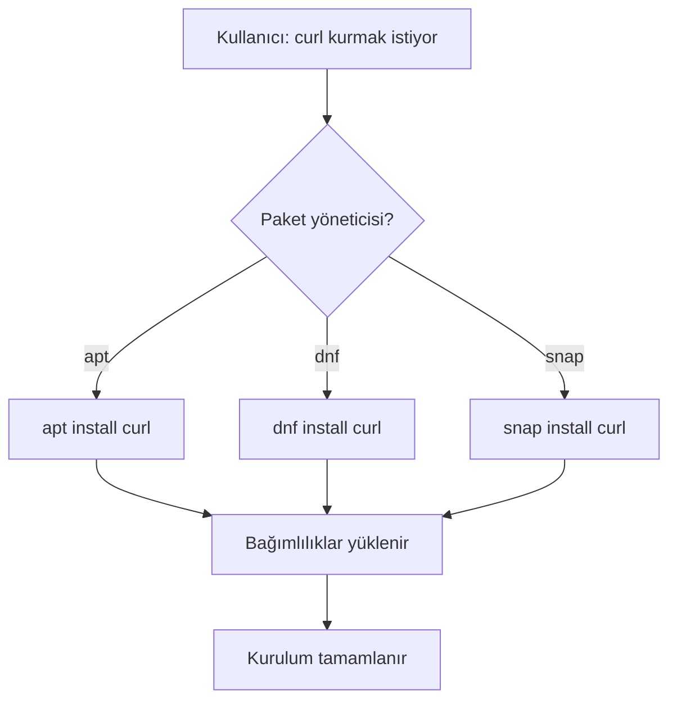
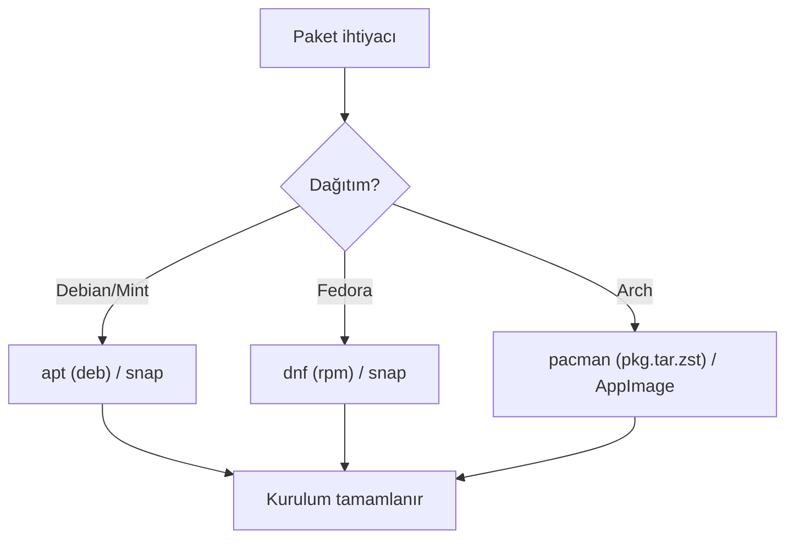

# Paket Yönetimi

## 🎯 Bu Derste Ne Öğreneceğiz?

Bu derste, Linux sistemlerinde yazılım paketlerinin kurulumunu, güncellenmesini, kaldırılmasını, aranmasını ve listelenmesini yöneten paket yöneticilerini tanıyacaksınız: `apt` (Debian/Ubuntu/Linux Mint tabanlı), `dnf` (Fedora), `snap` (evrensel), `pacman` (Arch Linux). Ayrıca `appimage` gibi evrensel paket formatlarını, depo arama (`search`), kurulu paket listeleme (`list`), paket kaldırma (`remove`/`erase`), bağımlılık yönetimi (`autoremove`) ve güncelleme sıklığını öğreneceksiniz.

## 💡 Neden Bu Konuyu Öğreniyoruz?

Veri biliminde, Python kütüphaneleri, veri işleme araçları ve sunucu yazılımları sürekli kurulur ve güncellenir. Paket yöneticisini doğru kullanmak, sisteminizi güncel tutmak için vazgeçilmezdir. Ayrıca bir yazılım kurulumunda hata alırsanız, paket bağımlılıklarını anlamak sorun giderme sürecinizi hızlandırır.

> [!IMPORTANT]
> Paketleri `sudo` ile kurun; ancak her zaman kuracağınız paketin kaynağını doğrulayın. Bilinmeyen bir kaynaktan paket kurmak sistem güvenliğinizi riske atabilir.

## Ön Bilgi

Bu dersi takip etmek için önceki haftalarda öğrenilen temel komutlar (`ls`, `pwd`, `cd`) ve dağıtım karşılaştırması (Hafta 4) yeterlidir. Ayrıca `chmod` ile izinleri değiştirmeyi biliyor olmanız faydalıdır; çünkü bazı paket kurulumları yeni dizinler oluşturur.

## Kavramlar

### Paket Yöneticisi (Package Manager)

Paket yöneticisi, yazılım paketlerini kuran, güncelleyen ve kaldıran araçtır. Her dağıtım kendi paket deposunu (repository) kullanır.

### Bağımlılıklar (Dependencies)

Bir yazılım başka yazılımlara ihtiyaç duyabilir. Örneğin `curl` kurarken sistem otomatik olarak `libcurl` gibi bağımlılıkları yükler.

### Karşılaştırma Tablosu

| Özellik | apt | dnf | snap | pacman (Arch) |
|---|---|---|---|---|
| Dağıtım | Debian, Mint, Ubuntu | Fedora | Evrensel | Arch Linux |
| Paket formatı | `.deb` | `.rpm` | `.snap` | `.pkg.tar.zst` |
| Depo | Debian/Ubuntu repo | Fedora repo | Snap Store | Arch Linux repos |
| Güncelleme | `apt update` | `dnf upgrade` | Otomatik / `snap refresh` | `pacman -Syu` |

### Paket İşlemleri (Kurulum, Arama, Listeleme, Kaldırma)

| İşlem | apt | dnf | pacman (Arch) | snap |
|---|---|---|---|---|
| Kurulum | `apt install pkg` | `dnf install pkg` | `pacman -S pkg` | `snap install pkg` |
| Arama / Bul | `apt search pkg` | `dnf search pkg` | `pacman -Ss pkg` | `snap find pkg` |
| Kurulu listele | `apt list --installed` | `dnf list installed` | `pacman -Q` | `snap list` |
| Kaldır | `apt remove pkg` | `dnf remove pkg` | `pacman -R pkg` | `snap remove pkg` |
| Güncelle | `apt upgrade pkg` | `dnf upgrade pkg` | `pacman -Syu` | `snap refresh pkg` |

> [!TIP]
> `apt search` veya `pacman -Ss` kullanarak paket adı hatırlamadan arama yapabilirsiniz.

### AppImage (Evrensel Paket Formatı)

AppImage, `.AppImage` uzantılı, bağımsız çalıştırılabilir bir paket formatıdır; kurulum gerektirmez; `chmod +x` ardından doğrudan çalıştırılır (`./program.AppImage`). Bu, farklı dağıtımlarda (Arch dahil) aynı programı çalıştırmak için idealdir. Örneğin `AppImageLauncher` veya `Foxit Reader` gibi yazılımlar AppImage formatında dağıtılır.

### Flatpak (Evrensel Paket Formatı)

Flatpak, evrensel bir paket formatıdır; `snap` gibi kendi bağımlılıklarını (runtime) taşır ancak `snap`ten farklı olarak kum havuzu (sandbox) kullanarak uygulamaları izole eder. Temel komutlar:

- Kurulum: `flatpak install flathub <paket>`
- Çalıştırma: `flatpak run <paket>`
- Listeleme: `flatpak list`
- Kaldırma: `flatpak uninstall <paket>`

Flatpak, `Flathub` deposu üzerinden çalışır (`https://flathub.org/`). Örneğin, Firefox veya LibreOffice gibi uygulamaları Flatpak ile kurup farklı dağıtımlarda (Arch, Fedora, Debian) aynı versiyonda çalıştırabilirsiniz. Flatpak, `AppImage` gibi kurulum gerektirmez (depo bağlantısı yeterli) ancak `snap` gibi kendi bağımlılıklarını (runtime) taşır.

## 🔍 Birlikte Keşfedelim

Terminalinizi açın ve şu gözlemleri yapın:

1. `which apt` (veya `dnf`) komutuyla sisteminizde hangi paket yöneticisinin olduğunu kontrol edin.
2. `apt list --installed 2>/dev/null | wc -l` (Debian/Mint) veya `dnf list installed 2>/dev/null | wc -l` (Fedora) ile kurulu paket sayısını öğrenin.
3. `snap list` komutuyla (varsa) snap paketlerini listeleyin.

Tahmin edin: `apt` ile `snap` arasındaki temel fark nedir? `snap` paketleri neden kendi bağımlılıklarını taşır?

Şimdi `apt update` (veya `dnf upgrade --assumeyes`) komutunu çalıştırın; çıktılarda hangi paketlerin güncelleneceğini gözlemleyin.

## 🛠️ Uygulama

Aşağıdaki görevleri sırasıyla tamamlayın:

1. `sudo apt install htop` (Debian/Mint) veya `sudo dnf install htop` (Fedora) komutuyla `htop` kurun.
2. Kurulum tamamlandığında `htop` komutuyla çalıştırın; sistem süreçlerini gözlemleyin.
3. `htop`'u kaldırın: `sudo apt remove htop` veya `sudo dnf remove htop`.
4. `ls -l /usr/bin/htop` komutuyla dosyanın silindiğini doğrulayın.

> [!TIP]
> `htop` kurulumunda `apt` veya `dnf` bağımlılıkları otomatik yükler; bu nedenle sadece `htop` yazmanız yeterlidir. Eğer kurulum hatası alırsanız `apt update` veya `dnf upgrade` ile depoyu güncelleyin.

## 🧪 Deneyelim ve Gözlemleyelim

Deneyleri yapın:

1. **Paket kurulum farkı:** `sudo apt install curl` (Debian/Mint), `sudo dnf install curl` (Fedora), `sudo pacman -S curl` (Arch Linux) komutlarını deneyin. Her iki komutun da başarıyla çalışıp çalışmadığını gözlemleyin.
2. **Bağımlılık gözlem:** `sudo apt install tree` komutunu çalıştırın; çıktıda hangi ek paketlerin yükleneceğini not edin.
3. **Güncelleme farkı:** `sudo apt update && sudo apt upgrade` (Debian/Mint) ile `sudo dnf upgrade` (Fedora) çıktılarındaki paket sayısını karşılaştırın.

> [!WARNING]
> `remove` komutu paketi kaldırır ama bağımlılıkları otomatik kaldırmaz. Sistem disk alanını temizlemek için `apt autoremove` veya `dnf autoremove` komutlarını kullanın.

## Bir Şeyler Ters Giderse

Paket kurulumu hatası alırsanız:

1. `sudo apt update` ile depoyu güncelleyin.
2. `apt list --installed | grep <paket>` ile paketin zaten kurulu olup olmadığını kontrol edin.
3. Hata mesajını `man apt` veya `man dnf` ile kontrol edin; genellikle `No package found` depodan kaynaklanır.
4. Ağ bağlantısını doğrulayın (`ping google.com`).

> [!TIP]
> `snap` paketleri kendi bağımlılıklarını taşıdığı için bazen `apt` paketlerinden daha büyük olur; düşük disk alanı olan sistemlerde `snap` yerine `apt` kullanmak daha verimli olabilir.

## Kendin Dene

Aşağıdaki görevleri tamamlayın:

1. **Paket arama:** `apt search curl` (Debian/Mint), `dnf search curl` (Fedora), `pacman -Ss curl` (Arch Linux) ile arama yapın.
2. **Kurulu paketleri listeleme:** `apt list --installed | wc -l` (Debian), `dnf list installed | wc -l` (Fedora), `pacman -Q | wc -l` (Arch Linux) ile kurulu paket sayısını öğrenin.
3. **Paket kaldırma:** `sudo apt remove tree` (Debian/Mint), `sudo dnf remove curl` (Fedora), `sudo pacman -R curl` (Arch Linux) ile kaldırın.
4. **AppImage kullanımı:** Örnek bir `.AppImage` dosyasını indirin (`chmod +x`), `./program.AppImage` ile doğrudan çalıştırın; kurulum gerektirmez.

> [!TIP]
> `pacman -Syu` ile hem güncelleme hem kurulum yapılabilir; `pacman -Rns` bağımlılıkları da siler.

## 🧠 Öğrendiklerini Kontrol Et

1. `apt` ile `snap` arasındaki temel fark nedir?
2. `htop` paketi kurulduğunda bağımlılıklar neden otomatik yüklenir?
3. Paketi kaldırdıktan sonra bağımlılıkları nasıl temizlersiniz?

Cevapları göster

1. `apt` sistem depo paketini kurar (bağımlılıkları paylaşır); `snap` kendi bağımlılıklarını paketler.
2. Yazılım çalışması için başka kitaplıklara ihtiyaç duyar; paket yöneticisi bunları çözümler.
3. `apt autoremove` veya `dnf autoremove` komutları ile.

## Bağımsız Çalışma

Kendi Linux sisteminizde bu bağımsız çalışmayı tamamlayın:

- `sudo apt update` (veya `dnf upgrade`) ile depoyu güncelleyin.
- `sudo apt install nano` (veya `dnf install nano`) ile `nano` editörünü kurun.
- `nano` ile `/tmp/test_nano.txt` dosyası oluşturun; içine bir satır yazın.
- `nano`'yu kaldırın (`sudo apt remove nano`) ve `ls /usr/bin/nano` ile silindiğini doğrulayın.
- `apt autoremove` ile gereksiz bağımlılıkları temizleyin.

## Daha Fazlasını Öğrenmek

- Debian Paket Yönetimi: [https://wiki.debian.org/PackageManagement](https://wiki.debian.org/PackageManagement)
- Fedora `dnf`: [https://docs.fedoraproject.org/en-US/quick-docs/dnf/](https://docs.fedoraproject.org/en-US/quick-docs/dnf/)
- `snap` dokümantasyonu: `snap help`

## Kısa Özet

Bu derste paket yöneticilerinin (`apt`, `dnf`, `snap`) temel işlevlerini öğrendiniz; paket kurulumu, güncelleme, kaldırma ve bağımlılık yönetimini pratiğe döktünüz. Bir sonraki derste ağ temellerini (IP, ağ yapılandırması) öğreneceğiz.

---

← [Masaüstü Ortamları](05-Desktop-Environments.md) | [Ağ Temelleri →](07-Network-Basics.md)
