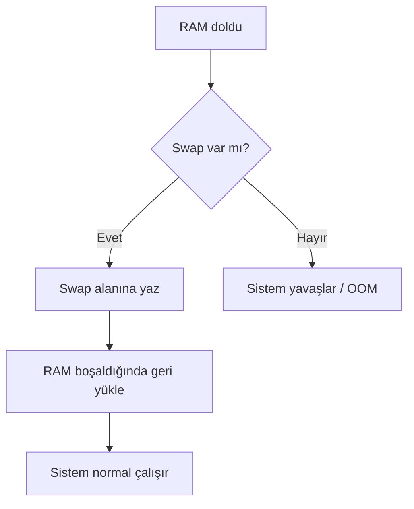
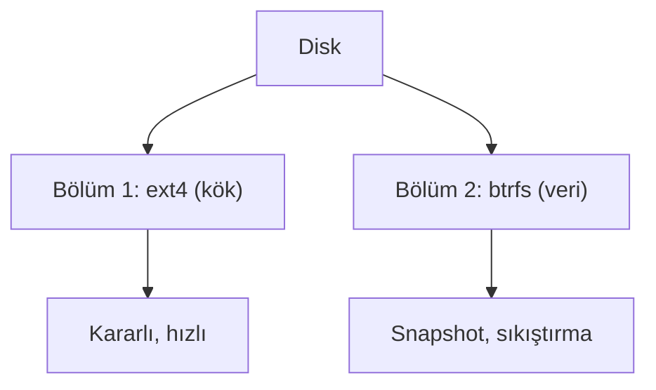

# Disk Bölümleme ve Dosya Sistemleri

## 🎯 Bu Derste Ne Öğreneceğiz?

Bu derste, disk bölümleme (partitioning) kavramını öğrenecek; `ext4` ve `btrfs` dosya sistemlerinin temel farklarını karşılaştıracaksınız. Ayrıca disk alanını gözlemleyip, dosya sistemleri arasında seçim yapmanın neden önemli olduğunu anlayacaksınız.

## 💡 Neden Bu Konuyu Öğreniyoruz?

Veri biliminde büyük veri setlerini saklamak, yedeklemek ve hızlı erişmek için disk yapısını doğru planlamak gerekir. `ext4` kararlıdır; `btrfs` anlık görünümler (snapshots) ve sıkıştırma sunar. Bu farkları bilmek, sistem bakımı kararlarınızı bilgilendirir.

> [!NOTE]
> Dosya sistemi (file system), verilerin disk üzerinde nasıl organize edileceğini belirleyen yapıdır. `ext4` Linux'un geleneksel dosya sistemidir; `btrfs` daha yeni özellikler sunar.

## Ön Bilgi

Önceki haftalardaki dosya komutları (`ls`, `cp`) ve paket yönetimi (Hafta 6) yeterlidir.

## Kavramlar

### Disk Bölümleme

Disk bölümleme, tek bir fiziksel diski mantıksal bölümlere ayırmaktır. Her bölüm ayrı bir dosya sistemine sahip olabilir.

### Swap (Takasta Alanı)

Swap, RAM dolduğunda sistemin disk üzerinde geçici bellek olarak kullanabileceği bir alanı temsil eder. Linux'ta swap bir dosya (`/swapfile`) veya özel bir bölüm (`/dev/sda2` gibi) olabilir.

| Özellik | Swap Dosyası | Swap Bölümü |
|---|---|---|
| Esneklik | Kolay oluşturulur/oluşturulur | Disc yapısına bağlı |
| Performans | Daha yavaş (dosya sistemi katmanı) | Daha hızlı (doğrudan disk) |
| Yönetim | `fallocate` + `mkswap` + `swapon` | `fdisk` ile bölüm |

> [!NOTE]
> Genellikle RAM'in 1-2 katı swap alanı önerilir. Örneğin 8 GB RAM için 4-8 GB swap uygun olur. Çok büyük swap (32 GB+) disk alanını gereksiz şekilde tüketir.

> [!WARNING]
> Swap dosyası oluştururken `fallocate` yerine `dd` kullanın; `fallocate` bazı dosya sistemlerinde düzgün çalışmayabilir. Ayrıca `swapon` komutuyla aktif hale getirin (`/etc/fstab`) kalıcı hale getirin.

### Diğer Dosya Sistemleri (Karşılaştırma)

Linux dışında kullanılan başlıca dosya sistemleri:

| Özellik | `ext4` | `btrfs` | NTFS (Windows) | APFS (macOS) | FAT32/exFAT |
|---|---|---|---|---|---|
| Platform | Linux | Linux | Windows | macOS | Evrensel |
| Kararlılık | Çok yüksek | Yüksek | Yüksek | Yüksek | Orta |
| Karşılaştırma | Linux varsayılanı | Modern Linux | Windows | Apple | USB/harici |

- **NTFS (New Technology File System):** Windows'un varsayılan dosya sistemi; Linux'ta `ntfs-3g` ile okunabilir/yazılabilir.
- **APFS (Apple File System):** macOS'un varsayılanı; Linux'ta sınırlı destek (genelde yalnızca okuma).
- **FAT32 / exFAT:** Evrensel uyumluluk; USB sürücülerde yaygın; büyük dosya sınırı (FAT32: 4 GB).

> [!TIP]
> Linux Mint (Debian tabanlı), NTFS bölümlerini otomatik bağlar (`ntfs-3g` kuruluysa). macOS APFS bölümlerini ise yalnızca `hfsprogs` ile sınırlı okuma yapılabilir.

### `ext4` vs `btrfs`

| Özellik | `ext4` | `btrfs` |
|---|---|---|
| Kararlılık | Çok yüksek | Yüksek |
| Anlık görüntü (snapshot) | Yok | Var |
| Sıkıştırma | Yok | Var |
| Güncelleme | Kararlı | Sürekli gelişen |

## 🔍 Birlikte Keşfedelim

Terminalinizde:

1. `df -h` komutuyla disk kullanımını gözlemleyin.
2. `lsblk` ile bölümleri listeleyin.
3. `sudo fdisk -l` (varsa) ile disk yapısını görüntüleyin.

Tahmin edin: `ext4` ile `btrfs` arasında hangisi daha fazla özellik sunar? Neden?

## 🛠️ Uygulama

1. `df -h` çıktısını yazın.
2. `/etc/fstab` dosyasını `cat` ile görüntüleyin; hangi dosya sistemi kullanılıyor?
3. Yeni bir dizin oluşturun (`mkdir /tmp/btrfs_deneme`); üzerine `btrfs` kuruluysa test edin.

## 🧪 Deneyelim ve Gözlemleyelim

- `df -T` ile dosya sistemi türünü gözlemleyin.
- `btrfs --version` (varsa) ile sürümü kontrol edin.
- `lsblk -f` ile her bölümün dosya sistemini not edin.

> [!WARNING]
> `fdisk` veya `parted` ile disk bölümü değiştirmek veri kaybına neden olabilir. Bu deney için yalnızca gözlemleyin; bölüm oluşturmayın.

## Bir Şeyler Ters Giderse

1. `df` komutu hatalı sonuç verirse sistem yeniden başlatılabilir.
2. `lsblk` boş görünüyorsa `sudo lsblk -f` kullanın.
3. Dosya sistemi türü bilinmiyorsa `/proc/mounts` dosyasını kontrol edin.

## Kendin Dene

1. `df -h` çıktısını bir metin dosyasına yazın.
2. `ext4` ile `btrfs` farklarını bir cümleyle özetleyin.
3. `lsblk -f` çıktısında `FILESYSTEM` sütununu okuyun.

Cevapları göster

1. `df -h > /tmp/disk_bilgi.txt`
2. `ext4` kararlı, `btrfs` snapshot/sıkıştırma sunar.
3. `ext4`, `btrfs`, `vfat` gibi değerler görünebilir.

## 🧠 Öğrendiklerini Kontrol Et

1. `btrfs` hangi özelliği sunar?
2. Disk bölümleme neden yapılır?
3. `df -h` neyi gösterir?

Cevapları göster

1. Snapshot, sıkıştırma, dinamik bölümleme.
2. Bir diski birden fazla mantıksal alana ayırmak için.
3. Disk kullanımını (boş/dolu) insan okunabilir formatta.

## Bağımsız Çalışma

- `df -h`, `lsblk -f`, `/etc/fstab` gözlemlerini kaydedin.
- `man fdisk` veya `man parted` ile bölümleme komutlarını okuyun.
- Karşılaştırma tablosu oluşturun: `ext4` vs `btrfs`.

## Daha Fazlasını Öğrenmek

- `btrfs` dokümantasyonu: `man btrfs`
- `ext4`: [https://ext4.wiki.kernel.org/](https://ext4.wiki.kernel.org/)

## Kısa Özet

Disk bölümleme ve `ext4`/`btrfs` farklarını öğrendiniz. Bir sonraki derste ileri kurulum ve çoklu önyükleme konularını ele alacağız.

---

← [Ağ Temelleri](07-Network-Basics.md) | [İleri Kurulum →](09-Advanced-Install.md)
