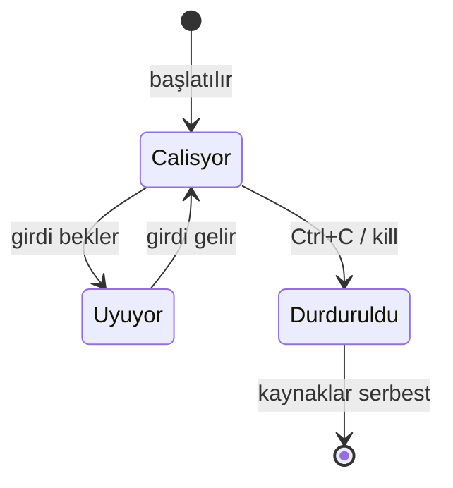

# Süreç ve Servis Yönetimi

## 🎯 Bu Bölümde Ne Öğreneceğiz?

Bu bölümü bitirdiğinde şunları yapabileceksin:

- Süreç (process) ve PID kavramlarını açıklayabileceksin.
- `ps`, `top` ve `htop` ile çalışan süreçleri izleyebileceksin.
- `kill` ve `pkill` ile süreçleri sonlandırabileceksin.
- Bir komutu ön planda ve arka planda çalıştırmayı, aralarında geçiş yapmayı
  öğreneceksin (`jobs`, `fg`, `bg`).
- `systemctl` ile servisleri denetleyebileceksin.
- Bir servisin durumunu okuyup yorumlayabileceksin.

## 💡 Neden Bu Konuyu Öğreniyoruz?

Bilgisayarın aynı anda pek çok iş yapar: arka planda çalışan servisler, açık
programlar, sistem görevleri. Bir şey yavaşladığında ya da takıldığında "şu an
ne çalışıyor, hangisi kaynak yiyor?" sorusunu cevaplamak gerekir. Bu bölüm,
sistemi bir bütün olarak görmeni ve gerektiğinde müdahale etmeni sağlar.

Servisleri bilmek de önemlidir: Bir web sunucusu, bir yazıcı servisi ya da bir
ağ servisi, sistemin açılışında kendiliğinden başlar. Bunların nasıl çalıştığını
anlamak, ileride bir sorunu çözerken "servisi yeniden başlat" gibi çözümleri
bilinçli uygulamanı sağlar.

## 📌 Ön Bilgi

Bu bölüm, 7. bölümde öğrendiğin paket kurma becerisine dayanır; `htop` aracını
orada tanımıştık. Ayrıca 5. bölümdeki `sudo` yetkisini ve 4. bölümdeki boru
kullanımını yeri geldikçe anımsayacaksın.

## 📖 Kavramlar

### Süreç ve PID

Çalışan her programa **süreç (process)** denir. Her süreç, işletim sistemi
tarafından bir **PID (Process ID, süreç kimliği)** ile numaralanır. Bu numara,
bir süreci hedef göstermen gerektiğinde (örneğin durdurmak için) işine yarar.
Süreçler ağaç hâlinde düzenlenir: bir süreç başka süreçleri başlatabilir; ilk
sürece **ebeveyn (parent)**, onun başlattıklarına **çocuk (child)** denir.

### Ön plan ve arka plan

Komut satırında başlattığın bir iş, normalde **ön planda (foreground)** çalışır;
seni bekletir. Örneğin uzun süren bir iş bitene kadar yeni komut yazamazsın.
Bazı işleri **arka planda (background)** çalıştırıp terminali serbest
bırakabilirsin.

### Servis ve systemd

**Servis (service, daemon),** kullanıcı müdahalesi olmadan arka planda çalışan
programdır. Modern Linux sistemlerinde servisler **systemd** tarafından yönetilir
ve `systemctl` komutuyla denetlenir.

Bir sürecin yaşam döngüsünü şöyle özetleyebiliriz:



## 🔍 Birlikte Keşfedelim

Sence şu anda, hiçbir şey yapmasan bile, sisteminde kaç süreç çalışıyor? Beş mi,
elli mi, daha fazla mı?

Tahminini netleştirdikten sonra şu komutu çalıştır:

```bash
ps aux | wc -l
```

`ps aux`, sistemdeki süreçleri listeler; `wc -l` ise satır sayısını verir.
Bu komutun çıktısını bir de şöyle gör:

```bash
ps aux
```

Sütunlara bak: kullanıcı, PID, işlemci kullanımı, bellek kullanımı ve komutun
adı. Bilmediğin pek çok süreç göreceksin; çoğu sistemin kendi servisleridir.
Sistem, senin hiçbir şey yapmadığın anda bile ayakta kalmak için onlarca küçük
iş yürütür.

## 🛠️ Uygulama

### 1. Adım: Süreçleri listele ve izle

```bash
ps aux | head
top
```

`top`, süreçleri canlı olarak izler ve genellikle en çok kaynak kullananları en
üstte gösterir. Çıkmak için `q` tuşuna bas. Daha renkli ve kullanışlı bir
sürümü, 7. bölümde kurduğun `htop`'tur:

```bash
htop
```

`htop` içinde ok tuşlarıyla gezinir, `F6` ile sıralama ölçütünü değiştirirsin.
Sistem kaynaklarının üst taraftaki çubuklarda canlı değiştiğini gözlemle.

### 2. Adım: Bir süreci sonlandır

Önce uzun süren bir iş başlatalım:

```bash
sleep 300
```

Bu komut 300 saniye boyunca hiçbir şey yapmadan bekler. Şimdi başka bir
terminal aç ve `ps aux | grep sleep` ile bu sürecin PID'sini bul. Ardından:

```bash
kill PID
```

`PID` yerine gördüğün numarayı yaz. `kill`, süreçten düzgünce kapanmasını ister.
Adıyla sonlandırmak için `pkill` kullanılır:

```bash
pkill sleep
```

> [!NOTE]
> `kill` komutunun adı "öldürmek" olsa da aslında sürece bir **sinyal**
> gönderir. Varsayılan sinyal, süreçten kendini düzgünce kapatmasını ister.
> `-9` sinyali ise zorla sonlandırır ve son çare olarak kullanılmalıdır.

### 3. Adım: Ön plan ve arka plan arasında geçiş yap

Bir komutu arka planda çalıştırmak için sonuna `&` eklenir:

```bash
sleep 300 &
```

Terminal sana `[1] 12345` gibi bir çıktı verir; buradaki `1` iş numarası,
`12345` ise PID'dir. Arka plandaki işleri görmek için:

```bash
jobs
```

Çalışan bir ön plan işini `Ctrl` + `Z` ile duraklatıp arka plana
alabilirsin. Örneğin `sleep 300` yazıp Enter'a bastıktan sonra `Ctrl` + `Z`,
ardından:

```bash
bg
jobs
fg
```

- `bg`, duraklatılmış işi arka planda devam ettirir.
- `fg`, işi tekrar ön plana getirir.

`fg` ile ön plana aldıktan sonra `Ctrl` + `C` ile tamamen durdurabilirsin.

### 4. Adım: Servisleri denetle

```bash
systemctl status ssh
systemctl status NetworkManager
```

`status`, bir servisin çalışıp çalışmadığını, son durumunu ve son birkaç günlük
satırını gösterir. Çıktıda `active (running)` yazıyorsa servis çalışıyordur.
Diğer faydalı komutlar:

```bash
systemctl list-units --type=service
```

Bu komut, sistemdeki tüm servis birimlerini listeler. Bir servisi durdurup
başlatmayı, yönetici yetkisi gerektirdiği için şöyle yaparsın:

```bash
sudo systemctl restart ssh
```

Bu komut `ssh` servisini yeniden başlatır. `restart`, durdurup başlatmayı tek
adımda yapar ve bir yapılandırma değişikliğinden sonra sık kullanılır.

> [!WARNING]
> Çalışan kritik servisleri sebepsiz yere durdurmak, sistemin ya da ağ
> bağlantının çalışmamasına yol açabilir. Örneğin ağ servisini durdurursan
> internetin kesilir. Durdurmadan önce o servisin ne işe yaradığını bil.

## 🧪 Deneyelim ve Gözlemleyelim

Bir sürecin gerçekten kaynak tükettiğini gözlemleyelim. Yoğun bir hesaplama
yapan bir komut başlat:

```bash
yes > /dev/null &
```

`yes`, sürekli "y" yazdırır; `> /dev/null` çıktısını boşluğa yönlendirir;
sonundaki `&` ise bunu arka planda çalıştırır. Şimdi `htop`'u aç ve bu sürecin
işlemciyi yoğun kullandığını gör. Ardından onu durdur:

```bash
pkill yes
```

İşlemcinin rahatladığını gözlemle. Bu deney, "bir program tüm kaynağı yiyor"
şikâyetinin arkasında ne olduğunu somut olarak gösterir.

## ⚠️ Bir Şeyler Ters Giderse

**Belirti:** Bilgisayar yavaşladı, fan sürekli çalışıyor.

**Olası neden:** Bir süreç işlemciyi ya da belleği aşırı kullanıyor.

**Ne yapmalısın:** `htop`'u aç, en üstteki süreçlere bak. Tanımadığın ve yoğun
kaynak tüketen bir süreç varsa, ne olduğunu araştırmadan hemen öldürme; önce
`ps` ile komutunu incele.

**Belirti:** Bir komut terminali kilitledi, başka komut yazamıyorsun.

**Olası neden:** Komut ön planda çalışıyor ve bitmesini bekliyor.

**Ne yapmalısın:** `Ctrl` + `C` ile durdurmayı dene. İşe yaramazsa `Ctrl` + `Z`
ile duraklatıp `bg` ile arka plana al, sonra başka bir terminalde `ps` ile
PID'sini bulup `kill` ile sonlandır.

**Belirti:** Bir servisi başlatmaya çalıştın ama "failed" durumda kaldı.

**Ne yapmalısın:** `systemctl status <servis>` çıktısındaki hata satırlarını
oku. `journalctl` ile o servisin günlüklerine bakabilirsin; günlükleri bir
sonraki bölümde ayrıntılı inceleyeceğiz.

## ✍️ Kendin Dene

**Görev:** Arka planda iki `sleep` komutu başlat (farklı sürelerle). `jobs` ile
işlerini listele, ikinci işi ön plana al ve `Ctrl` + `C` ile durdur. Kalan işi
`kill` ile PID'sini kullanarak sonlandır.

<details>
<summary>İpucu göster</summary>

Arka planda başlatmak için komutun sonuna `&` ekle. İş numaralarını `jobs`
çıktısında görürsün; ön plana almak için `fg %1` gibi numarayı
kullanabilirsin.

</details>

<details>
<summary>Örnek çözüm göster</summary>

```bash
sleep 600 &
sleep 700 &
jobs
fg %2        # ikinci işi ön plana al
# Ctrl+C ile durdur
ps aux | grep sleep   # kalanın PID'sini bul
kill PID
```

Bu alıştırma, süreçleri hem iş numarasıyla hem PID ile yönetmeyi bir arada
öğretir.

</details>

## 🧠 Öğrendiklerini Kontrol Et

1. Süreç ile PID arasındaki ilişki nedir?
2. Ön plan ve arka plan çalışma arasındaki farkı açıkla.
3. `kill` komutu bir sürece ne yapar? `-9` seçeneği neden son çaredir?
4. `jobs`, `fg` ve `bg` komutları ne işe yarar?
5. Servis nedir ve hangi araçla yönetilir?

<details>
<summary>Cevapları göster</summary>

1. Her çalışan program bir süreçtir ve işletim sistemi ona benzersiz bir PID
   (süreç kimliği) verir. PID, süreci hedef göstermek için kullanılır.
2. Ön plandaki iş terminali meşgul eder ve bitmesini beklersin; arka plandaki iş
   çalışırken terminali serbest bırakır, sen başka komutlar yazabilirsin.
3. `kill`, sürece bir sinyal gönderir ve varsayılan olarak düzgünce kapanmasını
   ister. `-9` sinyali zorla sonlandırır; süreç temizlik yapamaz, bu yüzden son
   çare olarak kullanılır.
4. `jobs` arka plandaki işleri listeler, `fg` bir işi ön plana alır, `bg` bir
   işi arka planda çalıştırır.
5. Servis, kullanıcı müdahalesi olmadan arka planda çalışan programdır ve
   `systemctl` ile yönetilir.

</details>

## 🚀 Bağımsız Çalışma

1. **İnceleme görevi:** `systemctl list-units --type=service` çıktısından
   tanımadığın üç servis seç. Her birinin ne işe yaradığını `systemctl status`
   çıktısından ve kısa bir aramayla öğren.
2. **Gözlem görevi:** `htop`'u açıp birkaç dakika izle. En çok bellek kullanan
   süreçlerle en çok işlemci kullanan süreçler aynı mı? Gözlemlerini not et.

Bu görevler, sistemi "kara kutu" olmaktan çıkarıp anlaşılır bir bütün olarak
görmeni sağlar.

## 📚 Daha Fazlasını Öğrenmek

- htop projesi: <https://htop.dev>
- systemd belgeleri: <https://www.freedesktop.org/wiki/Software/systemd/>
- Ubuntu man sayfaları (ps, kill, systemctl): <https://manpages.ubuntu.com>

## 📝 Kısa Özet

- Çalışan her program bir süreçtir ve bir PID ile tanımlanır.
- `ps`, `top` ve `htop` süreçleri izlemek için kullanılır.
- `kill` ve `pkill` süreçleri sonlandırır; `-9` son çaredir.
- İşleri ön planda ya da arka planda çalıştırabilir, `jobs`, `fg`, `bg` ile
  aralarında geçiş yapabilirsin.
- Servisler arka planda çalışır ve `systemctl` ile yönetilir.

[Önceki bölüm: Paket Yönetimi](07-Package-Management.md) | [İçindekiler](../README.md) | [Sonraki bölüm: Disk, Donanım ve Sistem İzleme](09-Disk-And-Monitoring.md)
