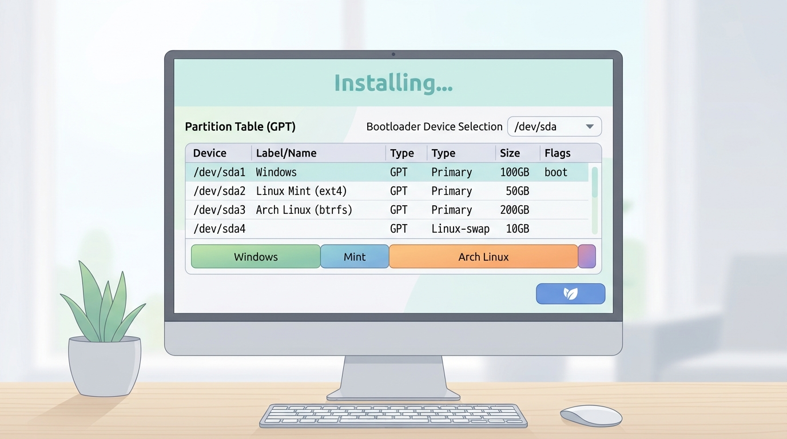

# İleri Kurulum ve Çoklu Önyükleme

## 🎯 Bu Derste Ne Öğreneceğiz?

Bu derste, çoklu önyükleme (multi-boot) kurulumu ve ileri düzey disk bölümleme tekniklerini öğreneceksiniz. Linux Mint, Ubuntu ve Arch Linux gibi farklı dağıtımları aynı sistemde kurarak, farklı dağıtımların nasıl yönetileceğini öğreneceksiniz. Ayrıca, partitioning, filesystem seçimi ve bootloader konfigürasyonu gibi ileri seviye konuları öğreneceksiniz.

## 💡 Neden Bu Konuyu Öğreniyoruz?

Veri bilimi ve analitiği alanında, proje çalışmaları sırasında farklı işletim sistemleriyle çalışmak zorunda kalabilirsiniz. Linux ve Windows gibi iki farklı ortamı aynı anda kullanmak, proje geliştirme, test ve raporlama süreçlerini çok daha etkili hale getirir. Bu ders, ileri kurulum ve çoklu önyükleme tekniklerini öğrenmenizi sağlayarak bu çeşit çeşitli ortamlara hazırlayacaktır.

> [!IMPORTANT]
> Çoklu önyükleme, aynı bilgisayarın farklı çalışma sistemlerini aynı anda taşıyabilmenizi sağlar. Bu, proje geliştirme, test ve sunucu yönetimi gibi senaryolarda büyük avantaj sağlar.

## Ön Bilgi

Bu dersi takip etmek için önceki haftalarda öğrenilen temel Linux kavramları (kurulum, dosya sistemi, temel komutlar) ve 04 haftasında öğrendiğiniz farklı dağıtımları (Ubuntu, Fedora, Debian) bilmeniz gerekir. Ayrıca, sanal makine veya canlı USB ile bir Linux dağıtımı kurmayı bilmelisiniz.

## Kavramlar

### Çoklu Önyükleme (Multi-Boot)

Bir tek fisik makinede birden fazla işletim sistemi kurulumu; örnek: Windows + Linux Mint + Arch Linux.

### GPT ve MBR Bölümleme Şeması

- **MBR (Master Boot Record):** Eski, sınırlı kapasite (2TB) ve 4 ana bölüm desteği olan bölümlü sistem.
- **GPT (GUID Partition Table):** Yeni standart, 9.4 ZB (zettabytes) kapasite desteği, 128 bölüm desteği, daha güvenlidir.

### Dosya Sistemleri

- **ext4:** Linux için önerilen, kararlı, hızlı, geniş kullanım alanı.
- **btrfs:** modern, snapshot (anlık görüntü) ve dosya sistemine göre sıkıştırma desteği; daha karmaşıkdır.

> [!TIP]
> GPT bölümleme, Windows 7/8/10/11 ile uyumluluk için önerilir. MBR sadece eski sistemlerde (Windows XP/7) kullanılır.

## 🔍 Birlikte Keşfedelim

1. Sanal makine oluşturun (Ubuntu veya Mint).
2. `lsblk` komutuyla mevcut disk bölümlerini inceleyin.
3. `fdisk /dev/sdb` ile yeni bir disk ekleyin (örnek: 50GB).
4. `gdisk` veya `gdisk` aracılığıyla bölümleme yapın.
5. Kurulum sırasında "Özel Kurulum" seçeneğini seçin.
6. Bölümleme sırasında "ext4" veya "btrfs" seçin ve "birincil" bölüm oluşturun.
7. Linux Mint kurulumu ile "Ext4" dosya sistemini seçin.
8. Kurulum sonrası, `grub-install` ile bootloader ayarını kontrol edin.

## 🧪 Deneyelim ve Gözlemleyelim

1. `lsblk` komutuyla mevcut disk bölümlerini inceleyin.
2. `fdisk /dev/sdb` ile yeni bir disk bölümleme deneyin (sanal makine veya canlı USB üzerinde).
3. `gdisk` ile GPT bölümleme deneyin.
4. `mkfs.ext4` ve `mkfs.btrfs` komutlarını deneyin ve sonuçları karşılaştırın.
5. `timeshift --create` ile bir anlık görüntü alın ve `timeshift --list` ile görüntüleri inceleyin.

> [!WARNING]
> `fdisk`/`gdisk` ile çözülme yapmayın; sadece `lsblk` ve `fdisk` ile görüntüleyin. Gerçek disk bölümlemesi her zaman yedek alınmadan önce yapılmalıdır.

> [!TIP]
> `timeshift --create --comments "Hafta 9 - Multi-Boot"` komutuyla bir anlık görüntü oluşturun; bu, ilerleyen haftalarda geri dönüş yapmanızı sağlar.

## Bir Şeyler Ters Giderse

1. **Kurulum ekranı gelmiyorsa:** Sanal makineyi yeniden başlatın ve ISO dosyasını kontrol edin.
2. **Bölüm oluşturulmadıysa:** `fdisk` ile manuel bölüm oluşturun ve `mkfs.ext4` ile formatlayın.
3. **Bootloader hatası:** `grub-install` komutuyla bootloader'ı yeniden yükleyin: `sudo grub-install /dev/sda`.

> [!TIP]
> `fdisk` yerine `gdisk` kullanın; GPT desteği ve daha az hata yapılır.

## Kendin Dene

1. Sanal makinede iki farklı dağıtımı (örneğin Ubuntu ve Fedora) kurun.
2. `grub-mkconfig` komutuyla boot menüsünü güncelleyin.
3. `efibootmgr` ile boot menüsünü yönetin: `sudo efibootmgr -v`

Cevapları göster

1. Çoklu önyükleme: Windows, Linux, macOS gibi birden fazla OS kurulumu.
2. `lsblk` ile disk bölümlerini görüntüleyebilirsiniz; `sda1`, `sda2` gibi isimler kullanılır.

## Bağımsız Çalışma

Kendi Linux sisteminizde şu adımları uygulayın:

- `/dev/sda` diskinizi (örneğin 500GB) bir `sda1` (Windows), `sda2` (Linux) ve `sda3` (btrfs) bölümlerine bölün.
- `gdisk` ile GPT bölümleme yapın; `n` komutuyla bir bölüm oluşturun, `w` ile kaydedin.
- `mkfs.ext4 /dev/sda3` ile ext4 dosya sistemini oluşturun.
- `grub-install /dev/sda` ile bootloader'ı yükleyin.
- `update-grub` ile grub menüsünü güncelleyin.

## Daha Fazlasını Öğrenmek

- GPT partitioning standards: [https://www.efi-spec.org/](https://uefi.org/specifications/)
- Timeshift: [https://github.com/linuxmint/timeshift](https://github.com/linuxmint/timeshift)

## Kısa Özet

Bu derste çoklu önyükleme ve ileri kurulum tekniklerini öğrendiniz. Gelişmiş bölümleme yöntemlerini, GPT/MBR ayrımı ve Timeshift ile yedekleme stratejileri öğrenmiş oldunuz. Bir sonraki derste, Linux sistemlerini sanal ortamda (Docker, VirtualBox) izlemeyi öğreneceksiniz.

---

← [Disk Bölümleme ve Dosya Sistemleri](08-Disk-Partitioning.md) | [Shell Betikleri ve Otomasyon →](10-Shell-Scripting.md)