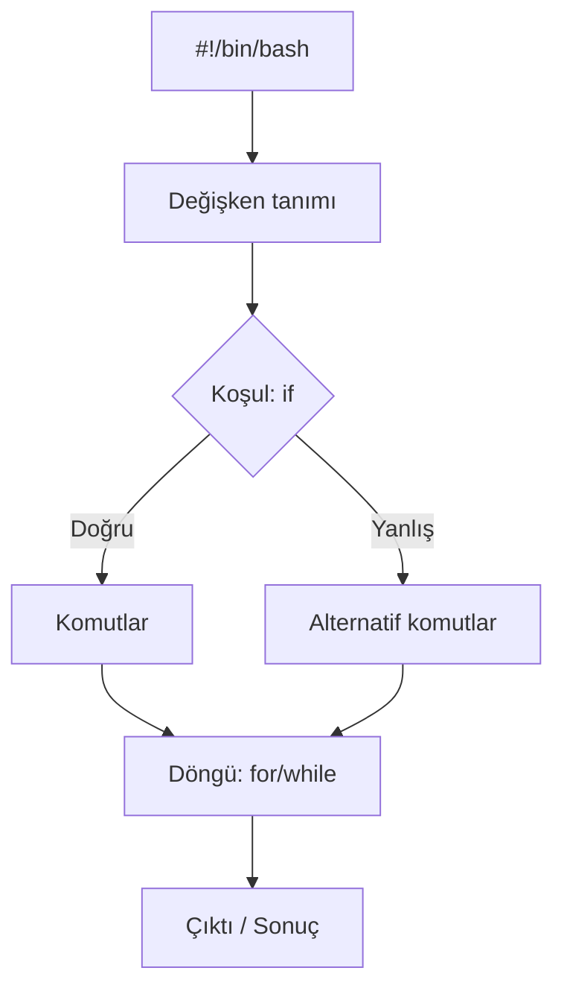

# Shell Betikleri ve Otomasyon

## 🎯 Bu Derste Ne Öğreneceğiz?

Bu derste, Bash kabuk betikleri (shell scripts) yazarak tekrarlayan görevleri otomatikleştirmeyi öğreneceksiniz. Betik oluşturma, çalıştırma izni verme, değişken kullanma, koşullu ifadeler (`if`) ve döngüler (`for`, `while`) ile pratik otomasyon örnekleri geliştireceksiniz. Bu dersin sonunda, kendi sisteminizde günlük yedekleme, dosya işlemleri ve sistem bakımı betiklerini yazıp çalıştırabileceksiniz.

## 💡 Neden Bu Konuyu Öğreniyoruz?

Veri biliminde veri setlerini indirmek, ön işleme yapmak, model eğitimi başlatmak ve sonuçları arşivlemek gibi görevler sıklıkla tekrarlanır. Bu görevleri el ile yapmak hata riskini artırır ve zaman kaybına yol açar. Basit bir Bash betiği, bu süreçleri tek komutla çalıştırmanızı sağlar. Ayrıca betik yazma becerisi, ileri sistem yönetimi (Hafta 11) ve CI/CD süreçlerinin temelini oluşturur.

> [!IMPORTANT]
> Betikler sisteminizi değiştirebilir; `sudo` ile çalıştırırken dikkatli olun. Her betiği önce test ortamında (örneğin `/tmp`) deneyin.

## Ön Bilgi

Bu dersi takip etmek için temel komutlar (Hafta 2: `ls`, `cp`, `mv`, `cat`), dosya izinleri (Hafta 3: `chmod`), paket yönetimi (Hafta 6) ve metin editörü (`nano` veya `vim`) bilmeniz yeterlidir.

## Kavramlar

### Betik (Script) Nedir?

Betik, kabuk tarafından sırayla yorumlanan komutların bir dizisidir. `#!/bin/bash` (shebang) satırıyla başlar ve çalıştırılabilir hale getirilerek (`chmod +x`) doğrudan çalıştırılır.

### Temel Betik Yapısı



### Yaygın Yapılar

| Yapı | Açıklama | Örnek |
|---|---|---|
| Değişken | `DEGISKEN=deger` | `DOSYA="veri.txt"` |
| Koşul | `if ...; then ...; fi` | `if [ -f "$DOSYA" ]; then ...` |
| Döngü (for) | `for i in liste; do ...; done` | `for f in *.txt; do ...` |
| Döngü (while) | `while kosul; do ...; done` | `while [ $SAYAC -lt 5 ]; do ...` |

## 🔍 Birlikte Keşfedelim

Terminalinizde:

1. `echo '#!/bin/bash' > deneme.sh` ile yeni bir dosya oluşturun.
2. `echo 'echo "Merhaba $USER"' >> deneme.sh` ile bir satır ekleyin.
3. `chmod +x deneme.sh` ile çalıştırma izni verin.
4. `./deneme.sh` ile çalıştırın.

Tahmin edin: `$USER` değişkeni neyi yazdırır? Betik çalışmazsa neden olabilir?

Şimdi `./deneme.sh` çıktısını gözlemleyin ve not edin.

## 🛠️ Uygulama

Aşağıdaki betikleri sırayla yazın ve çalıştırın:

1. **Basit selamlama betiği:**
   ```bash
   #!/bin/bash
   echo "Merhaba, $USER!"
   echo "Bugün: $(date)"
   ```

2. **Dosya yedekleme betiği:**
   ```bash
   #!/bin/bash
   KAYNAK="$HOME/Belgeler"
   HEDEF="/tmp/yedek_$(date +%Y%m%d)"
   mkdir -p "$HEDEF"
   cp -r "$KAYNAK"/* "$HEDEF"/
   echo "Yedek alındı: $HEDEF"
   ```

3. **Döngü ile dosya listeleme:**
   ```bash
   #!/bin/bash
   for dosya in "$HOME"/*.txt; do
       if [ -f "$dosya" ]; then
           echo "Bulundu: $(basename "$dosya")"
       fi
   done
   ```

> [!TIP]
> Betik yazarken yorum satırları (`#`) kullanın; ileride hatırlamanızı ve başkalarının anlamasını kolaylaştırır.

## 🧪 Deneyelim ve Gözlemleyelim

1. Yukarıdaki betikleri ayrı dosyalara kaydedin (`selamla.sh`, `yedek.sh`, `listele.sh`).
2. Her birini `chmod +x` ile çalıştırılabilir yapın ve `./` ile çalıştırın.
3. Çıktıları karşılaştırın; hangi betik ne zaman hata verebilir?

> [!WARNING]
> `cp -r` komutu kaynak dizin boşsa hata vermez ama hedefi doldurmaz. Yedekleme betiğinde kaynak dizinin varlığını `if [ -d "$KAYNAK" ]` ile kontrol edin.

## Bir Şeyler Ters Giderse

Betik çalışmazsa:

1. `bash -x betik.sh` ile hata ayıklama (debug) modunda çalıştırın; her adım yazdırılır.
2. `chmod +x` unutulmuş olabilir; `ls -l betik.sh` ile izinleri kontrol edin (`-rwxr-xr-x` beklenir).
3. Satır sonu karakteri (Windows CRLF) sorunlu olabilir; `dos2unix betik.sh` ile düzeltin.
4. `#!/bin/bash` eksikse sistem varsayılan kabukla çalıştırır; her zaman ekleyin.

## Kendin Dene

Aşağıdaki görevleri deneyin:

1. `for i in {1..5}; do echo "Sayı: $i"; done` tek satırlı döngüyü terminalde çalıştırın.
2. Kullanıcıdan isim alan bir betik yazın: `read -p "İsminiz: " ISIM; echo "Hoş geldin $ISIM"`.
3. `/tmp` altında 5 dosya oluşturan bir betik yazın (`touch /tmp/dosya_$i.txt`).

<details>
<summary>Cevapları göster</summary>

1. `Sayı: 1` ... `Sayı: 5` yazdırılır.
2. İsim girildikten sonra selamlama yapar.
3. `dosya_1.txt` ... `dosya_5.txt` oluşur.

</details>

## 🧠 Öğrendiklerini Kontrol Et

1. `#!/bin/bash` satırı ne işe yarar?
2. Betik çalıştırma izni nasıl verilir?
3. `for` ile `while` döngüsü arasındaki fark nedir?

<details>
<summary>Cevapları göster</summary>

1. Betiğin Bash tarafından yorumlanacağını belirtir (shebang).
2. `chmod +x betik.sh` komutuyla.
3. `for` belli bir liste/aralık üzerinde; `while` bir koşul doğru olduğu sürece döner.

</details>

## Bağımsız Çalışma

Kendi Linux sisteminizde bu bağımsız çalışmayı tamamlayın:

- Günlük yedekleme betiği yazın: `~/yedek_gunluk.sh` dosyası oluşturun.
- Betik: `~/Belgeler` klasörünü `/tmp/yedek_YYYYMMDD` klasörüne kopyalasın.
- Hata durumunda (kaynak yoksa) uyarı versin.
- Betiği `chmod +x` yapın ve `crontab -e` ile her gün saat 02:00'de çalışacak şekilde planlayın (isteğe bağlı).
- Sonucu `/tmp/yedek_rapor.txt` dosyasına yazdırın.

## Daha Fazlasını Öğrenmek

- Bash referansı: `man bash`
- Gelişmiş betikleme: [https://tldp.org/LDP/abs/html/](https://tldp.org/LDP/abs/html/)
- ShellCheck (betik doğrulayıcı): `shellcheck betik.sh`

## Kısa Özet

Bu derste Bash betikleriyle temel otomasyonu öğrendiniz: shebang, değişkenler, koşullar, döngüler ve pratik yedekleme/listeleme betikleri. Bir sonraki derste sistem izleme (`top`, `htop`, `dmesg`, loglar) konularını ele alacağız.

---

← [İleri Kurulum ve Çoklu Önyükleme](09-Advanced-Install.md) | [Sistem İzleme ve Hata Ayıklama →](11-System-Monitoring.md)