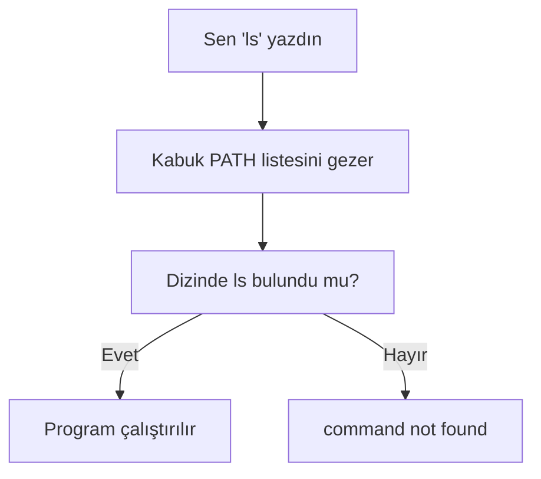

# Ortam Değişkenleri, PATH ve Kabuk Yapılandırması

## 🎯 Bu Bölümde Ne Öğreneceğiz?

Bu bölümü bitirdiğinde şunları yapabileceksin:

- Ortam değişkeni (environment variable) kavramını açıklayabileceksin.
- `echo` ve `env` ile değişkenlerin değerlerini okuyabileceksin.
- `export` ile değişken tanımlayıp geçerli kılabileceksin.
- `PATH` değişkeninin ne işe yaradığını ve bir komutun nasıl bulunduğunu
  anlayacaksın.
- `alias` ile kendi kısayol komutlarını oluşturabileceksin.
- `.bashrc` dosyasını düzenleyerek ayarlarını kalıcı hâle getirebileceksin.
- `history` ile komut geçmişini kullanabileceksin.

## 💡 Neden Bu Konuyu Öğreniyoruz?

Terminalde her komut yazdığında, kabuk arka planda pek çok bilgiyi kullanır:
kullanıcı adın, ev dizinin, hangi dizinlerde komut arayacağı gibi. Bu bilgiler
**ortam değişkenleri** olarak saklanır. Bunları bilmek, "neden bu komut
bulunamıyor?" ya da "bu program neden çalışmıyor?" sorularının cevabını
vermeni sağlar.

Ayrıca tekrar eden işler için kısayollar (alias) tanımlamak ve kabuk ortamını
kendine göre biçimlendirmek, terminali gerçekten "senin" yapar. Bu bölüm,
terminali kullanmaktan terminali **tasarlamaya** geçiş noktasıdır ve bir sonraki
bölümde betik yazmaya hazırlıktır.

## 📌 Ön Bilgi

Bu bölüm, 2. ve 4. bölümlerde öğrendiğin kabuk kullanımına dayanır. `nano` ile
dosya düzenlemeyi (4. bölüm) ve `echo` komutunu biliyor olman yeterlidir. Ayrıca
5. bölümde `$USER` ifadesini görmüştün; şimdi bunun mantığını öğreneceksin.

## 📖 Kavramlar

### Ortam değişkeni

**Ortam değişkeni (environment variable),** kabuğun ve çalıştırdığın
programların okuyabildiği, isim-değer çiftleridir. Örneğin `USER` değişkeni
kullanıcı adını, `HOME` ev dizinini tutar. Bir değişkene `$` işaretiyle
ulaşırsın: `echo $USER`.

### PATH değişkeni

Bir komut yazdığında (örneğin `ls`), kabuk onu nerede arayacağını bilmelidir.
Bu bilgiyi `PATH` değişkeni taşır. `PATH`, iki nokta üst üste (`:`) ile ayrılmış
bir dizin listesidir. Kabuk, komutu bu dizinlerde sırayla arar; bulamazsa
"command not found" hatası verir.



### Kabuk yapılandırma dosyaları ve alias

Kabuk her açıldığında bazı dosyaları okuyup ortamı kurar. Bash için en yaygını
`~/.bashrc` dosyasıdır. Bu dosyaya yazdığın ayarlar, her yeni terminal
açılışında uygulanır. **alias** (kısa ad), uzun bir komuta kısa bir isim
vermenin yoludur; örneğin `ll` adını `ls -l` komutuna bağlayabilirsin.

## 🔍 Birlikte Keşfedelim

Sence `ls` komutu gerçekten nerede duruyor? Yazdığın anda kabuk onu nereden
buluyor?

Önce şunu tahmin et, sonra doğrula:

```bash
echo $PATH
echo $HOME
echo $USER
```

`$PATH` çıktısında, iki noktalı bir listeyle karşılaşacaksın. Şimdi `ls`
komutunun gerçek yerini bul:

```bash
which ls
```

`which`, "bu komut hangi dosyadan geliyor?" sorusunun cevabıdır. Çıktıdaki yolun,
`$PATH` çıktısındaki dizinlerden biri olduğunu fark edeceksin. İşte kabuk, `ls`
yazdığında tam olarak bu dosyayı çalıştırır. Bu, "bir komutu çalıştır" dediğimiz
anda kabuk içinde olup biten görünmez bir işlemi gözler önüne serer.

## 🛠️ Uygulama

### 1. Adım: Değişkenleri oku ve listele

```bash
echo $HOME
env
```

`env`, o an geçerli olan tüm ortam değişkenlerini listeler. İçlerinden birkaçını
tanımaya çalış; hepsini ezberlemene gerek yok.

### 2. Adım: Kendi değişkenini tanımla

```bash
selam="merhaba"
echo $selam
```

Bu şekilde tanımlanan değişken yalnızca **bu kabuk oturumunda** geçerlidir.
Yeni bir terminal açarsan kaybolur. Kalıcı ve alt programlara da aktarılabilir
kılmak için `export` kullanılır:

```bash
export PROJE="linux_calisma"
echo $PROJE
bash -c 'echo $PROJE'
```

Son komut, yeni bir alt kabuk açıp değişkeni okur; `export` sayesinde değer
oraya da taşınır. `export` olmadan bu değer alt kabuğa geçmez.

### 3. Adım: PATH'in nasıl çalıştığını gör

Geçici olarak `PATH`'e yeni bir dizin ekleyelim:

```bash
mkdir -p ~/bin
export PATH="$HOME/bin:$PATH"
echo $PATH
```

Artık `~/bin` dizini, komut aranan dizinlerin başında. Yeni açılan terminallerde
de geçerli olması için bu satırı `~/.bashrc` dosyasına eklememiz gerekir; bunu
birazdan yapacağız.

> [!IMPORTANT]
> `PATH`'i değiştirirken mevcut değeri korumayı unutma. `export PATH="$HOME/bin"`
> gibi bir satır, eski `PATH`'i tamamen siler ve sistemdeki komutları bulamaz
> hâle gelirsin. Her zaman `"$HOME/bin:$PATH"` biçiminde, sonuna ekleyerek
> yaz.

### 4. Adım: Kısayol (alias) oluştur

```bash
alias ll='ls -l'
ll
```

`ll` yazdığında artık `ls -l` çalışır. Bu alias da geçicidir; kalıcı yapmak için
`~/.bashrc`'ye eklenir. Faydalı birkaç örnek:

```bash
alias ..='cd ..'
alias guncelle='sudo apt update && sudo apt upgrade'
```

### 5. Adım: Ayarları kalıcı hâle getir

```bash
nano ~/.bashrc
```

Dosyanın sonuna şu satırları ekle:

```bash
export PATH="$HOME/bin:$PATH"
alias ll='ls -l'
alias ..='cd ..'
```

Kaydet (`Ctrl` + `O`, Enter) ve çık (`Ctrl` + `X`). Değişikliğin yeni
terminallerde geçerli olması için ya yeni bir terminal aç ya da dosyayı şimdiki
kabukta yeniden yükle:

```bash
source ~/.bashrc
ll
```

`source`, bir dosyayı çalıştırmadan içindeki satırları mevcut kabukta uygular.
Böylece yeni terminal açmadan ayarların devreye girer.

> [!TIP]
> `~/.bashrc` dosyasını düzenlemeden önce bir yedeğini almak iyi bir
> alışkanlıktır: `cp ~/.bashrc ~/.bashrc.yedek`. Yanlış bir satır kabuğun
> açılışını bozarsa yedekten geri dönebilirsin.

### 6. Adım: Komut geçmişini kullan

2. bölümde yukarı okla komut çağırmayı görmüştün. Geçmişin tamamı `history`
komutunda saklanır:

```bash
history
history | grep apt
```

İkinci komut, geçmişinde `apt` geçen komutları süzer. Aynı komutu tekrar
çalıştırmak için `!!` kullanılır:

```bash
sudo !!
```

Bu satır, bir önceki komutu `sudo` ile tekrar çalıştırır. "Az önce çalıştırdım
ama yetki vermeyi unuttum" durumunda pratik bir çözümdür.

## 🧪 Deneyelim ve Gözlemleyelim

`PATH`'in davranışını bizzat gözlemleyelim.

```bash
echo $PATH
mkdir -p ~/test_bin
touch ~/test_bin/merhaba
chmod +x ~/test_bin/merhaba
merhaba
```

Son komut "command not found" verir, çünkü `~/test_bin` PATH'te değil. Şimdi
onu geçici olarak PATH'e ekle ve tekrar dene:

```bash
export PATH="$HOME/test_bin:$PATH"
merhaba
```

Bu kez kabuk dosyayı bulur ama içi boş olduğu için hiçbir şey yapmaz; "command
not found" hatası kaybolur. Bu deney, bir komutun bulunması için iki koşul
gerektiğini gösterir: PATH'te olmak ve çalıştırma iznine sahip olmak (5. bölümü
anımsa).

## ⚠️ Bir Şeyler Ters Giderse

**Belirti:** Daha önce çalışan komutlar birden "command not found" veriyor.

**Olası neden:** Yanlış bir `PATH` ataması, önceki yolları sildi. Örneğin
`export PATH="$HOME/bin"` yazdın.

**Ne yapmalısın:** Terminali kapat, yeni bir tane aç. Sorun sürerse `~/.bashrc`
dosyasındaki hatalı satırı bul ve düzelt. Kalıcı bozulmalarda yedek dosyadan
geri dön.

**Belirti:** Terminal her açılışta hata mesajı veriyor.

**Olası neden:** `~/.bashrc` içine yazdığın bir satırda sözdizimi hatası var.

**Ne yapmalısın:** `bash -n ~/.bashrc` komutu dosyayı çalıştırmadan sözdizimi
açısından kontrol eder ve hatanın satırını söyler. Satırı düzelt.

**Belirti:** Bir alias tanımladın ama çalışmıyor.

**Olası neden:** Alias'ı geçici olarak tanımladın ya da `~/.bashrc`'ye ekledikten
sonra yüklemedin.

**Ne yapmalısın:** `~/.bashrc`'ye eklediysen `source ~/.bashrc` çalıştır.

## ✍️ Kendin Dene

**Görev:** Kendine üç alias tanımla: biri sık kullandığın uzun bir komut,
biri bir üst dizine dönmek için (`..`), biri de güncelleme yapmak için. Hepsini
`~/.bashrc` dosyasına ekle ve kalıcı hâle getir.

<details>
<summary>İpucu göster</summary>

Alias tanımlamak için `alias ad='komut'` biçimini kullan. Tırnak içindeki komut,
boşluk ve seçenek içerebilir. Ekledikten sonra `source ~/.bashrc` çalıştır.

</details>

<details>
<summary>Örnek çözüm göster</summary>

```bash
nano ~/.bashrc
# sona eklenecekler:
alias ..='cd ..'
alias guncelle='sudo apt update && sudo apt upgrade'
alias ll='ls -l'

# kaydet, çık ve yükle:
source ~/.bashrc
ll
```

Artık her yeni terminalde bu kısayollar hazır olacak. Bu küçük kolaylıklar,
terminal kullanımını belirgin biçimde hızlandırır.

</details>

## 🧠 Öğrendiklerini Kontrol Et

1. Ortam değişkeni nedir ve bir değişkenin değerini nasıl okursun?
2. `PATH` değişkeni ne işe yarar?
3. Yerel bir değişken ile `export` edilmiş bir değişken arasındaki fark nedir?
4. `alias` ne işe yarar ve kalıcı hâle nasıl getirilir?
5. `source ~/.bashrc` komutu ne yapar?

<details>
<summary>Cevapları göster</summary>

1. Kabuğun ve programların okuyabildiği isim-değer çiftleridir. Değeri okumak
   için `echo $DEGISKEN_ADI` kullanılır.
2. Kabuk, bir komutu hangi dizinlerde arayacağını `PATH`'ten öğrenir. Komut
   bulunamazsa "command not found" hatası verilir.
3. Yerel değişken yalnızca tanımlandığı kabukta geçerlidir; `export` edilen
   değişken alt kabuklara ve çalıştırılan programlara da aktarılır.
4. `alias`, uzun bir komuta kısa bir isim verir. Kalıcı yapmak için `~/.bashrc`
   dosyasına eklenir.
5. `~/.bashrc` içindeki satırları, yeni bir terminal açmadan mevcut kabukta
   uygular.

</details>

## 🚀 Bağımsız Çalışma

1. **İnceleme görevi:** `env` çıktısından üç değişken seç (`HOME`, `USER`,
   `SHELL` gibi) ve her birinin ne işe yaradığını araştır.
2. **Görev:** `~/bin` dizinini `PATH`'e ekleyip bu dizine küçük bir kişisel
   komut koy. Bu bölümdeki `merhaba` dosyasını, içine `echo "Merhaba, $USER!"`
   yazarak kullanışlı hâle getir ve çalıştırılabilir yap.

Bu görevler, kabuk ortamını kendine göre biçimlendirme becerisi kazandırır ve
bir sonraki bölümde yazacağın betikler için sağlam bir zemin oluşturur.

## 📚 Daha Fazlasını Öğrenmek

- GNU Bash kılavuzu (değişkenler, başlangıç dosyaları): <https://www.gnu.org/software/bash/manual/>
- Ubuntu man sayfaları (env, export, alias, history): <https://manpages.ubuntu.com>

## 📝 Kısa Özet

- Ortam değişkenleri, kabuğun ve programların okuduğu isim-değer çiftleridir;
  `$` ile okunur.
- `PATH`, komutların arandığı dizinleri belirler; yanlış ayarlanırsa komutlar
  bulunamaz.
- `export`, değişkeni alt kabuklara taşır.
- `alias`, komutlara kısa ad verir; kalıcı olması için `~/.bashrc` düzenlenir.
- `history` ve `!!` komut geçmişini kullanmanı sağlar.

[Önceki bölüm: Ağ Temelleri](10-Networking-Basics.md) | [İçindekiler](../README.md) | [Sonraki bölüm: Arşivleme ve Yedekleme](12-Archive-And-Backup.md)
