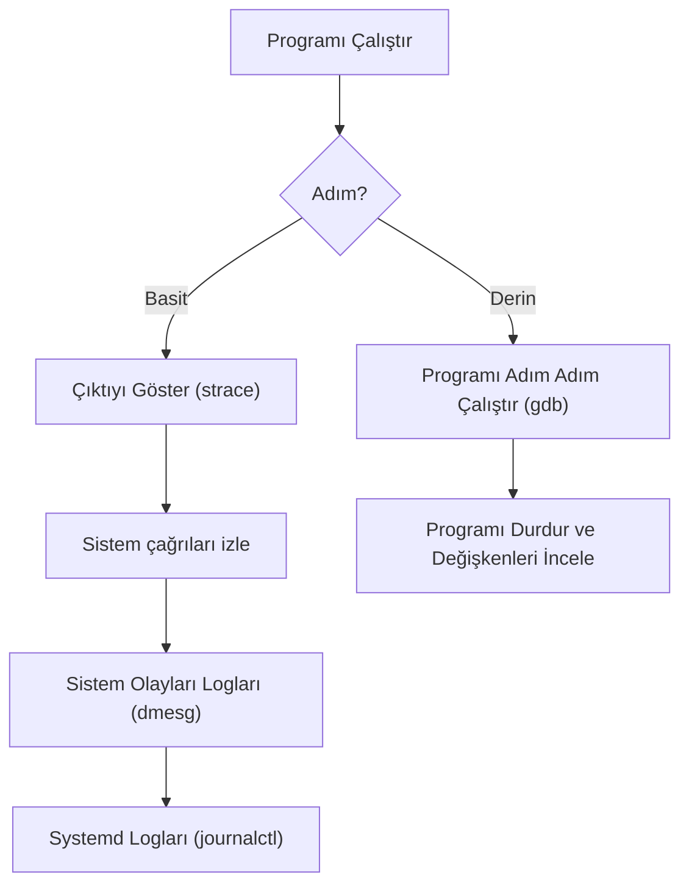

# System Monitoring and Hata Ayıklama

## 🎯 Bu Derste Ne Öğreneceğiz?

Bu derste, Linux sistem izleme ve hata ayıklama araçlarını öğreneceksiniz. `top`, `htop`, `dmesg`, `journalctl` gibi temel izleme araçları ile sistem performansı ve olaylarını nasıl inceleyeceğinizi; `strace`, `ltrace`, `gdb` gibi hata ayıklama araçlarını nasıl kullanacağınızı; ve sistem sorunlarını etkili bir şekilde nasıl gidereceğinizi öğreneceksiniz. Bu ders, verimli ve güvenilir sistem yönetimi için temel araçları size sunar.

> [!NOTE]
> Bu dersteki bilgiler, daha sonra sistem performansını analiz etmeyi öğrenirken veya güvenilir uygulamalar geliştirmek için sizi sistem içinde hassas hataları bulabilmenizi sağlar.

## 💡 Neden Bu Konuyu Öğreniyoruz?

Veri biliminde birden fazla kullanıcı ile çalışırken, sistem kaynakları paylaşılır; etkin bir izleme gereklidir. Dağıtık sistemlerinizde CPU kullanımı, bellek kullanımı, disk işlemleri ve ağ aktivitelerini anlamak büyük önem taşır. Ayrıca, sistem hataları genellikle veri işleme süreçlerinde veya veri alımında sorunlara neden olabilir.

Bazı temel izleme araçları ile sistem etkinliğini gerçek zamanlı gözlemleyebilir ve hataları hemen tespit edebilir, böylece veri bilimci olarak çalışmalarınızı daha güvenilir hale getirebilirsiniz. Bu kurs, bu temel becerileri sizlere sunar.

## Ön Bilgi

Bu derste temel komutları (`ls`, `pwd`, `cd`) ve paket yönetimini (Hafta 6) biliyor olmanız gereklidir. Bunlar, sunucu ortamlarında veri bilimi uygulamalarını yürütmek için temel görevleri yerine getirmek açısından oldukça önemlidir.

Ayrıca, temel dosya izinleri (`chmod`, `chown`) hakkında kısa bilgi sahibi olmanız gereklidir.

## Kavramlar

### Süreç İzleme Araçları (`top`, `htop`)

- **`top`** (en temel süreç izleme aracı): sistem kaynakları (CPU, bellek, swap) kullanımı grafiklerini görüntüler; size gerçek zamanlı bilgi sunar. **Dikkatli olun:** `top` komutunun ekranın tam ortasına çıktılarını yazdırır; terminal boyutu küçültülmüyse ekranı yeniden boyutlandırmak, `Ctrl + L` tuşuna basarak terminal ekranını temizleyebilirsiniz.
- **`htop`** (daha kullanıcılar dostu alternatif): `top`'un arayüzünü geliştirir; daha sade grafikler sunar; süreci hangi kullanıcı tarafından yönetildiğini gösterir; ve geçmişteki süreç sayısını gösterir. Eğer `htop` kurulu değilse `apt install htop` (Debian/Ubuntu) veya `dnf install htop` (Fedora/CentOS) komutları ile yükleyebilirsiniz.

> [!IMPORTANT]
> `htop` bir GUI (grafik kullanıcı arayüzü) değildir; komut satırı programıdır; sadece daha iyi bir kullanıcı arayüzü sunar.

### Sistem Olayları Logları (`dmesg`, `journalctl`)

- **`dmesg`** (kernel mesajları): kernel tarafından yazılan uyarıları, hataları, bilgi mesajlarını veya uyumlu aygıtların mesajlarını görüntüler; genellikle `dmesg | tail -n 20` ile azalan ekranda görüntülenir.
- **`journalctl`** (systemd log kaydı): systemd tarafından yönetilen hizmetlerin (logger, ssh-server gibi) loglarını görüntüler; günlük, saat, dakika, or birim filtreleri ile arama yapılır.

### Hata Ayıklama Araçları

- **`strace`** (sistem çağrı izleyicisi): bir programın sistem çağrılarını (açma, yazma, okuma) step by step gösterir; bir komut sırasında `strace ls` ile kullanılabilir.
- **`ltrace`** (dil çağrı izleyicisi): `strace`'in ciropran dillerde daha kullanışlı bir alternatifidir; ancak çok az desteklenen bir araçtır.
- **`gdb`** (GNU Debugger): bir programı adım adım çalıştırır, değişkenleri inceler; `break` komutuyla hata ayıklama noktaları kurulur.

## 🔍 Birlikte Keşfedelim

Terminalinizi açın ve aşağıdaki adımları uygulayın:

1. `htop` (eğer kuruluysa) ile çalıştırın; süreç listesini ve kaynak kullanımını gözlemleyin.
2. `dmesg | tail -n 20` ile son 20 sistem mesajını görüntüleyin.
3. `journalctl -u ssh --since "5 dakika önce" | head` ile son 5 dakikadaki SSH loglarını filtreleyin.

Tahmin edin: `htop` ile `top` çıktılarının ne farkı vardır? Hangisi daha kullanışlı?

Şimdi, `htop` (varsa) çıktısını bir görsel example alacak şekilde not edin.

## 🛠️ Uygulama

1. `htop` (eğer kuruluysa) ile çalıştırın; %CPU kullanımı yüksek olan bir süreci not edin.
2. `dmesg | tail -n 5` komutu ile son 5 sistem mesajını yazın.
3. `journalctl -u cron` ile cron işlemleri loglarını filtreleyin.
4. `journalctl -u ssh --no-pager` ile SSH loglarını görüntüleyin.

> [!TIP]
> `htop` sadece okuma yetkisi ile çalışır; süreci sonlandırmaz; sadece gerçek zamanlı gösterim sağlar.

## 🧪 Deneyelim ve Gözlemleyelim

1. `htop` komutu ile bir süreç komutunu `kill` ile sonlandırın.
2. `strace ls` komutu ile `ls` komutunun sistem çağrılarını inceleyin.
3. `journalctl --priority=3` ile uyarı seviyesindeki olayları filtreleyin.

> [!WARNING]
> `strace` kullanırken dikkatli olun; hassas verilere erişen sistem çağrılarını inceler. Sadece okuma olaylarını izleyin.

## Bir Şeyler Ters Giderse

1. `htop` çalışmazsa: `top` komutunu kullanın; `htop` kurulu mu? `apt install htop` (Debian) veya `dnf install htop` (Fedset) komutu ile yükleyin.
2. `dmesg` çalışmazsa: `sudo systemctl restart systemd` komutu ile yeniden başlatın.
3. `journalctl` çalışmazsa: `journalctl -u ssh` komutu ile tek bir hizmeti filtreleyin; ardından `sudo journalctl --flush --sync` ile logları sıfırlayın.

## Kendin Dene

1. `htop` çıktısını bir not defterine yazın; %CPU kullanımı yüksek olan süreci not edin.
2uyu 3. `dmesg | grep "error" | head -n 3` ile hataları görüntüleyin.
3. `journalctl -a -u cron` ile cron loglarını görüntüleyin.

Cevapları göster

1. %CPU kullanımı yüksek bir süreç bulunur.
2. Logların ilk 3 hatası görüntülenir.
3. Cron işlemleri logları görüntülenir.

## 🧠 Öğrendiklerini Kontrol Et

1. `top` ve `htop` arasındaki temel fark nedir?
2. `strace` ve `ltrace` arasındaki fark nedir?
3. `journalctl` hangi tür olayları gösterir?

Cevapları göster

1. `top` hala kullanılabilir, grafik yok; `htop` daha kullanıcı dostu ve grafik.
2. `strace` sistem çağrılarını izler; `ltrace` dil çağrılarını izler.
3. systemd logları; kernel mesajları.

## Bağımsız Çalışma

Kendi sisteminizde bu bağımsız çalışmayı tamamlayın:

- `htop` ile çalışırken RAM kullanımı yüksek tutan bir komutu `kill` ile sonlandırın; çıktıyı not edin.
- `dmesg | grep "error" | head -n 5` ile hataları görüntüleyin; `journalctl` ile karşılaştırın.
- Süreç izleme için `strace` kullanarak `ls /usr/bin/ls` komutunu inceleyin; çıktıları analiz edin.
- Tüm çıktıları `/tmp/sistem_izleme_raporu.txt` dosyasına yazın.

## Daha Fazlasını Öğrenmek

- `journalctl`: `man journalctl`

## Kısa Özet

Bu derste sistem izleme araçlarını (`top`, `htop`, `dmesg`, `journalctl`), hata ayıklama (`strace`, `gdb`) öğrendiniz. Bir sonraki derste veri bilim araçları (`python`, `jupyter`) kurulumunu öğreneceğiz.

---

← [Shell Betikleri](10-Shell-Scripting.md) | [Veri Bilimi Araçları →](12-Data-Science-Tools.md)