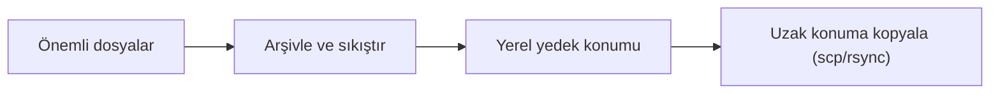

# Arşivleme ve Yedekleme

## 🎯 Bu Bölümde Ne Öğreneceğiz?

Bu bölümü bitirdiğinde şunları yapabileceksin:

- Arşiv ve sıkıştırma arasındaki farkı açıklayabileceksin.
- `tar` ile dosyaları arşivleyip geri açabileceksin.
- `gzip` ve `zip` ile sıkıştırma yapabileceksin.
- `rsync` ile bir dizini başka bir konuma eşleyebileceksin.
- `scp` ile uzaktaki bir bilgisayara dosya kopyalayabileceksin.
- Basit ama işleyen bir yedekleme planı kurabileceksin.

## 💡 Neden Bu Konuyu Öğreniyoruz?

Disk arızalanır, yanlış bir komut dosyaları siler, bir güncelleme sistemi bozar.
Bu durumlarda tek kurtarıcın yedektir. Ancak yedek, "bir kopya daha almak"
değildir; dosyaları taşınabilir, sıkıştırılmış ve düzenli tutmaktır. Arşivleme
araçları tam da bunu sağlar.

Ayrıca birden çok dosyayı tek pakete dönüştürmek, paylaşmak ve saklamak için
günlük hayatta sık işine yarar. `rsync` ise büyük dizinleri akıllıca eşleyerek
her seferinde her şeyi baştan kopyalamaktan kurtarır.

## 📌 Ön Bilgi

Bu bölüm, 3. bölümde öğrendiğin dosya ve dizin işlemlerine dayanır. Ayrıca
uzaktaki bir bilgisayara kopyalamayı gördüğümüzde 10. bölümdeki ağ bilgisinden
yararlanacağız. Dosya yollarını ve `~` işaretini rahat kullanabiliyor olman
yeterlidir.

## 📖 Kavramlar

### Arşiv ve sıkıştırma

**Arşivleme (archiving),** birden çok dosyayı tek bir dosyada toplamaktır; bu
işlem dosyaları küçültmez. **Sıkıştırma (compression),** verinin boyutunu
küçültür. İkisi sıklıkla birlikte kullanılır: önce dosyalar arşivlenir, sonra
sıkıştırılır.

- `tar` -> arşivleme aracıdır (isteğe bağlı sıkıştırma da yapar).
- `gzip` -> tek bir dosyayı sıkıştırır.
- `zip` -> hem arşivler hem sıkıştırır; Windows ile uyumu yüksektir.

### Yedekleme stratejisi

İyi bir yedek, "ne, nereye, ne sıklıkla?" sorularına cevap verir. Basit bir
yaklaşım şudur:



Yedek yalnızca başka bir ortamda olursa değerlidir: disk bozulduğunda aynı
diskteki yedek de gider. Bu yüzden önemli veriler en az iki farklı yerde
tutulmalıdır.

## 🔍 Birlikte Keşfedelim

Sence bir metin arşivini sıkıştırdığında boyutu ne kadar azalır? Yarıya mı
iner, onda birine mi, yoksa hiç değişmez mi?

Tahminini netleştirdikten sonra şunu dene:

```bash
cd ~
mkdir -p yedek_deneme
cp /etc/services yedek_deneme/
ls -l yedek_deneme/services
gzip -k yedek_deneme/services
ls -l yedek_deneme/
```

`-k` seçeneği, özgün dosyayı silmeden sıkıştırılmış bir kopya oluşturur. İki
dosya boyutunu karşılaştır. Gördüğün şey bize sıkıştırmanın **içeriğe bağlı**
olduğunu söyler: metin gibi tekrar eden desenleri bol olan dosyalar çok
küçülürken, zaten sıkıştırılmış dosyalar (örneğin resimler) neredeyse hiç
küçülmez.

## 🛠️ Uygulama

### 1. Adım: tar ile arşiv oluştur

```bash
cd ~
tar -cvf belgeler.tar yedek_deneme
ls -l belgeler.tar
```

`tar` seçeneklerini bir cümle gibi oku: `c` (create/oluştur), `v` (verbose,
yapılanı göster), `f` (file/dosya adı ver). Yani "bir arşiv dosyası oluştur ve
yapılanı göster" diyoruz.

### 2. Adım: Arşivi sıkıştır

```bash
tar -czvf belgeler.tar.gz yedek_deneme
ls -l belgeler.tar.gz
```

Buradaki `z` harfi, arşivi `gzip` ile sıkıştır demektir. İki dosya boyutunu
karşılaştır: `.tar.gz` genellikle `.tar`'dan küçüktür.

### 3. Adım: Arşivin içini gör ve geri aç

```bash
tar -tzvf belgeler.tar.gz
```

`t` harfi "içeriği listele" demektir; açmadan içine bakarsın. Arşivi açmak için:

```bash
mkdir acilan
tar -xzvf belgeler.tar.gz -C acilan
ls acilan/yedek_deneme
```

`x` (extract/aç) ve `-C` (belirtilen dizine aç) seçeneklerini kullandık.

### 4. Adım: zip ile çalış

Windows ile dosya paylaşacaksan `zip` pratik olabilir:

```bash
zip -r belgeler.zip yedek_deneme
unzip -l belgeler.zip
```

`-r` (recursive), dizini içeriğiyle birlikte arşivler; `unzip -l` içeriği
listeler.

### 5. Adım: rsync ile eşle

`rsync`, bir dizini başka bir konuma akıllıca kopyalar; yalnızca değişen
dosyaları taşır:

```bash
rsync -av --progress yedek_deneme/ yedek_kopya/
```

`-a` (archive), izinleri ve zaman damgalarını koruyarak kopyalar; `-v` ayrıntı
gösterir. Kaynak yolun sonundaki `/` işareti önemlidir: `yedek_deneme/` "içeriği
kopyala", `yedek_deneme` ise "dizinin kendisini kopyala" demektir.

### 6. Adım: Uzak konuma kopyala

Aynı ağdaki başka bir bilgisayara dosya göndermek için `scp` kullanılır:

```bash
scp belgeler.tar.gz kullanici@192.168.1.50:/home/kullanici/
```

Bu komut, `belgeler.tar.gz` dosyasını, belirtilen IP adresindeki bilgisayarın
ilgili dizinine kopyalar. Bunun çalışması için hedef makinede SSH servisinin
açık olması ve doğru kullanıcı bilgilerini vermen gerekir.

> [!TIP]
> Yedek alırken tarihi dosya adına koymak, sürümleri ayırt etmeyi kolaylaştırır:
> `belgeler-2026-10-16.tar.gz` gibi. Böylece hangi yedeğin ne zaman alındığını
> dosyaya bakarak anlarsın.

## 🧪 Deneyelim ve Gözlemleyelim

`rsync`'in yalnızca değişen dosyaları taşıdığını gözlemleyelim.

```bash
rsync -av --progress yedek_deneme/ yedek_kopya/
# ikinci kez çalıştır:
rsync -av --progress yedek_deneme/ yedek_kopya/
```

İlk çalıştırmada dosyaların kopyalandığını, ikincisinde ise neredeyse hiçbir
şeyin taşınmadığını göreceksin. Şimdi kaynak dizinde bir dosya değiştir (örneğin
içine bir satır ekle) ve `rsync`'i tekrar çalıştır: yalnızca o dosyanın
güncellendiğini göreceksin. Bu, `rsync`'i yedekleme için neden bu kadar verimli
yaptığını açıklar.

## ⚠️ Bir Şeyler Ters Giderse

**Belirti:** `tar` arşivi açarken dosyalar yanlış yere çıktı.

**Olası neden:** `-C` ile hedef dizini belirtmedin; arşiv, bulunduğun dizine
açıldı.

**Ne yapmalısın:** Açmadan önce `tar -tzvf arsiv.tar.gz` ile içeriği listele ve
`-C` ile hedef dizini açıkça belirt.

**Belirti:** `rsync` komutu, hedefte beklenmedik dosyalar sildi.

**Olası neden:** `--delete` seçeneği kullanıldı; bu seçenek, kaynakta olmayan
her şeyi hedeften siler.

**Ne yapmalısın:** `--delete` seçeneğini çok dikkatli kullan. Önce `-n` (dry run,
deneme) seçeneğiyle çalıştırıp neyin değişeceğini gör, sonra seçeneği kaldır.

> [!CAUTION]
> `rsync --delete`, yanlış bir kaynak yol verildiğinde hedefteki değerli
> dosyaları silebilir. Kaynak ve hedef yollarını iki kez kontrol et; ilk
> denemeleri mutlaka `-n` ile yap.

**Belirti:** `scp` "connection refused" ya da "permission denied" hatası veriyor.

**Olası neden:** Hedef makinede SSH açık değil, adres yanlış ya da kullanıcı
bilgileri hatalı.

**Ne yapmalısın:** Önce hedefe `ping` atarak ulaşabildiğini doğrula; ardından
adres ve kullanıcı bilgilerini kontrol et.

## ✍️ Kendin Dene

**Görev:** `linux_deneme` dizinini tarih içeren bir adla arşivle ve sıkıştır.
Arşivi başka bir dizine aç, içeriğin eksiksiz geldiğini doğrula. Son olarak
aynı dizini `rsync` ile bir yedek klasörüne eşle.

<details>
<summary>İpucu göster</summary>

Sıkıştırılmış arşiv için `tar -czvf`. İçeriği doğrulamak için `diff -r` ya da
`ls` kullanabilirsin. `rsync -av` ile eşle.

</details>

<details>
<summary>Örnek çözüm göster</summary>

```bash
cd ~
tar -czvf linux_deneme-2026-10-16.tar.gz linux_deneme
mkdir geri_yukleme
tar -xzvf linux_deneme-2026-10-16.tar.gz -C geri_yukleme
diff -r linux_deneme geri_yukleme/linux_deneme
rsync -av linux_deneme/ linux_yedek/
```

`diff -r` iki dizini karşılaştırır; çıktı vermemesi, içeriklerin birebir aynı
olduğunu gösterir. Amaç, yedeğin gerçekten işe yaradığını kanıtlamaktır.

</details>

## 🧠 Öğrendiklerini Kontrol Et

1. Arşivleme ile sıkıştırma arasındaki fark nedir?
2. `tar -czvf` komutundaki `c`, `z`, `v`, `f` harfleri ne anlama gelir?
3. `rsync`'i basit `cp` komutuna göre avantajlı kılan nedir?
4. `scp` ne işe yarar ve çalışması için neye ihtiyaç duyar?
5. Neden tek bir diskte tutulan yedek yeterli sayılmaz?

<details>
<summary>Cevapları göster</summary>

1. Arşivleme birden çok dosyayı tek dosyada toplar ama boyutu küçültmez;
   sıkıştırma verinin boyutunu azaltır. Genellikle ikisi birlikte kullanılır.
2. `c` oluştur, `z` gzip ile sıkıştır, `v` yapılanı göster, `f` dosya adı
   belirt.
3. `rsync` yalnızca değişen dosyaları kopyalar, izin ve zaman bilgisini korur;
   büyük dizinlerde tekrar eden yedekleri çok hızlandırır.
4. `scp`, uzaktaki bir makineye ya da makineden dosya kopyalar. Hedef makinede
   SSH hizmetinin açık olması ve doğru kullanıcı bilgilerinin verilmesi gerekir.
5. Çünkü disk arızalandığında üzerindeki yedek de kaybolur. Yedeğin değeri,
   ayrı bir ortamda tutulduğunda ortaya çıkar.

</details>

## 🚀 Bağımsız Çalışma

1. **Plan görevi:** Kendi ev dizinin için basit bir yedekleme planı yaz: hangi
   klasörleri, hangi sıklıkla, nereye yedekleyeceksin? Üç-dört cümlelik bir
   plan oluştur.
2. **Uygulama görevi:** Bu planın ilk adımını bugün uygula: önemli bir
   klasörünü tarihli bir arşive dönüştür ve ikinci bir konuma (varsa harici
   disk ya da ağdaki bir bilgisayara) kopyala.

Bu görevler, "yedek" kavramını soyut bir tavsiyeden uygulanabilir bir alışkanlığa
dönüştürür.

## 📚 Daha Fazlasını Öğrenmek

- GNU tar kılavuzu: <https://www.gnu.org/software/tar/manual/>
- rsync projesi: <https://rsync.samba.org>
- Ubuntu man sayfaları (tar, gzip, zip, rsync, scp): <https://manpages.ubuntu.com>

## 📝 Kısa Özet

- Arşivleme dosyaları birleştirir, sıkıştırma boyutu küçültür; `tar` ikisini
  birlikte yapabilir.
- `tar -czvf` ile arşiv oluşturur, `tar -xzvf` ile açarsın.
- `zip`/`unzip` Windows uyumu yüksek bir alternatiftir.
- `rsync` yalnızca değişenleri kopyalar; yedekleme için verimlidir.
- `scp` uzaktaki makineyle dosya taşır; `--delete` gibi yıkıcı seçeneklerde
  çok dikkatli ol.
- Yedeğin değeri, ayrı bir ortamda tutulduğunda ortaya çıkar.

[Önceki bölüm: Ortam Değişkenleri, PATH ve Kabuk Yapılandırması](11-Environment-And-Path.md) | [İçindekiler](../README.md) | [Sonraki bölüm: Kabuk Betikleme Temelleri](13-Shell-Scripting.md)
