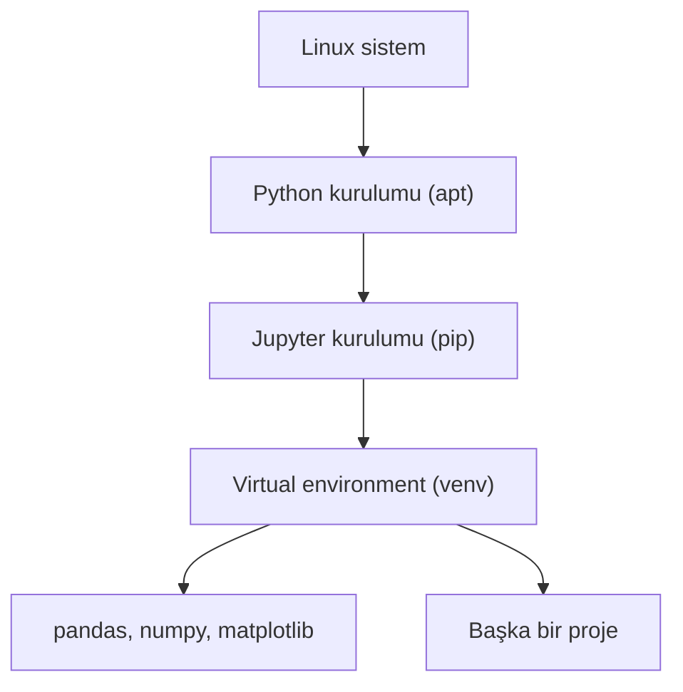

# Veri Bilimi Araçları Kurulumu

## 🎯 Bu Derste Ne Öğreneceğiz?

Bu derste, Linux sistemine veri bilimi için Python, pip, virtual environment ve Jupyter Notebook kurulumunu öğreneceksiniz. Ayrıca temel veri bilimi kütüphanelerini (pandas, numpy, matplotlib) kurup bir Jupyter defterinde çalıştırabileceksiniz.

## 💡 Neden Bu Konuyu Öğreniyoruz?

Veri biliminde Python, veri işleme, analiz ve makine öğrenmesi için evrensel bir dil olmuştur. Jupyter Notebook, kodu, sonuçları ve açıklamaları bir arada tutan interaktif bir ortam sunar. Bu araçların Linux'ta doğru kurulması, ilerideki çalışmalarınızı hızlandırır.

> [!NOTE]
> Python ve pip sisteminizde kurulu olabilir; komutlar `python3 --version` ve `pip3 --version` ile kontrol edin.

## Ön Bilgi

Temel komutlar (Hafta 2), paket yönetimi (Haht 6), shell betikleri (Hafta 10) bilgileri yeterlidir.

## Kavramlar

### Python ve pip
- Python, veri biliminde yaygın kullanılan bir programlama dilidir.
- pip, Python paket yöneticisidir.

### Virtual Environment
- `python3 -m venv`, yalıtılmış paketler için proje bazlı ortam sağlar.

## 🔍 Birlikte Keşfedelim

1. `python3 --version`, `pip3 --version` çalıştırın.
2. `python3 -m pip list` ile kurulu paketleri görüntüleyin.
3. `python3 -m venv /tmp/py` oluşturun; `. /tmp/py/bin/activate` aktive edin.

Tahmin edin: `pip3 install pandas` sistem genelinde müdahale eder mi?

## 🛠️ Uygulama

1. Python'u kurun: `sudo apt install python3 python3-pip python3-venv` (Debian) / `sudo dnf install python3 python3-pip` (Fedora).
2. `python3 -m venv pyvenv` oluşturun; `. pyvenv/bin/activate`.
3. `pip install jupyter pandas` kurun.
4. `jupyter notebook` çalıştırın; tarayıcıda notebook oluşturun: `!python3 --version`.

> [!TIP]
> `apt install python3-venv` bazen gereklidir; `venv` modülü sistem paketlerinde olmayabilir.

## 🧪 Deneyelim ve Gözlemleyelim

- Aktif ortamı `(pyvenv)` gözlemleyin; `pip list` ile paketleri karşılaştırın.
- Jupyter'de `!pip list` ile aynı paketleri görüntüleyin.

> [!WARNING]
> Sistem genelinde `pip install` çatışmalara yol açabilir; hep `venv` kullanın.

## Bir Şeyler Ters Giderse

1. `python3: command not found` → `sudo apt install python3`
2. `pip3: command not found` → `sudo apt install python3-pip`
3. `jupyter: command not found` → `pip install jupyter` (aktif ortamda)

## Kendin Dene

1. `pyvenv`'te `python3 -c "import pandas as pd; print(pd.__version__)"`.
2. Jupyter'de `import numpy as np; np.array([1,2,3]).sum()`.
3. `deactivate` ile ortamı kapatın; `python3` hata verir mi?

Cevapları göster

1. pandas sürümü yazdırılır.
2. 6 sonuç verir.
3. Hayır; sistem python3 yine çalışır.

## 🧠 Öğreniklerini Kontrol Et

1. `venv` ne işe yarar?
2. Jupyter Notebook avantajı nedir?
3. `pip install` sistem genelinde müdehale eder mi?

Cevapları göster

1. Yalıtılmış paket ortamı sağlar.
2. Kod, sonuç ve açıklama bütünleşiktir.
3. Evet, sistem genelinde paket ekler.

## Bağımsız Çalışma

- Kendi `proje_venv`'yi oluşturun; içine `matplotlib` kurun.
- Jupyter notebook açın; `matplotlib` ile basit bir grafik çizin.
- `!pip show pandas` ile pandas sürümünü not edin.

## Daha Fazlasını Öğrenmek

- Python belgeleri: [https://www.python.org/](https://www.python.org/)
- Jupyter: [https://jupyter.org/](https://jupyter.org/)
- pandas: [https://pandas.pydata.org/](https://pandas.pydata.org/)

## Kısa Özet

Python, pip, venv ve Jupyter kurulumunu öğrendiniz; veri bilimi kütüphanelerini kurup notebook çalıştırdınız. Bir sonraki derste yedekleme (Timeshift) konusuna gireceğiz.

---

← [Sistem İzleme ve Hata Ayıklama](11-System-Monitoring.md) | [Yedekleme ve Kurtarma →](13-Backup-Timeshift.md)