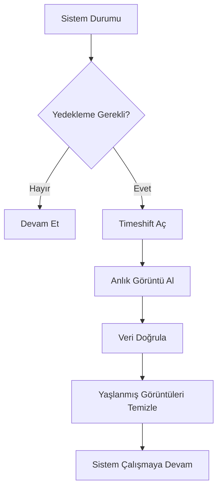

# Yedekleme ve Kurtarma

## 🎯 Bu Derste Ne Öğreneceğiz?

Bu derste, Linux sistemlerindeTimeshift kullanarak sistem yedekleme (backup) ve kurtarma (restore) işlemlerini öğreneceksiniz. Ayrıca yedekleme stratejileri (düzenli, olay-bağlı, disk alanı yönetimi) ve anlık görüntüler (snapshots) kavramlarını öğrenerek sistem güvenliğinizi artıracaksınız.

## 💡 Neden Bu Konuyu Öğreniyoruz?

Veri biliminde, analiz sonuçları, veri setleri ve sistem yapılandırmaları sürekli güncellenir. Bir sistem arızası veya yanlış bir güncelleme, saatlerce çalışmanızı yok edebilir. Timeshift, sistemin o anda tam bir görüntüsünü alarak geri yükleme olanağı sunar; bu sayede veri kayıp riskini en aza indirirsiniz.

> [!IMPORTANT]
> Yedekleme işlemine başlamadan önce yeterli boş disk alanı olduğundan emin olun. Minimum 10 GB boş alan önerilir; büyük veri setleri için daha fazla gerekir.

## Ön Bilgi

Bu dersi takip etmek için önceki haftalardaki disk bölümleme (Hafta 8) ve paket yönetimi (Hafta 6) bilgileri gerekir. Ayrıca `sudo` yetkisi gereklidir çünkü yedekleme sistem dosyalarına erişir.

## Kavramlar

### Timeshift

Timeshift, Linux sisteminin anlık görüntülerini (snapshots) oluşturan bir yedekleme aracıdır. Temel özellikleri:

- **Anlık Görüntüler:** Sistemin belirli bir anki durumunun tam kopyası.
- **Geri Yükleme:** Sistemi önceki bir anki duruma geri döndürme.
- **Otomatik Temizlik:** Eski anlık görüntüleri otomatik silme seçeneği.

### Yedekleme Stratejileri

| Strateji | Açıklama | Ne Zaman |
|---|---|---|
| Düzenli | Haftalık/aylık | Her hafta/ay |
| Olay Bağlı | Önemli güncellemeden önce | Güncelleme öncesi |
| Disk Alanı | Eski görüntüleri silme | Yeterli alan azaldığında |

## 🔍 Birlikte Keşfedelim

1. `timeshift --version` (varsa) komutuyla sürümü kontrol edin.
2. `sudo apt install timeshift` (Debian/Mint) ile kurulum yapın.
3. `timeshift --list` ile mevcut anlık görüntüleri listeleyin.

Tahmin edin: Timeshift ile alınan yedek, sadece kullanıcı dosyalarını mı içerir, yoksa sistem dosyalarını da mı? Neden?

Shimdi `timeshift --list` çıktısını gözlemleyin; varsa en eski ve en yeni görseli not edin.

## 🛠️ Uygulama

Aşağıdaki görevleri sırayla tamamlayın:

1. `sudo apt install timeshift` ile kurun.
2. Timeshift arayüzünü açın (`timeshift-gtk` veya `timeshift` komutu).
3. İlk anlık görüntüyü alın (`snapshots` sekmesinde "Create" seçeneği).
4. `timeshift --list` ile anlık görüntüyü doğrulayın.
5. `ls -la /timeshift` (varsa) veya yedek konumunu kontrol edin.

> [!TIP]
> Timeshift varsayılan olarak `/timeshift` veya `/home` altına yedek alabilir; yedek konumunu ayarlarda kontrol edin.

## 🧪 Deneyelim ve Gözlemleyelim

1. Timeshift kurulduktan sonra `timeshift --list` ile anlık görüntü sayısını not edin.
2. Küçük bir sistem değişikliği yapın (örneğin bir dosya oluşturun); ardından yeni bir anlık görüntü alın.
3. `timeshift --list` ile sayının bir arttığını doğrulayın.
4. Eski anlık görüntüyü silmeyi deneyin (`timeshift --delete --latest`).

> [!WARNING]
> Eski görseli silmek, sistemin geri yüklenmesini zorlaştırabilir; silmeden önce yedeğinizi doğrulayın.

## Bir Şeyler Ters Giderse

Yedekleme veya kurulumda sorunlar:

1. `timeshift` kurulum hatası → `sudo apt update && sudo apt install timeshift`
2. `timeshift --list` boş → Henüz anlık görüntü alınmamış olabilir; önce `snapshots` oluşturun.
3. Disk alanı yetersiz → `df -h` ile kontrol edin; eski görselleri silin (`timeshift --delete`).
4. Geri yükleme hatası → `/boot/grub` yapılandırmasını kontrol edin; `sudo update-grub` ile yeniden yükleyin.

> [!TIP]
> Timeshift'yi `snapshots` modunda kullanırken, her güncellemeden önce anlık görüntü almak en güvenli yöntemdir.

## Kendin Dene

Aşağıdaki görevleri deneyin:

1. `timeshift --list` çıktısını bir metin dosyasına yazın (`timeshift --list > /tmp/yedek_listesi.txt`).
2. Yeni bir anlık görüntü alın (`timeshift --create --comments "Hafta 13 Test"`).
3. `timeshift --delete --latest` ile en son görseli silin; tekrar `timeshift --list` ile doğrulayın.

Cevapları göster

1. `/tmp/yedek_listesi.txt` oluşturulur; görsel listesi içerir.
2. Yeni görsel alınır; `timeshift --list` ile artış görülür.
3. `--latest` siler; `timeshift --list` sayısı azalır.

## 🧠 Öğrendiklerini Kontrol Et

1. Timeshift ne tür yedekleme sağlar?
2. `timeshift --delete --latest` ne işlev görür?
3. Yedekleme stratejisi neden önemlidir?

Cevapları göster

1. Sistem anlık görüntüsü (snapshot); dosya sistemi düzeyi.
2. En son anlık görüntüyü siler.
3. Veri kaybını önler; sistemdeki değişiklikleri güvenli şekilde geri yükler.

## Bağımsız Çalışma

Sisteminizde bu bağımsız çalışmayı tamamlayın:

- `sudo apt install timeshift` ile kurun.
- İlk anlık görüntüyü alın (`snapshots` sekmesinden "Create").
- `timeshift --list` ile görselleri listeleyin.
- `timeshift --delete --latest` ile son görseli silin.
- `df -h` ile disk kullanımını kontrol edin.
- Tüm adımları `/tmp/yedekleme_raporu.txt` dosyasına yazın.

## Daha Fazlasını Öğrenmek

- Timeshift resmi: [https://github.com/linuxmint/timeshift](https://github.com/linuxmint/timeshift)
- Yedekleme stratejileri: [https://wiki.archlinux.org/title/Backup](https://wiki.archlinux.org/title/Backup)
- `man timeshift`

## Kısa Özet

Bu derste Timeshift ile sistem yedekleme, anlık görüntü oluşturma ve geri yükleme yöntemlerini öğrendiniz. Bir sonraki derste bütünleşik proje ile tüm konuları bir araya getireceğiz.

---

← [Veri Bilimi Araçları](12-Data-Science-Tools.md) | [Bütünleşik Proje →](14-Integrated-Project.md)