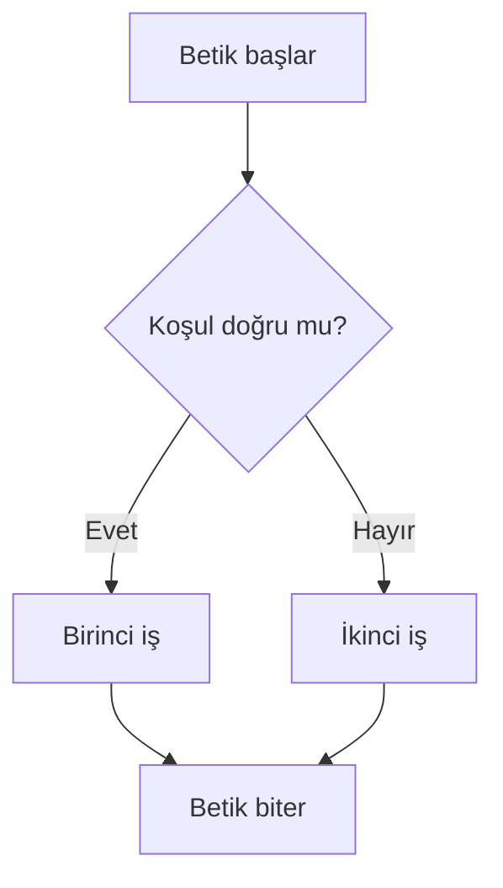

# Kabuk Betikleme Temelleri

## 🎯 Bu Bölümde Ne Öğreneceğiz?

Bu bölümü bitirdiğinde şunları yapabileceksin:

- Betik (script) kavramını ve neden kullanıldığını açıklayabileceksin.
- Bir betiğin ilk satırındaki `#!/bin/bash` ifadesinin ne işe yaradığını
  söyleyebileceksin.
- Değişken tanımlayıp betik içinde kullanabileceksin.
- `if` ile koşul, `for` ve `while` ile döngü kurabileceksin.
- Bir betiği çalıştırılabilir yapıp çalıştırabileceksin.
- Yinelenen bir işi otomatikleştiren küçük bir betik yazabileceksin.

## 💡 Neden Bu Konuyu Öğreniyoruz?

Aynı komutları her gün elle yazmak yorucudur ve hata yapma olasılığını artırır.
Betikler, bu komutları bir dosyada toplamanı ve tek komutla çalıştırmanı sağlar.
Bir kez yazarsın, bin kez çalıştırırsın; üstelik her seferinde aynı sonucu
verir.

Betikleme, Linux becerilerinin birleştiği yerdir: bu kurs boyunca öğrendiğin
dosya işlemleri, boru, izinler, ortam değişkenleri ve komutlar burada tek bir
araçta buluşur. Bu bölüm, seni "komut kullanan" kişiden "işini otomatikleştiren"
kişiye dönüştürür.

## 📌 Ön Bilgi

Bu bölüm, 11. bölümdeki ortam değişkenlerine ve 5. bölümdeki çalıştırma iznine
dayanır. Ayrıca 4. bölümdeki komutlar, boru ve `echo` kullanımı ile `nano` ile
dosya düzenlemeyi biliyor olman gerekir.

## 📖 Kavramlar

### Betik ve yorumlayıcı satırı

**Betik (script),** bir kabuk tarafından satır satır okunan bir komut
dosyasıdır. Betiğin ilk satırına **yorumlayıcı satırı (shebang)** yazılır:

```bash
#!/bin/bash
```

Bu satır, "bu dosyayı çalıştırmak için `bash` kullan" demektir. Bu satır
olmadan da betik çalışabilir ama hangi kabukla çalışacağı belirsiz kalır.

### Değişken, koşul ve döngü

Betik içinde değişkenler ortam değişkenleriyle aynı mantıkla çalışır. `if`
yapısı bir koşulu sınar; doğruysa bir iş, yanlışsa başka bir iş yapılır. `for`
ve `while` ise bir işi birçok kez yinelemeye yarar.



Bu akış, neredeyse tüm koşullu betiklerin temelidir. Döngüler ise aynı akışı
bir liste üzerinde tekrarlar.

## 🔍 Birlikte Keşfedelim

Aşağıdaki betiği çalıştırmadan önce, ekrana ne yazacağını tahmin et:

```bash
#!/bin/bash
isim="Dunya"
echo "Merhaba, $isim!"
```

Sence çıktı `Merhaba, $isim!` mi olur, yoksa `Merhaba, Dunya!` mi?

Tahminini netleştirdikten sonra betiği oluştur, çalıştırılabilir yap ve
çalıştır:

```bash
nano merhaba.sh
# yukarıdaki üç satırı yaz ve kaydet
chmod +x merhaba.sh
./merhaba.sh
```

Gördüğün gibi `$isim` ifadesi, değişkenin değeriyle yani `Dunya` ile
değiştirildi. Bu, 11. bölümde öğrendiğin `$` mantığının betik içindeki hâlidir.
Baştaki `./` ifadesi ise "bu dosyayı bulunduğum dizinden çalıştır" demektir;
çünkü geçerli dizin genellikle `PATH` içinde değildir.

## 🛠️ Uygulama

### 1. Adım: Basit bir betik yaz

```bash
cd ~/linux_deneme
nano selamla.sh
```

İçine şunları yaz:

```bash
#!/bin/bash
echo "Bugun: $(date)"
echo "Kullanici: $USER"
echo "Dizin: $(pwd)"
```

`$(komut)` ifadesi, bir komutun çıktısını metnin içine yerleştirir. Kaydet ve
çalıştır:

```bash
chmod +x selamla.sh
./selamla.sh
```

Betik, tarih, kullanıcı ve dizin bilgisini tek seferde yazdırdı. Bunları her
gün elle yazmak yerine tek komutla elde ettin.

### 2. Adım: Kullanıcıdan bilgi al

```bash
nano selamla2.sh
```

```bash
#!/bin/bash
echo "Adin ne?"
read isim
echo "Merhaba, $isim!"
```

`read`, kullanıcıdan girdi alır ve `isim` değişkenine koyar. Çalıştırıp adını
yaz.

### 3. Adım: Koşul ekle

```bash
nano kontrol.sh
```

```bash
#!/bin/bash
if [ -f "$HOME/linux_deneme/selamla.sh" ]; then
    echo "Dosya bulundu."
else
    echo "Dosya yok."
fi
```

`[ -f ... ]` ifadesi "bu bir dosya mı?" diye sorar. `then` doğruysa, `else`
yanlışsa çalışır; `fi` ise koşulu kapatır. Betiği çalıştır, sonra dosyayı
geçici olarak yeniden adlandırıp tekrar çalıştır ve iki durumu da gözlemle.

### 4. Adım: Döngü kur

```bash
nano say.sh
```

```bash
#!/bin/bash
for i in 1 2 3 4 5; do
    echo "Sayi: $i"
done
```

`for` döngüsü, listedeki her değer için aradaki işi tekrarlar. Şimdi bir de
`while` döngüsüyle, bir koşul doğru olduğu sürece çalışan bir örnek yaz:

```bash
#!/bin/bash
sayac=1
while [ $sayac -le 3 ]; do
    echo "Tur: $sayac"
    sayac=$((sayac + 1))
done
```

`-le` "küçük ya da eşit" demektir; `$((...))` ise aritmetik işlem yapar.

### 5. Adım: İşe yarar bir betik yaz

```bash
nano yedekle.sh
```

```bash
#!/bin/bash
kaynak="$HOME/linux_deneme"
hedef="$HOME/yedekler"
tarih=$(date +%Y-%m-%d)

mkdir -p "$hedef"
tar -czvf "$hedef/linux_deneme-$tarih.tar.gz" "$kaynak"
echo "Yedek alindi: $hedef/linux_deneme-$tarih.tar.gz"
```

Çalıştır ve çıktıyı izle:

```bash
chmod +x yedekle.sh
./yedekle.sh
```

Bu betik, 12. bölümde öğrendiğin arşivleme işini tarih ekleyerek otomatikleştirir.
Her çalıştırdığında o günün tarihiyle yeni bir yedek oluşur.

> [!IMPORTANT]
> Betiklerde tırnak kullanımı önemlidir. Değişkenleri `"$kaynak"` gibi çift
> tırnak içinde kullanmak, değerde boşluk olsa bile tek bir bütün olarak
> işlenmesini sağlar. Tırnağı unutmak, yol adlarında boşluk olduğunda
> betiğin bozulmasına yol açar.

## 🧪 Deneyelim ve Gözlemleyelim

Betikleri güvenli test etmenin bir yolunu gözlemleyelim. Betiği çalıştırmadan
önce ne yapacağını denetleyebilirsin:

```bash
bash -n yedekle.sh
bash -x yedekle.sh
```

- `bash -n`, betiği çalıştırmadan sözdizimi açısından kontrol eder.
- `bash -x`, betiği çalıştırırken her satırı ve değişkenlerin aldığı değerleri
  ekrana yazar.

Döngü içeren `say.sh` betiğini `bash -x say.sh` ile çalıştır ve ekranda
değişken değerlerinin nasıl değiştiğini satır satır izle. Bu, betiğin içinde
ne olup bittiğini görmenin en açık yoludur.

## ⚠️ Bir Şeyler Ters Giderse

**Belirti:** `./betik.sh: Permission denied` hatası.

**Olası neden:** Betiğe çalıştırma izni vermedin.

**Ne yapmalısın:** `chmod +x betik.sh` komutunu çalıştır. İzni 5. bölümden
hatırlarsın.

**Belirti:** Betik çalışıyor ama değişkenler boş görünür.

**Olası neden:** Değişkeni tanımlarken eşittir işaretinin çevresine boşluk
koydun. Bash'te `isim = "deger"` değil, `isim="deger"` yazılır.

**Ne yapmalısın:** Atama satırlarındaki boşlukları kaldır.

**Belirti:** Betik çalışıyor ama beklediğin sonucu vermiyor.

**Ne yapmalısın:** `bash -x betik.sh` ile satır satır izle ve değişkenlerin
gerçek değerlerini gör. Hatanın çoğu zaman bir tırnak ya da bir boşluk
olduğunu fark edeceksin.

## ✍️ Kendin Dene

**Görev:** Kullanıcıdan bir dizin adı isteyen, o dizinin var olup olmadığını
kontrol eden, yoksa oluşturan ve sonunda dizinin içindeki dosyaları listeleyen
bir betik yaz.

<details>
<summary>İpucu göster</summary>

Girdi için `read`, dizin kontrolü için `if [ -d "$ad" ]`, oluşturmak için
`mkdir -p`, listelemek için `ls` kullanabilirsin.

</details>

<details>
<summary>Örnek çözüm göster</summary>

```bash
#!/bin/bash
echo "Dizin adi ne olsun?"
read ad
if [ -d "$ad" ]; then
    echo "Dizin zaten var."
else
    mkdir -p "$ad"
    echo "Dizin olusturuldu: $ad"
fi
echo "Icindekiler:"
ls -l "$ad"
```

Bu betik; girdi alma, koşul, dizin oluşturma ve listeleme işlemlerini bir arada
kullanır. Kurguyu değiştirip kendine göre genişletmeyi dene.

</details>

## 🧠 Öğrendiklerini Kontrol Et

1. Betiğin ilk satırındaki `#!/bin/bash` ne işe yarar?
2. `bash -x betik.sh` komutu neden yararlıdır?
3. `if`, `for` ve `while` yapıları ne için kullanılır?
4. Betiği çalıştırırken başına neden `./` yazılır?
5. Betiklerde değişkenleri çift tırnak içinde kullanmak neden önemlidir?

<details>
<summary>Cevapları göster</summary>

1. Betiğin hangi kabukla çalıştırılacağını belirtir.
2. Betiği çalıştırırken her satırı ve değişken değerlerini gösterdiği için
   hatayı bulmayı kolaylaştırır.
3. `if` koşula göre karar verir; `for` bir liste üzerinde, `while` bir koşul
   doğru olduğu sürece tekrar eder.
4. Çünkü geçerli dizin genellikle `PATH` içinde değildir; `./` "bu dizindeki
   dosyayı çalıştır" demektir.
5. Değerin içinde boşluk olsa bile tek bir bütün olarak işlenmesini sağlar;
   tırnaksız kullanım, yol adlarında boşluk olduğunda hataya yol açar.

</details>

## 🚀 Bağımsız Çalışma

1. **Geliştirme görevi:** `yedekle.sh` betiğini, arşivden önce hedef klasörün
   doluluk oranını kontrol edecek ve yeterli yer yoksa uyarı verecek biçimde
   genişlet. (İpucu: 9. bölümdeki `df` komutundan yararlan.)
2. **Birleştirme görevi:** Bu kurs boyunca öğrendiğin en az üç komutu tek bir
   betikte birleştirerek günlük bir işini otomatikleştir (örneğin günlük not
   oluşturma, sistem bilgisi toplama).

Bu görevler, betiklemeyi gerçek ihtiyaçlarını çözmek için kullanma becerisi
kazandırır.

## 📚 Daha Fazlasını Öğrenmek

- GNU Bash kılavuzu: <https://www.gnu.org/software/bash/manual/>
- Bash betikleme rehberi (Gregory B. Hall): <https://tldp.org/HOWTO/Bash-Prog-Intro-HOWTO.html>
- Ubuntu man sayfaları (bash, test, read): <https://manpages.ubuntu.com>

## 📝 Kısa Özet

- Betik, bir kabuk tarafından satır satır okunan komut dosyasıdır; ilk satırda
  yorumlayıcı (`#!/bin/bash`) bulunur.
- Değişkenler, koşullar (`if`) ve döngüler (`for`, `while`) betiğin yapı
  taşlarıdır.
- `chmod +x` ile betiği çalıştırılabilir yapar, `./betik.sh` ile çalıştırırsın.
- `bash -n` ve `bash -x` betikleri test etmek ve hatalarını bulmak için
  kullanılır.
- Betikler, günlük tekrar eden işleri güvenilir biçimde otomatikleştirir.

[Önceki bölüm: Arşivleme ve Yedekleme](12-Archive-And-Backup.md) | [İçindekiler](../README.md) | [Sonraki bölüm: Sorun Giderme ve Günlük Kullanım](14-Troubleshooting-And-Usage.md)
