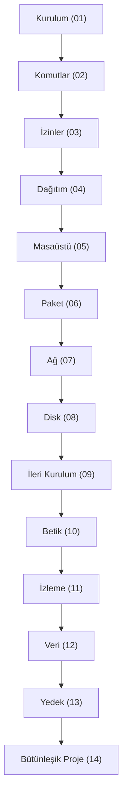

# Bütünleşik Proje ve İnceleme

## 🎯 Bu Derste Ne Öğreneceğiz?

Bu derste, bu kurs boyunca öğrendiğiniz tüm konuları (kurulum, komutlar, izinler, dağıtım karşılaştırması, masaüstü ortamları, paket yönetimi, ağ, disk bölümleme, ileri kurulum, shell betikleri, sistem izleme, veri bilimi araçları, yedekleme) tek bir projede bir araya getireceksiniz. Projenin amacı: kendi sisteminizde tüm bu bilgileri uygulayarak, kurulumdan başlayıp yedeklemeye kadar tam bir sistem yönetimi deneyimi kazanmaktır.

## 💡 Neden Bu Konuyu Öğreniyoruz?

Kazanımların bütünleşik kullanımı, öğrenmeyi kalıcı hale getirir. Her hafta ayrı ayrı öğrenilen konular, bu projede tek bir sistem üzerinde bir araya gelerek gerçek bir kullanım senaryosuna dönüşür. Ayrıca, bu proje, kendi sisteminizi daha iyi anlamanızı sağlar: hangi dağıtım kullandığınızı, disk yapısını, sistem güvenliğini ve yedekleme durumunuzu değerlendirme fırsatı sunar.

> [!IMPORTANT]
> Bu projede gerçek sisteminiz üzerinde işlem yapacaksınız; veri kaybına karşı yedek alın (Hafta 13) ve sistem dosyalarını (`/etc`, `/usr`) değiştirmeyin.

## Ön Bilgi

Bu dersi takip etmek için önceki 13 haftanın tüm içeriği (özellikle Hafta 1 kurulum, Hafta 2 komutlar, Hafta 3 izinler, Hafta 6 paket yönetimi, Hafta 13 yedekleme) gereklidir.

## Kavramlar

### Proje Adımları

Proje şu adımları içerir:

1. **Kurulum İncelemesi:** Mevcut dağıtımı (`lsb_release -a`) ve çekirdek (`uname -a`) bilgisini not edin.
2. **Komut Kullanımı:** `ls -la`, `pwd`, `cd`, `mkdir` ile dizin gezintisi; `cp`, `mv`, `rm` ile dosya işlemleri.
3. **İzinler:** `chmod`, `chown` ile güvenli izin ayarları (`700` gibi).
4. **Paket Yönetimi:** `apt`/`dnf`/`snap` ile bir paket kurun (`nano` veya `htop`).
5. **Ağ:** `ip addr`, `ping`, `cat /etc/resolv.conf` ile ağ durumunu gözlemleyin.
6. **Disk:** `lsblk -f`, `df -h`, `/etc/fstab` ile disk yapısını inceleyin.
7. **Betik:** Basit bir bash betiği (`yedekle.sh`) yazın ve çalıştırın (`chmod +x`).
8. **İzleme:** `htop` veya `top` ile sistem durumunu gözlemleyin; `dmesg | tail` ile son mesajları not edin.
9. **Veri Bilimi:** `python3 -c` ile basit bir işlem yapın (`print("Merhaba Linux")`).
10. **Yedekleme:** `timeshift --list` ile anlık görüntüleri görüntüleyin.
11. **Özet:** Tüm çıktıları bir rapor dosyasına (`/tmp/butunlesik_rapor.txt`) yazın.

## 🔍 Birlikte Keşfedelim

Kendi sisteminizde aşağıdaki gözlemleri yapın:

1. `cat /etc/os-release` ile mevcut dağıtımınızı belirleyin.
2. `uname -a`, `lsblk -f`, `df -h` çıktıları ile sistem durumunu not edin.
3. `ls -la /home` ile kullanıcı dizinlerini listeleyin; `pwd` ile çalışma dizininizi doğrulayın.
4. `htop` (varsa) veya `top` ile sistemin anlık durumunu gözlemleyin.

Tahmin edin: Tüm bu bilgilerin bir araya gelmesi, sisteminizi daha iyi anlamanıza nasıl katkı sağlar?

## 🛠️ Uygulama

Projeyi adım adım tamamlayın; her adımda çıktıları `/tmp/proje_raporu.txt` dosyasına yazın:

1. Kurulum ve sistem bilgisi: `uname -a`, `cat /etc/os-release` → `echo "Sistem: $(uname -a)" >> /tmp/proje_raporu.txt`
2. Komutlar ve dizin: `pwd`, `ls -la`, `mkdir proje_klasoru` → `echo "Dizin: $(pwd)" >> /tmp/proje_raporu.txt`
3. İzinler: `touch proje_klasoru/gizli_dosya.txt`, `chmod 700 proje_klasoru` → `echo "İzin ayarı: 700" >> /tmp/proje_raporu.txt`
4. Paket: `sudo apt install nano` (veya `dnf install nano`) → `echo "Paket kuruldu: nano" >> /tmp/proje_raporu.txt`
5. Ağ: `ip addr`, `ping -c 2 8.8.8.8` → `echo "IP: $(ip -4 addr show | grep inet)" >> /tmp/proje_raporu.txt`
6. Disk: `lsblk -f`, `df -h` → `echo "Disk: $(df -h | head -n 2)" >> /tmp/proje_raporu.txt`
7. Betik: `/tmp/yedekle.sh` oluşturun (`#!/bin/bash`, `echo "Yedek alındı: $(date)" >> /tmp/yedek_log.txt`), `chmod +x` → `echo "Betik yazıldı" >> /tmp/proje_raporu.txt`
8. İzleme: `htop -b -n 1 | head -n 5` veya `top -b -n 1 | head -n 5` → `echo "Süreç izleme: $(ps aux | wc -l)" >> /tmp/proje_raporu.txt`
9. Veri: `python3 -c "print('Linux Temelleri Proje')"` → `echo "Python çalıştı" >> /tmp/proje_raporu.txt`
10. Yedek: `timeshift --list` → `echo "Yedek durumu: $(timeshift --list | wc -l) görsel" >> /tmp/proje_raporu.txt`

> [!TIP]
> Her adımda `/tmp/proje_raporu.txt` dosyasına yazmak, projenizi düzenli tutar ve son rapor oluşturmanızı kolaylaştırır.

## 🧪 Deneyelim ve Gözlemleyelim

1. `echo $(date) >> /tmp/proje_raporu.txt` ile zaman damgası ekleyin.
2. `chmod 700 /tmp/proje_klasoru` ile izinleri değiştirin; `ls -ld` ile doğrulayın.
3. `timeshift --create --comments "Proje 14 - Bütünleşik"` ile yedek alın (isteğe bağlı); `timeshift --list` ile doğrulayın.
4. `cat /tmp/proje_raporu.txt` ile raporu görüntüleyin; eksik adım var mı?

> [!WARNING]
> Bu projede gerçek sistem dosyalarını (`/etc`, `/usr`) değiştirmeyin. Yalnızca `/tmp` ve kullanıcı dizinlerinde çalışın.

## Bir Şeyler Ters Giderse

1. Komut bulunamadı (`command not found`) → `man <komut>` veya `which <komut>` ile kontrol edin; kurulum eksikse `sudo apt install <paket>`.
2. İzin hatası (`Permission denied`) → `sudo` kullanın (`chmod` için gerekirse).
3. Disk dolu (`No space left`) → `df -h` ile kontrol edin; `rm -rf /tmp/gecici_dosya` ile temizleyin.
4. Betik hatası (`syntax error`) → `bash -x /tmp/yedekle.sh` ile satır satır izleyin.

## Kendin Dene

1. Proje raporunu (`/tmp/proje_raporu.txt`) bir metin dosyasına yazın.
2. Üç komut sonucunu (`ls -la`, `df -h`, `ip -4 addr`) karşılaştırın.
3. `/tmp/yedekle.sh` betiğini çalıştırıp çıktıyı gözlemleyin.

Cevapları göster

1. `/tmp/proje_raporu.txt` sistem durumunu, komut sonuçlarını ve yedek bilgisini içerir.
2. `ls` dizin içeriği; `df` disk kullanımı; `ip` ağ adresi.
3. Betik çalışır; `/tmp/yedek_log.txt` güncellenir.

## 🧠 Öğrendiklerini Kontrol Et

1. Proje hangi haftaları kapsamaktadır?
2. `timeshift --create` ne işe yarar?
3. `bash -x` ne işe yarar?

Cevapları göster

1. 01-13 tüm haftalar (kurulumdan yedeklemeye).
2. Yeni bir anlık görüntü oluşturur.
3. Betiği satır satır izler; hata ayıklama.

## Bağımsız Çalışma

Kendi Linux sisteminizde şu adımları uygulayın:

- `cat /etc/os-release` ile dağıtımınızı yazın (`/tmp/proje_raporu.txt`).
- `pwd`, `ls -la`, `mkdir`, `chmod`, `cat`, `mv`, `cp`, `rm` komutlarını kullanın.
- `ip -4 addr show`, `df -h`, `htop` (veya `top`) sonuçlarını kaydedin.
- `/tmp/yedekle.sh` betiği yazın (`#!/bin/bash`, `date`, `echo`); çalıştırın (`chmod +x`, `./`).
- `timeshift --list` ile yedek durumunu kontrol edin.
- Tüm çıktıları `/tmp/proje_raporu.txt` dosyasına birleştirin; son satırda `mkdir` ve `ls -l` sonuçlarını ekleyin.
- Projeyi tamamlarken `echo "Linux Temelleri Projesi Tamamlandı: $(date)" >> /tmp/proje_raporu.txt` ekleyin.

## Daha Fazlasını Öğrenmek

- Tüm kurs kaynakları: `COURSE_PLAN.md`
- Bu dersin notları: `Topics/`
- Proje raporu örneği: `/tmp/proje_raporu.txt`
- Gelişmiş betikleme: `man bash`

## Kısa Özet

Bu derste, bu kurs boyunca öğrendiğiniz tüm kavramları tek bir projede bir araya getirdiniz. Kurulumdan başlayıp komut kullanımı, izinler, paket yönetimi, ağ, disk bölümleme, ileri kurulum, betik yazma, sistem izleme, veri bilimi araçları ve yedeklemeye kadar tüm haftaların çıktısını bir rapor dosyasına yazdınız. Bu proje, bağımsız öğrenme becerinizi pekiştirir ve kendi sisteminizi daha derinlemesine anlamanızı sağlar.

---

← [Yedekleme](13-Backup-Timeshift.md) | [Son]
