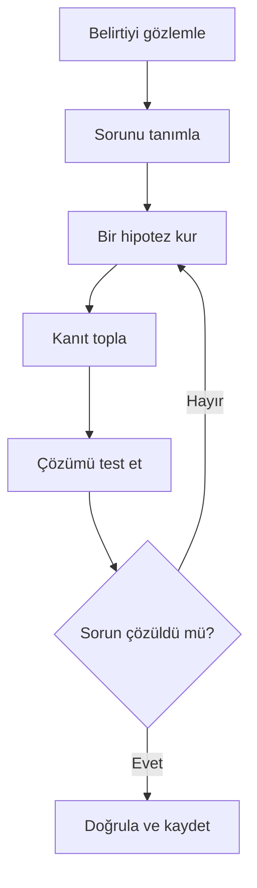

# Sorun Giderme ve Günlük Kullanım

## 🎯 Bu Bölümde Ne Öğreneceğiz?

Bu bölümü bitirdiğinde şunları yapabileceksin:

- Sistematik bir sorun giderme yöntemini uygulayabileceksin.
- Önyükleme, ağ, paket, izin ve disk sorunlarına yöntemli yaklaşabileceksin.
- Hatayı gözlemleyip kanıt toplayarak hipotez kurabileceksin.
- Kurtarma araçlarına nasıl ulaşacağını bileceksin.
- Günlük bilgisayar işlerini Linux üzerinde yürütebileceksin.
- Öğrendiklerini kursun bütünü üzerinden gözden geçirebileceksin.

## 💡 Neden Bu Konuyu Öğreniyoruz?

Bu kursun amacı, seni Windows'a bağımlı kalmadan günlük işlerini Linux'ta
yürütebilecek bir kullanıcı hâline getirmekti. Ancak gerçek kullanımın kaçınılmaz
bir parçası vardır: **sorunlar çıkacaktır.** Bir servis durur, bir güncelleme
bozulur, disk dolar, ağ kesilir.

Bu bölümde önemli olan, belirli bir hatayı ezberlemek değil; her hataya
uygulanabilen bir **yöntem** öğrenmektir. Çünkü karşılaşacağın sorunların çoğu bu
kursta göremeyeceğin kadar çeşitlidir. Yöntem sabit kalır, sorunlar değişir.

## 📌 Ön Bilgi

Bu bölüm, kursun bütününe dayanır. Dosya işlemleri, izinler, paket yönetimi,
süreçler, günlükler, ağ ve betikleme gibi önceki 13 bölümde öğrendiğin her şey
burada bir arada kullanılır. Zorlandığın bir konu olursa ilgili bölüme dönmekten
çekinme.

## 📖 Kavramlar

### Sorun giderme yöntemi

Sorun gidermenin en güvenilir yolu, bir bilim insanı gibi davranmaktır: tahmin
et, kanıt topla, test et, sonucu kaydet. Adımlar şöyledir:



Bu döngü, panik yapmayı gereksiz kılar. "Bir şeyler ters gitti" duygusunu,
"şu belirtiye bakılırsa sorun şurada olmalı" düşüncesine dönüştürür. Eğer bir
hipotez yanlışsa, bir önceki adıma dönüp yeni bir tahmin kurarsın; bu bir
başarısızlık değil, yöntemin işleyişidir.

### Günlük kullanım için Linux

Bir işletim sistemini "öğrenmek" ile "kullanmak" farklıdır. Artık günlük
işlerini Linux'ta yapabilirsin: yazı yazmak, belge hazırlamak, web'de gezinmek,
dosyalarını düzenlemek, yazılım kurmak. Önemli olan, bir sorun çıktığında
Windows'taki alışkanlıklarla değil, Linux'un kendi mantığıyla (günlükler,
izinler, paket yöneticisi, komutlar) düşünmeye başlamaktır.

## 🔍 Birlikte Keşfedelim

Şöyle bir belirti düşün: Bilgisayarını açtın, oturum açma ekranı geldi ama
açılış beklenenden çok yavaş ve masaüstü açıldıktan sonra bir şey tuhaf
davranıyor.

Sence ilk olarak kime, neye bakmalısın? Bu belirtinin altında yatan olası
nedenler için üç tahmin yürüt. Tahminlerini netleştirdikten sonra şunu yap:

```bash
journalctl -b -p err
systemctl --failed
```

İlk komut, bu açılışta üretilen hata düzeyindeki günlükleri; ikinci komut,
başarısız olmuş servisleri listeler. Eğer `systemctl --failed` bir servis
gösteriyorsa, belki de yavaşlığın nedeni odur. Bu, "gözlemle, sonra hipotez
kur" adımının somut hâlidir: tüm sistemi kurcalamadan, önce en olası ipucuna
bakarsın.

Tahminlerin çıkmazsa hiç sorun değil; yöntemin bir sonraki adımı yeni bir
hipotez kurmaktır. Önemli olan, rastgele denemeler yapmak yerine kanıta dayalı
ilerlemektir.

## 🛠️ Uygulama

Aşağıda beş yaygın sorun kategorisi ve her biri için izleyeceğin yöntem
bulunuyor. Bunları bir kontrol listesi gibi kullanabilirsin.

### 1. Ağ sorunları

Belirti: İnternete bağlanamıyorsun.

İzleyeceğin sıra, 10. bölümdeki testin aynısıdır: `ip a` (arayüz ayakta mı?),
`ip route` (ağ geçidi var mı?), `ping` ağ geçidi, `ping 8.8.8.8`, son olarak
`ping` bir alan adı. Hangi adımda tıkandığını not et; kanıtın budur.

### 2. Paket sorunları

Belirti: `apt` komutları kilit hatası veriyor ya da yarım kalmış kurulumla
uğraşıyorsun.

Önce başka bir paket işleminin açık olup olmadığını kontrol et. Yarım kurulum
için `sudo apt --fix-broken install` dene ve günlükleri oku. Kilit dosyasını
zorla silmek son çaredir.

### 3. İzin sorunları

Belirti: Bir dosyayı düzenleyemiyor ya da çalıştıramıyorsun.

`ls -l` ile sahiplik ve izinleri incele. "Erişemiyorum" belirtisi genellikle ya
yazma izni eksikliğinden ya da dosyanın başka bir kullanıcıya ait olmasından
kaynaklanır. Çözüm, 5. bölümdeki `chmod`/`chown` bilgindir; ancak boş yere
`sudo` kullanmadan önce neden erişemediğini anla.

### 4. Disk dolu

Belirti: Programlar açılmıyor, kayıt yapılamıyor.

`df -h` ile hangi dosya sisteminin dolduğunu bul. Sonra `du -h --max-depth=1`
ile o alandaki en büyük dizini tespit et. Genellikle biriken günlükler,
indirilen dosyalar ya da önbellekler baş sorumludur. Silmeden önce ne olduğunu
anla.

### 5. Önyükleme sorunları

Belirti: Sistem açılmıyor ya da masaüstüne gelemiyorsun.

Bu, en ciddi kategori olsa da yöntem aynıdır. Önce ekrandaki mesajı oku; sistem
genellikle neyin başarısız olduğunu söyler. Gerekirse açılış menüsünden kurtarma
seçeneklerine (recovery mode) girip günlükleri inceleyebilirsin. Bu alanda
ilerlemek istersen kurtarma modu üzerine ayrıca çalışmak gerekir.

> [!NOTE]
> Kurtarma modu, sistemin en az servisle açıldığı bir ortamdır. Orada düzeltme
> yapabilir, günlükleri okuyabilir ya da bozuk bir güncellemeyi geri alabilirsin.
> Bu kursun kapsamının sınırında yer alır; gerektiğinde resmî belgelerden
> yararlan.

### Günlük kullanım kontrol listesi

Son olarak, günlük işlerini Linux'ta yürütmek için küçük bir alışkanlık listesi:

1. Dosyalarını düzenli bir dizin yapısında tut (3. bölüm).
2. Önemli verilerini düzenli olarak yedekle (12. bölüm).
3. Yazılımlarını paket yöneticisiyle güncel tut (7. bölüm).
4. Tekrar eden işleri betiklerle otomatikleştir (13. bölüm).
5. Bir sorun çıktığında önce günlüklere bak (9. bölüm).

## 🧪 Deneyelim ve Gözlemleyelim

Yöntemi, kasıtlı olarak bozacağımız küçük bir sorunla deneyelim.

```bash
touch erisim_yok.txt
chmod 000 erisim_yok.txt
cat erisim_yok.txt
```

Şimdi yöntemi uygula:

1. **Gözlem:** `cat` "Permission denied" verdi.
2. **Tanım:** Bir dosyayı okuyamıyorum.
3. **Hipotez:** Dosyanın izni okumaya kapalı olabilir.
4. **Kanıt:** `ls -l erisim_yok.txt` çıktısında `----------` görüyorum.
5. **Test:** `chmod 600 erisim_yok.txt` ile sahibe okuma izni ver.
6. **Doğrula:** `cat erisim_yok.txt` artık hata vermiyor.

Sorunu çözdün. Kaydet: "Okuma hatası, dosya izninin kapalı olmasından
kaynaklanıyordu; `ls -l` ile izinleri kontrol etmek yeterli oldu." İşte bu kısa
not, gelecekteki senin için en değerli kaynaktır.

## ⚠️ Bir Şeyler Ters Giderse

**Belirti:** Sorunu çözmeye çalışırken daha büyük bir problem yarattın.

**Olası neden:** Çözümü test etmeden, birden çok değişikliği aynı anda yaptın.

**Ne yapmalısın:** Bir seferde yalnızca bir değişiklik yap ve sonucunu gözlemle.
Kritik dosyaları değiştirmeden önce yedekle. Unutma: Linux'ta bir hata
genellikle geri alınabilir, ama rastgele denemeler durumu kötüleştirir.

**Belirti:** Ne yapacağını hiç bilmiyorsun.

**Ne yapmalısın:** İki soruyu yanıtla: "Tam olarak hangi belirtiyi görüyorum?"
ve "En son ne değişti?" Bu iki cevap, çoğu zaman sorun gidermenin yarısını
halleder. Ardından hata mesajını bir arama motorunda, mümkünse dağıtımının adıyla
birlikte ara.

## ✍️ Kendin Dene

**Görev:** Kendi seçtiğin, zararsız bir sorun yarat (örneğin bir betiğin
çalıştırma iznini kaldır ya da `PATH`'ini geçici olarak boz) ve sonra bu
bölümdeki yedi adımlı yöntemi baştan sona uygulayarak çöz. Her adımda ne
yaptığını kısa kısa not et.

<details>
<summary>İpucu göster</summary>

Zararsız bir sorun yaratmak için `chmod -x ~/linux_deneme/selamla.sh` yeterli.
Sonra yöntemi uygula: gözlemle, tanımla, hipotez kur, `ls -l` ile kanıt topla,
`chmod +x` ile test et, doğrula ve kaydet.

</details>

<details>
<summary>Örnek çözüm göster</summary>

```bash
chmod -x ~/linux_deneme/selamla.sh
./selamla.sh              # Permission denied
ls -l ~/linux_deneme/selamla.sh   # x harfi yok
chmod +x ~/linux_deneme/selamla.sh
./selamla.sh              # çalışıyor
```

Notun şöyle olabilir: "Çalıştırma hatası, dosyanın çalıştırma izni
olmamasından kaynaklandı; izinleri `ls -l` ile kontrol etmek yeterli oldu."

</details>

## 🧠 Öğrendiklerini Kontrol Et

Aşağıdaki sorular kursun bütününe yayılmıştır; yanıtlayamadığın bir soru olursa
ilgili bölüme dön.

1. Bir sorunu giderirken neden önce belirtiyi netleştirmek gerekir?
2. Disk dolduğunda hangi iki komutla sorunun kaynağını bulursun?
3. Bir ağ sorununda "IP ile ulaşıyorum ama isimle ulaşamıyorum" belirtisi neyi
   gösterir?
4. Bir dosyaya erişemediğinde hangi komutla sahiplik ve izinleri incelersin?
5. Yedek almanın, sorun gidermedeki rolü nedir?

<details>
<summary>Cevapları göster</summary>

1. Çünkü hipotez ancak belirti netleştiğinde kurulabilir. Belirsiz bir şikâyetle
   yola çıkmak, rastgele denemelere yol açar.
2. `df -h` hangi dosya sisteminin dolduğunu, `du -h --max-depth=1` ise o alanda
   en çok yer kaplayan dizini gösterir.
3. Sorunun büyük olasılıkla DNS'te olduğunu; çünkü IP ile dış dünyaya
   ulaşılabildiğini ama isimlerin çözümlenemediğini gösterir.
4. `ls -l dosya_adi`.
5. Bir yedek, yanlış bir değişiklik ya da arıza sonrasında sistemi eski hâline
   döndürmeni sağlar; yani çözüm denemelerini güvenli kılar.

</details>

## 🚀 Bağımsız Çalışma

1. **Yöntem görevi:** Bu hafta karşılaşacağın (ya da hatırladığın) gerçek bir
   sorunu seç ve yedi adımlı yöntemi yazılı olarak uygula. Sonucu bir not
   defterine kaydet.
2. **Plan görevi:** Kendi "kişisel sorun giderme defterini" oluştur. Bu defterde
   yaşadığın sorunları, belirtileri, çözümleri ve çıkardığın dersleri biriktir.
   Bu defter, kurs bittikten sonra da en çok başvuracağın kaynak olacaktır.

## 📚 Daha Fazlasını Öğrenmek

- Linux Mint sorun giderme belgeleri: <https://linuxmint.com/documentation.php>
- Arch Wiki - General troubleshooting: <https://wiki.archlinux.org/title/General_troubleshooting>
- systemd journal belgeleri: <https://www.freedesktop.org/wiki/Software/systemd/journal/>
- Ubuntu topluluk belgeleri: <https://help.ubuntu.com/community>

## 📝 Kısa Özet

- Sorun giderme bir yöntemdir: gözlemle, tanımla, hipotez kur, kanıt topla,
  test et, doğrula, kaydet.
- Ağ, paket, izin, disk ve önyükleme sorunlarının her biri için izlenecek
  belirli bir sıra vardır.
- Günlükler ve `systemctl --failed`, sorunun izini sürmenin en güvenilir
  yoludur.
- Bir seferde yalnızca bir değişiklik yap; sonucu gözlemle ve not al.
- Bu kursla birlikte artık günlük işlerini Linux'ta bağımsız olarak
  yürütebilecek bilgi ve özgüvene sahipsin.

[Önceki bölüm: Kabuk Betikleme Temelleri](13-Shell-Scripting.md) | [İçindekiler](../README.md)
